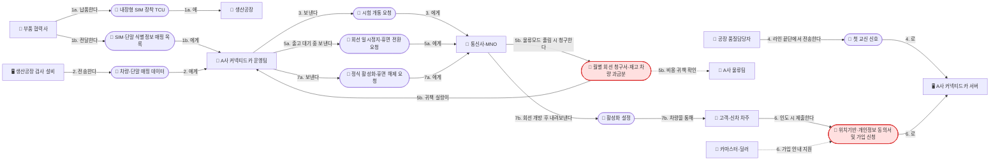
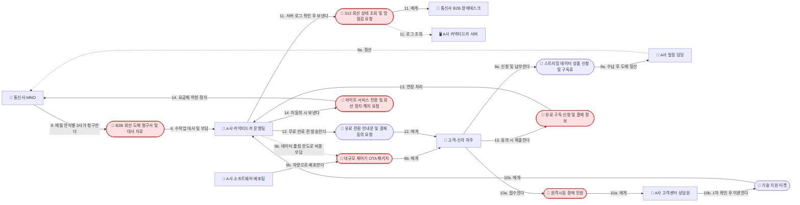
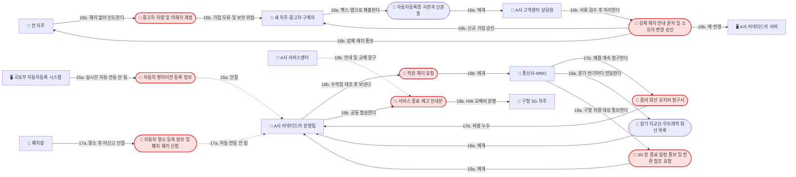
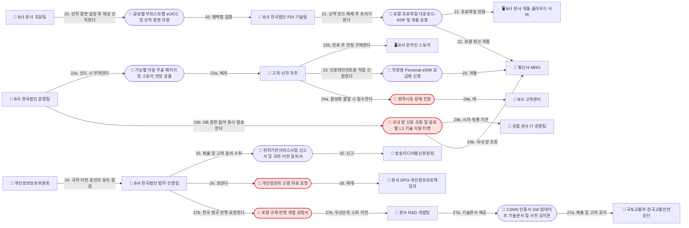

# P1-big-picture: 한국 자동차 OEM 커넥티드카 비즈니스 생애주기 (Big Picture)

## 1. 헤더 (Header)

| 항목 | 내용 |
|---|---|
| **스토리 ID** | `P1-big-picture` |
| **제목** | 한국 시장 자동차 OEM(국내 완성차 A사 및 수입차 한국법인 B사) 커넥티드카 차량·회선 생애주기 Big Picture |
| **Storyteller** | 커넥티드카 시니어 도메인 전문가 (국내 완성차 A사 신차 프로젝트·운영 및 유럽계 수입차 한국법인 B사 커넥티드카 운영 경험) |
| **Moderator** | Domain Storytelling Moderator |
| **Modeler** | Domain Storytelling Modeler |
| **Scope — Granularity** | **Coarse-grained** (차량 생산부터 물류·인도·운행·중고 이전·폐차·망 종료 및 수입차 글로벌-로컬 구조까지 생애주기 전체 조망) |
| **Scope — Point in time** | **As-is** (현재 실제 업무 현실 및 수작업·단절 구간 포함) |
| **Scope — Domain purity** | **Pure** (특정 화면 UI가 아닌 도메인 주체 간 역할과 정보·업무·회선 흐름 중심) |
| **출처 Transcript 경로** | [P1-big-picture-transcript.md](file:///Users/goodnews/Documents/1.Projects/OEM%20Dashboard/docs/01-domain-stories/transcripts/P1-big-picture-transcript.md) |
| **참고 Fact Base 경로** | [00-fact-base.md](file:///Users/goodnews/Documents/1.Projects/OEM%20Dashboard/docs/00-fact-base.md) |

---

## 2. Actor 목록

| 아이콘 및 이름 | 유형 | 구분 | 설명 |
|---|---|---|---|
| 👥 **부품 협력사** | 그룹/조직 | 국내 공통 | 내장형 SIM 또는 eUICC가 탑재된 텔레매틱스 제어기-TCU-를 조립해 완성차 생산공장에 납품하고 SIM·단말 식별정보 매핑 목록을 전달하는 Tier-1 공급사(모비스 등) |
| 👥 **생산공장** | 그룹/조직 | 국내 완성차(A사) | 완성차를 조립하고 라인오프 시점에 TCU를 장착하는 제조 현장 조직 |
| 🖥️ **생산공장 검사 설비** | 시스템 | 국내 완성차(A사) | 조립 라인에서 차대번호-VIN-와 TCU 식별번호를 매칭하여 차량-단말 매핑 데이터를 생성·전송하는 설비 시스템 |
| 👤 **공장 품질담당자** | 사람 | 국내 완성차(A사) | 조립 라인 끝단-EOL-에서 개통된 회선으로 OEM 서버와의 첫 교신 성공 여부를 검사하는 담당자 |
| 👥 **A사 커넥티드카 운영팀** | 그룹/조직 | 국내 완성차(A사) | 국내 완성차 OEM의 커넥티드카 회선 개통·휴면·활성화·정산 대사·장애 에스컬레이션·말소 직권해지 등을 총괄하는 운영 조직(마케팅·빌링 역할 포함) |
| 🖥️ **A사 커넥티드카 서버** | 시스템 | 국내 완성차(A사) | 차량 TCU와 교신하고 원격제어·가입·로그·계정 권한을 처리하는 OEM 백엔드 및 앱 서버 시스템 |
| 👥 **A사 물류팀** | 그룹/조직 | 국내 완성차(A사) | 출고장과 물류센터에서 출고 대기·재고 차량의 이동과 사전 점검-PDI-을 담당하는 조직 |
| 👥 **통신사-MNO** | 그룹/조직 | 공통(국내 3사) | 012 법인 명의 차량 회선 및 eSIM 프로파일을 공급·개통·청구하고 장기 미교신 회선 목록 및 3G 망 종료 일정을 통보하는 이동통신 사업자(SKT, KT, LG U+) |
| 👥 **통신사 B2B 장애데스크** | 그룹/조직 | 공통(국내 3사) | OEM 운영팀으로부터 012 회선 상태 조회 및 망 점검 요청을 받아 회선·기지국 이상 유무를 점검하는 전담 조직 |
| 👤 **카마스터-딜러** | 사람 | 판매 현장 | 대리점·전시장에서 고객과 차량 매매 계약을 맺고 인도 시점에 커넥티드 서비스 가입 및 약관 동의를 안내·지원하는 판매 담당자 |
| 👤 **고객-신차 차주** | 사람 | 서비스 이용자 | 신차를 인도받아 커넥티드 서비스 및 스트리밍 상품에 가입·이용하고 장애 민원이나 무료 만료 후 유료 전환 여부를 결정하는 1차 차량 소유자 |
| 👤 **A사 빌링 담당** | 사람 | 국내 완성차(A사) | 고객의 유료 구독료 및 스트리밍 데이터 상품 요금을 수납하고 통신사와 도매 정산을 처리하는 담당자 |
| 👥 **A사 소프트웨어 배포팀** | 그룹/조직 | 국내 완성차(A사) | 리콜 및 품질 개선을 위해 대규모 제어기 무선 업데이트-OTA- 패키지를 차량에 배포하는 조직 |
| 👥 **A사 고객센터 상담원** | 사람 | 국내 완성차(A사) | 고객의 장애 민원, 중고차 명의이전 증빙 서류, 폐차 해지 신청 등을 1차 접수·검수하고 티켓 이관 및 강제 해지·소유자 변경을 처리하는 상담 인력 |
| 🖥️ **국토부 자동차등록 시스템** | 시스템 | 공공/외부 기관 | 구청·자동차등록사업소의 신차 등록, 중고차 명의이전 등록, 폐차 말소 등록 원부를 관리하는 공공 시스템(OEM과 실시간 자동 연동되지 않음) |
| 👤 **전 차주** | 사람 | 서비스 이용자 | 중고차 매매 시 차량을 매도하는 기존 소유자(종종 커넥티드 서비스 해지 없이 차량만 인도함) |
| 👤 **새 차주-중고차 구매자** | 사람 | 서비스 이용자 | 중고차를 매수하여 자동차등록증과 신분증으로 기존 계약 강제 해지 및 신규 소유자 변경 가입을 신청하는 소유자 |
| 👥 **폐차장** | 그룹/조직 | 외부 조직 | 노후·사고 차량을 인수해 폐차 및 자동차 말소 등록을 처리하는 사업장 |
| 👥 **A사 서비스센터** | 그룹/조직 | 국내 완성차(A사) | 차량 정비 및 3G 종료 대상 구형 TCU 하드웨어 교체 안내·작업을 수행하는 정비 네트워크 |
| 👤 **구형 3G 차주** | 사람 | 서비스 이용자 | 2012~2015년형 구형 3G TCU 장착 차량을 운행하며 3G 망 종료에 따른 서비스 중단 및 하드웨어 교체 비용 이슈를 겪는 차주 |
| 👥 **B사 본사 조달팀** | 그룹/조직 | 수입차(B사 본사) | 해외 본사 공장에서 단일 부품 번호-SKU-로 글로벌 통신사 부트스트랩 프로파일이 탑재된 eUICC-TCU-를 조립·선적하는 조직 |
| 👥 **B사 한국법인 PDI 기술팀** | 그룹/조직 | 수입차 한국법인(B사) | 평택항 등 입항지 PDI 센터에서 차량 선적 모드를 해제하고 국내 로컬 프로파일 다운로드-RSP- 및 개통을 트리거하는 기술 조직 |
| 🖥️ **B사 본사 개통·클라우드 서버** | 시스템 | 수입차(B사 본사) | 글로벌 eUICC 프로파일 전환-SGP.02/SGP.32-과 차량 원격제어·구독 활성화 설정 및 운행 데이터를 관리하는 유럽 본사 서버 |
| 👥 **B사 한국법인 운영팀** | 그룹/조직 | 수입차 한국법인(B사) | 한국 시장의 커넥티드 패키지 부여, 장애 대응 조율, 로컬 통신사 협업 등을 담당하는 운영 조직(본사 DB 직접 수정 권한 없음) |
| 🖥️ **B사 온라인 스토어** | 시스템 | 수입차(B사) | 기능 단위 무료 기간이 만료된 후 고객이 직접 원격제어·내비게이션 등 연장 상품을 선택·결제하는 디지털 스토어 |
| 👥 **B사 고객센터** | 그룹/조직 | 수입차 한국법인(B사) | 수입차 고객의 스토어 결제 후 기능 미활성화 등 장애 민원을 접수하는 상담 창구 |
| 👥 **유럽 본사 IT 운영팀** | 그룹/조직 | 수입차(B사 본사) | 한국법인으로부터 영문 글로벌 L3 기술 지원 티켓을 받아 본사 서버 DB 및 프로비저닝 로그를 점검하는 본사 조직 |
| 👥 **B사 한국법인 법무·인증팀** | 그룹/조직 | 수입차 한국법인(B사) | 국내 위치기반서비스사업 신고, 개인정보보호위원회 소명, 국토부 CSMS 인증 및 SW 업데이트 기술문서 제출을 담당하는 법무·인증 조직 |
| 👤 **본사 DPO-개인정보보호책임자** | 사람 | 수입차(B사 본사) | 유럽 본사에서 글로벌 개인정보 국외 이전 및 처리 적정성 소명 자료를 관할하는 책임자 |
| 👥 **본사 R&D·개발팀** | 그룹/조직 | 수입차(B사 본사) | 차량 CSMS 인증·SW 업데이트 기술문서를 작성하고 한국 법규 반영을 위한 약관 화면·OTA 사전 공지 기능을 개발하는 본사 엔지니어링 조직 |
| 👥 **방송미디어통신위원회** | 그룹/조직 | 규제 기관 | 위치정보법에 따른 위치기반서비스사업 신고를 수리·관할하는 규제 기관(구 방통위) |
| 👥 **개인정보보호위원회** | 그룹/조직 | 규제 기관 | 커넥티드카 개인정보 처리방침, 국외 이전 적정성, 가족·대리기사 등 운전자 동의 사각지대를 점검하는 규제 기관 |
| 👥 **국토교통부-한국교통안전공단** | 그룹/조직 | 규제 기관 | 자동차관리법상 사이버보안 관리체계-CSMS- 인증 및 SW 업데이트 안전기준 적합성 기술문서를 심사·관리하는 기관 |

---

## 3. Work Object 목록

| 아이콘 및 이름 | 관련 구간 | 설명 |
|---|---|---|
| 📄 **내장형 SIM 장착 TCU** | 구간 1, 4 | 차량에 장착되는 텔레매틱스 제어기 하드웨어(국산차는 내장형 SIM/eSIM, 수입차는 글로벌 부트스트랩 eUICC 탑재) |
| 📄 **SIM·단말 식별정보 매핑 목록** | 구간 1 | 부품 협력사가 TCU 납품 시 전달하는 ICCID·IMSI·IMEI 매핑 리스트 |
| 📄 **차량-단말 매핑 데이터** | 구간 1 | 공장 라인오프 시 차대번호-VIN-와 TCU 식별번호를 1:1로 묶어 생성한 기준 데이터 |
| 📄 **시험 개통 요청** | 구간 1 | 라인 끝단-EOL- 품질 검사를 위해 012 법인 명의 회선을 임시 개통하도록 통신사에 보내는 요청 |
| 📄 **첫 교신 신호** | 구간 1 | EOL에서 개통된 회선으로 차량 TCU가 OEM 서버에 처음 송수신하는 통신 검사 신호 |
| 📄 **회선 일시정지-휴면 전환 요청** | 구간 1 | 출고·재고 대기 기간 중 요금 부과를 막기 위해 출고 대기 차량 회선을 휴면으로 바꾸는 요청(차량은 물류모드 전환) |
| 📄 **월별 회선 청구서-재고 차량 과금분** | 구간 1 | 재고 이동·PDI 중 물류모드가 풀려 데이터가 발생한 미판매 차량 요금이 포함된 통신사 청구서 |
| 📄 **위치기반·개인정보 동의서 및 가입 신청** | 구간 1 | 차량 인도 시 고객 또는 카마스터가 앱·차량 화면으로 제출하는 필수 약관 동의 및 커넥티드 서비스 개통 신청 |
| 📄 **정식 활성화-휴면 해제 요청** | 구간 1 | 고객 가입 신청 접수 후 통신사 망의 회선 휴면을 해제하도록 보내는 요청 |
| 📄 **활성화 설정** | 구간 1 | 통신사 회선 개방과 함께 차량 TCU로 내려보내 원격제어 등 서비스를 여는 개통 설정 데이터 |
| 📄 **B2B 회선 도매 청구서 및 대사 자료** | 구간 2 | 5년 무료 기간 중 통신사(연식별 3사)가 매달 전체 차량 데이터 사용량을 묶어 OEM 운영팀에 청구하는 도매 내역서 |
| 📄 **스트리밍 데이터 상품 신청 및 구독료** | 구간 2 | 인포테인먼트 음원·OTT 이용을 위해 고객이 월 3,300원/7,700원 등으로 별도 신청·납부하는 부가 데이터 상품 |
| 📄 **대규모 제어기 OTA 패키지** | 구간 2 | 리콜·품질 개선을 위해 OEM 소프트웨어 배포팀이 무선으로 차량에 내려보내는 대용량 펌웨어·SW 패키지 |
| 📄 **원격시동 장애 민원** | 구간 2, 4 | 원격시동 불발이나 스토어 결제 후 기능 미활성화 시 고객이 고객센터에 접수하는 불만·민원 |
| 📄 **기술 지원 티켓** | 구간 2 | 고객센터 상담원이 1차 확인 후 해결되지 않은 장애를 OEM 운영팀으로 이관하는 내부 티켓 |
| 📄 **012 회선 상태 조회 및 망 점검 요청** | 구간 2 | OEM 운영팀이 자사 서버 로그 확인 후 연식별 담당 통신사 B2B 장애데스크에 보내는 회선·기지국 점검 요청 |
| 📄 **유료 전환 안내문 및 결제 동의 요청** | 구간 2 | 5년 무료 기간 만료 수개월 전부터 고객 앱·문자로 발송하는 유료 전환 고지 및 동의 요청 메시지 |
| 📄 **유료 구독 신청 및 결제 정보** | 구간 2 | 무료 만료 후 서비스 연장에 동의한 고객이 제출하는 유료 상품(무약정 월 1만 원 안팎/1년 약정 월 5,500원) 결제 신청 |
| 📄 **라이트 서비스 전환 및 회선 정지·해지 요청** | 구간 2 | 유료 전환 미동의 차량에 대해 유료 기능을 차단하고 기본 안전 기능만 남기거나 통신사에 요금제 하향·정지·해지를 요청하는 목록 |
| 📄 **자동차 명의이전 등록 정보** | 구간 3 | 중고차 매매 시 국토부 등록 시스템에 기록되는 소유권 변경 정보(OEM에 자동 연동되지 않음) |
| 📄 **중고차 차량 및 미해지 계정** | 구간 3 | 전 차주가 서비스 해지 신청 없이 넘겨 새 차주 차량에 전 차주 앱 연결이 그대로 남아 있는 상태 |
| 📄 **자동차등록증 사본과 신분증** | 구간 3 | 새 차주가 전 차주 계정 강제 해지 및 본인 명의 신규 가입을 위해 고객센터에 팩스·앱으로 제출하는 증빙 서류 |
| 📄 **강제 해지 안내 문자 및 소유자 변경 승인** | 구간 3 | 고객센터 검수 후 전 차주 계정을 강제 해지 통보하고 새 차주의 가입·소유자 변경을 승인하는 처리 결과 |
| 📄 **자동차 말소 등록 정보 및 폐차 해지 신청** | 구간 3 | 폐차 시 구청에 등록되는 말소 정보(자동 미연동) 및 차주·폐차장이 고객센터에 전화로 접수하는 해지 신청 |
| 📄 **좀비 회선 유지비 청구서** | 구간 3 | 이미 폐차된 차량의 012 회선이 해지되지 않아 통신사가 매달 OEM 운영팀에 계속 청구하는 회선 유지비 내역 |
| 📄 **장기 미교신-무트래픽 회선 목록** | 구간 3 | 좀비 회선 적발을 위해 통신사가 분기·반기마다 추출해 OEM 운영팀에 전달하는 장기간 트래픽 0건 회선 리스트 |
| 📄 **직권 해지 요청** | 구간 3 | OEM 운영팀이 장기 미교신 회선과 무료 만료·차량 상태를 수작업 대조한 뒤 통신사에 일괄 요청하는 해지 목록 |
| 📄 **3G 망 종료 일정 통보 및 전환 협조 요청** | 구간 3 | 3G 종료를 추진하는 통신사가 2012~2015년형 구형 3G TCU 차량에 대해 OEM 운영팀에 보내는 공식 협조 요청 |
| 📄 **서비스 종료 예고 안내문** | 구간 3 | OEM 운영팀·서비스센터가 구형 3G 차주에게 발송하는 망 종료 및 서비스 중단·TCU 교체 안내문 |
| 📄 **글로벌 부트스트랩 eUICC 및 선적 휴면 차량** | 구간 4 | 수입차 본사 공장에서 단일 SKU로 조립해 선적 휴면 모드로 설정한 해상 운송 차량 |
| 📄 **로컬 프로파일 다운로드-RSP 및 개통 요청** | 구간 4 | 평택항 PDI 입항 시 선적 모드를 해제하며 SGP.02/SGP.32 규격으로 국내 통신사 프로파일 전환을 트리거하는 요청 |
| 📄 **기능별 차등 무료 패키지 및 스토어 연장 상품** | 구간 4 | 수입차가 부여하는 기능 단위 차등 무료 혜택(또는 VIN 귀속 구독권) 및 만료 후 스토어에서 구매하는 연장 상품 |
| 📄 **차량용 Personal eSIM 요금제 신청** | 구간 4 | 인포테인먼트 대용량 5G 데이터 이용을 위해 고객이 직접 국내 통신사에 신청·개통하는 소비자용 eSIM 상품 |
| 📄 **국내 망 신호 조회 및 글로벌 L3 기술 지원 티켓** | 구간 4 | 수입차 스토어 결제 후 활성화 불발 시 한국법인 운영팀이 국내 통신사와 유럽 본사 IT팀에 각각 발송하는 점검 요청 및 영문 티켓 |
| 📄 **위치기반서비스사업 신고서 및 국외 이전 동의서** | 구간 4 | 국내 출시를 위해 방송미디어통신위원회에 제출하는 신고서 및 본사 클라우드 전송을 위해 고객에게 받는 필수 동의서 |
| 📄 **개인정보위 소명 자료 요청** | 구간 4 | 개인정보보호위원회의 국외 이전·운전자 동의 사각지대 점검에 대응하기 위해 한국법인이 본사 DPO에게 보내는 자료 요청 |
| 📄 **CSMS 인증서·SW 업데이트 기술문서 및 사전 공지문** | 구간 4 | 자동차관리법 시행에 따라 본사 R&D팀에서 받아 국토부에 제출하는 인증 문서 및 OTA 배포 시 고객에게 발송하는 사전 공지 |
| 📄 **로컬 규제 반영 개발 요청서** | 구간 4 | 한국 고유 법규(약관 동의 화면·OTA 사전 공지 절차 등) 반영을 위해 한국법인이 본사 개발팀에 보내는 시스템 수정 요청 |

---

## 4. 도메인 스토리 문장 목록 및 문장별 Annotation

> **문장 번호 안내**: 오케스트레이터 지침의 4개 구간 분할(`#1~#7`, `#8~#14`, `#15~#19`, `#20~#27`)에 맞추어 복합 문장을 행동 단위로 정렬하였으며, 출처 기록([P1-big-picture-transcript.md](file:///Users/goodnews/Documents/1.Projects/OEM%20Dashboard/docs/01-domain-stories/transcripts/P1-big-picture-transcript.md))의 원문 문장 번호를 함께 표기하여 양방향 추적이 가능하도록 작성했습니다.

### [구간 1] 국내 완성차(A사) — 생산·물류·판매 인도 (#1 ~ #7)

1. **(1a)** 👥 **부품 협력사**가 📄 **내장형 SIM 장착 TCU**를 👥 **생산공장**에 납품하고, **(1b)** 동시에 📄 **SIM·단말 식별정보 매핑 목록**을 👥 **A사 커넥티드카 운영팀**에 전달한다. `[사실][추정]` *(Transcript #1)*
   - 📝 **용어**: **TCU (Telematics Control Unit)** — 내장형 SIM(ICCID·IMSI)이 탑재된 차량 통신 제어기(IMEI 보유).
2. 차량이 조립 라인에서 라인오프될 때 🖥️ **생산공장 검사 설비**가 차대번호(VIN)와 TCU 식별번호를 매칭한 📄 **차량-단말 매핑 데이터**를 👥 **A사 커넥티드카 운영팀**에 전송한다. `[추정]` *(Transcript #2)*
   - 📝 **용어**: **차량-단말 매핑 데이터** — VIN과 ICCID·IMSI·IMEI를 1:1로 묶어 개통 및 원장 관리의 기준이 되는 데이터.
3. 👥 **A사 커넥티드카 운영팀**이 📄 **시험 개통 요청**을 👥 **통신사-MNO**에 보내 012 법인 명의 회선을 개통시킨다. `[사실][추정]` *(Transcript #3 전반)*
4. 👤 **공장 품질담당자**가 조립 라인 끝단(EOL)에서 개통된 회선으로 📄 **첫 교신 신호**를 🖥️ **A사 커넥티드카 서버**에 전송하여 통신 검사를 완료한다. `[추정]` *(Transcript #3 후반)*
   - 📝 **용어**: **시험 개통 및 EOL 첫 교신** — 공장 출하 전 통신 모뎀과 회선의 정상 작동 여부를 검증하는 절차.
5. **(5a)** 출고장·물류센터 재고 대기 기간 중 요금 부과를 막기 위해 👥 **A사 커넥티드카 운영팀**이 출고 대기 차량 목록을 묶어 📄 **회선 일시정지-휴면 전환 요청**을 👥 **통신사-MNO**에 보내고 차량을 물류모드로 전환한다. **(5b)** 단, 재고 이동·PDI 중 물류모드가 풀리면 👥 **통신사-MNO**가 📄 **월별 회선 청구서-재고 차량 과금분**을 👥 **A사 커넥티드카 운영팀**에 청구하여 👥 **A사 물류팀** 및 통신사와 과금 귀책 실랑이가 벌어진다. `[추정][가정]` *(Transcript #4)*
   - ⚠️ **Pain Point (PP-1)**: *"현장에서 재고 차를 옮기거나 사전 점검(PDI)을 하다가 물류모드가 풀려버리는 경우가 종종 있었고, 나중에 통신사가 보내온 '월별 회선 청구서'를 보며 운영팀이 '왜 안 팔린 재고차에서 데이터가 터졌느냐'며 통신사 및 물류팀과 비용 귀책을 두고 실랑이를 벌이곤 했습니다."* `[가정]`
   - 🔀 **변형/예외**: 출고 전 재고·PDI 기간 중 비정상 트래픽 발생 탐지 및 과금 귀책 조정 프로세스 (P2 상세 스토리 후보 1).
6. 차량 매매 계약 후 인도 시점에 👤 **고객-신차 차주**(또는 👤 **카마스터-딜러**)가 스마트폰 앱이나 차량 화면을 통해 📄 **위치기반·개인정보 동의서 및 가입 신청**을 🖥️ **A사 커넥티드카 서버**(👥 **A사 커넥티드카 운영팀**)에 제출한다. `[사실][가정]` *(Transcript #5)*
   - ⚠️ **Pain Point (PP-2)**: *"참고로 A사는 이 시점에 고객에게 기본 5년 무료 혜택을 주는데, 기산 기준이 '최초 가입일'이냐 '출고일'이냐에 따라 딜러가 가입 안내를 늦게 해줬을 때 고객이 무료 기간을 손해 봤다고 고객센터에 항의하는 일이 잦았습니다."* `[사실][가정]`
7. **(7a)** 👥 **A사 커넥티드카 운영팀**이 해당 차량 회선의 📄 **정식 활성화-휴면 해제 요청**을 👥 **통신사-MNO**에 보내고, **(7b)** 👥 **통신사-MNO**가 망에서 회선을 열어 📄 **활성화 설정**을 차량 TCU를 통해 👤 **고객-신차 차주**의 차량에 내려보내면 고객이 원격제어 등 서비스를 이용하기 시작한다. `[추정]` *(Transcript #6)*
   - 📝 **용어**: **정식 활성화(휴면 해제)** — 물류 휴면 상태의 회선을 정식 개통 상태로 전환하고 차량 TCU 설정을 여는 절차.

---

### [구간 2] 국내 완성차(A사) — 운행·구독·OTA·장애·무료만료 (#8 ~ #14)

8. 5년 무료 서비스 기간 동안 👥 **통신사-MNO**가 매월 전체 차량 데이터 사용량을 묶은 📄 **B2B 회선 도매 청구서 및 대사 자료**를 👥 **A사 커넥티드카 운영팀**에 보내고, A사가 통신비와 서버비를 전액 부담한다. `[사실][추정][가정]` *(Transcript #7)*
   - ⚠️ **Pain Point (PP-4)**: *"특히 골치 아팠던 건 A사가 다년 수주 주기로 통신사를 바꾸다 보니 과거 연식은 3사 분산, 2023년 이후 신차는 특정 통신사(LG U+), 또 최근 신차는 다른 통신사(KT)로 회선이 나뉘어 있어서, 운영팀 실무자가 매달 서너 개 통신사에서 각기 다른 양식으로 날아오는 '회선 대사 자료 및 청구서'를 차량 연식·차종별로 맞춰보느라 진땀을 뺐던 기억이 납니다."* `[사실][추정][가정]`
   - ❓ **미해결 질문 (OQ-1)**: OEM 운영팀이 매달 3사 청구서와 내부 차량 원장(VIN-ICCID-개통상태)을 대조할 때 구체적으로 어떤 파일 포맷(EDI/엑셀/API)과 키값을 쓰며, 불일치 건수는 월평균 몇 건이나 발생하는가?
   - 🔀 **변형/예외**: 연식별 다중 통신사(3사) 회선 원장 및 월별 도매 청구서 대사(Reconciliation) 실무 (P2 상세 스토리 후보 1).
9. **(9a)** 인포테인먼트 음원·OTT 이용을 위해 👤 **고객-신차 차주**가 📄 **스트리밍 데이터 상품 신청 및 구독료**를 👤 **A사 빌링 담당**에게 납부하면 빌링 담당이 👥 **통신사-MNO**와 도매 정산하고, **(9b)** 리콜·품질 개선용 📄 **대규모 제어기 OTA 패키지**는 👥 **A사 소프트웨어 배포팀**이 👤 **고객-신차 차주**의 차량에 배포하며 그 트래픽 요금은 👥 **A사 커넥티드카 운영팀**이 👥 **통신사-MNO**와의 데이터 풀링 계약 한도 또는 별도 비용으로 부담한다. `[사실][추정]` *(Transcript #8)*
   - ⚠️ **Pain Point (PP-3)**: *"리콜이나 품질 개선을 위한 대규모 제어기 OTA 패키지는 A사 소프트웨어 배포팀이 차량으로 내려보내는데, 이때 발생한 막대한 트래픽 요금은 고객에게 물릴 수 없으니 A사 운영팀이 통신사와 맺은 '데이터 풀링(용량 공유) 계약' 한도 안에서 처리하거나 별도 비용으로 떠안게 됩니다."* `[사실][추정]`
   - 📝 **용어**: **데이터 풀링(Data Pooling) 계약** — 전체 차량 회선의 데이터 용량을 묶어 공유하는 도매 계약 구조.
   - 🔀 **변형/예외**: 대규모 제어기 OTA 배포 시 데이터 풀링 한도 관리 및 트래픽 제어 스토리 (P2 상세 스토리 후보 3).
10. **(10a)** 겨울철 출근길 원격시동 불발 등 문제 발생 시 👤 **고객-신차 차주**가 📄 **원격시동 장애 민원**을 👤 **A사 고객센터 상담원**에게 접수하면, **(10b)** 상담원이 1차 가입 상태 확인 후 해결되지 않을 때 📄 **기술 지원 티켓**을 👥 **A사 커넥티드카 운영팀**에 이관한다. `[추정][가정]` *(Transcript #9)*
11. 👥 **A사 커넥티드카 운영팀**이 🖥️ **A사 커넥티드카 서버** 로그를 먼저 확인한 뒤 이상이 없으면 해당 차량 연식을 담당하는 👥 **통신사 B2B 장애데스크**에 📄 **012 회선 상태 조회 및 망 점검 요청**을 보낸다. `[사실][추정][가정]` *(Transcript #10)*
   - ⚠️ **Pain Point (PP-5)**: *"양쪽 다 처음엔 '우리 쪽은 정상이다'라는 '1차 회신'만 주고받느라 고객은 그사이 몇 시간씩 차가운 차에 그냥 타야 했고, 통신 장애에 대한 손해배상 기준도 일반 휴대전화보다 약해서 늘 고객 불만이 컸습니다."* `[사실][가정]`
   - 🔀 **변형/예외**: 원격제어·통신 장애 시 고객센터 ↔ OEM 운영팀 ↔ 통신사 B2B 장애데스크 간 다자간 에스컬레이션 및 원인 규명 스토리 (P2 상세 스토리 후보 2).
12. 5년 무료 만료 수개월 전부터 👥 **A사 커넥티드카 운영팀**(마케팅/빌링)이 📄 **유료 전환 안내문 및 결제 동의 요청**을 👤 **고객-신차 차주**에게 발송한다. `[사실][추정]` *(Transcript #11)*
13. 유료 전환에 동의한 👤 **고객-신차 차주**가 📄 **유료 구독 신청 및 결제 정보**를 👥 **A사 커넥티드카 운영팀**(👤 **A사 빌링 담당**)에 제출하면 원격제어·내비게이션 서비스가 연장된다. `[사실]` *(Transcript #12)*
14. 고객이 유료 전환을 거부·미동의하면 👥 **A사 커넥티드카 운영팀**이 유료 기능 권한을 차단하고 SOS 등 기본 안전 기능만 남기거나 미전환 차량 목록을 추려 📄 **라이트 서비스 전환 및 회선 정지·해지 요청**을 👥 **통신사-MNO**에 보낸다. `[사실][추정]` *(Transcript #13)*
   - ⚠️ **Pain Point (PP-6)**: *"많은 고객이 '차 살 때 이미 다 낸 값 아니냐'며 유료 전환을 거부하는데, 고객이 끝내 동의하지 않으면 A사 운영팀은 원격제어 같은 유료 기능 권한을 차단하되 에어백 전개 자동통보나 SOS 같은 '라이트(기본 안전) 서비스'만 남겨두거나, 아예 미전환 차량 목록을 추려 통신사에 '요금제 하향 또는 회선 정지/해지 요청'을 보내 고정비를 줄이려 애씁니다."* `[사실][추정]`
   - 📝 **용어**: **라이트(기본 안전) 서비스** — 유료 미전환 차량에도 에어백 전개 자동통보·SOS 긴급출동 등 안전 기능만 유지하는 상태.
   - 🔀 **변형/예외**: 5년 무료 만료 도래 차량의 유료 전환 동의 수집 및 미전환 차량 요금제 하향·정지 오케스트레이션 (P2 상세 스토리 후보 3).

---

### [구간 3] 국내 완성차(A사) — 중고 명의이전·폐차 말소·3G 종료 (#15 ~ #19)

15. **(15a)** 중고차 매매 시 🖥️ **국토부 자동차등록 시스템**의 📄 **자동차 명의이전 등록 정보**가 👥 **A사 커넥티드카 운영팀**에 실시간 자동 연동되지 않으며, **(15b)** 👤 **전 차주**가 해지 신청 없이 📄 **중고차 차량 및 미해지 계정**을 👤 **새 차주-중고차 구매자**에게 그대로 넘기면 전 차주 계정이 차량에 남는다. `[사실][추정]` *(Transcript #14)*
   - ⚠️ **Pain Point (PP-7 전반)**: *"구청이나 자동차등록사업소(국토부 등록 시스템)에서 '자동차 명의이전 등록'이 완료되더라도, 그 명단이나 데이터가 A사 커넥티드카 운영팀으로 실시간 자동 연동되지 않기 때문에... 차를 산 새 차주가 앱에서 가입하려다 '이미 가입된 차량'이라는 오류를 보고 당황하거나, 심지어 해지 안 된 전 차주의 앱에서 새 차주의 차량 위치가 조회되고 원격으로 문이 열리는 아찔한 보안·사생활 문제가 벌어지기도 했습니다."* `[사실][추정]`
   - ❓ **미해결 질문 (OQ-2)**: 명의이전 및 폐차(말소) 정보를 OEM이나 통신사가 법적·기술적으로 자동 조회하거나 연동받지 못하는 구체적인 장벽(법적 근거 부재 vs 시스템 미구축 vs 차주 동의 요건)은 무엇인가?
16. **(16a)** 👤 **새 차주-중고차 구매자**가 본인 명의로 이전된 📄 **자동차등록증 사본과 신분증**을 👤 **A사 고객센터 상담원**에게 제출하면, **(16b)** 상담원이 서류를 검수한 뒤 🖥️ **A사 커넥티드카 서버**를 통해 👤 **전 차주**와 👤 **새 차주-중고차 구매자**에게 📄 **강제 해지 안내 문자 및 소유자 변경 승인**을 발송·처리한다. `[사실][추정]` *(Transcript #15)*
   - ⚠️ **Pain Point (PP-7 후반)**: *"구형 연식 정책에서는 전 차주가 한 번이라도 가입했으면 남은 2년의 무료 기간이 승계되지 않고 새 차주에게 곧바로 '유료 결제 요청'이 떠서 중고차 구매자들이 고객센터에 거세게 항의하곤 했는데, 최근 연식이나 계열사(기아 등)에서는 잔여 무료 기간을 승계해 주는 쪽으로 바뀌었습니다."* `[사실]`
   - 🔀 **변형/예외**: 중고차 명의이전 시 소유자 증빙 서류 검수·강제 해지·신규 승계 처리 프로세스 (P2 상세 스토리 후보 1).
17. **(17a)** 차량 폐차 시에도 🖥️ **국토부 자동차등록 시스템**의 📄 **자동차 말소 등록 정보 및 폐차 해지 신청**이 자동 연동되지 않고 차주나 👥 **폐차장**이 고객센터에 직접 해지 신청을 하지 않으면, **(17b)** 폐차된 차량의 012 회선이 살아 있는 좀비 회선이 되어 👥 **통신사-MNO**가 📄 **좀비 회선 유지비 청구서**를 👥 **A사 커넥티드카 운영팀**에 매달 계속 청구한다. `[사실][추정]` *(Transcript #16)*
   - ⚠️ **Pain Point (PP-8 전반)**: *"차주나 폐차장이 A사 고객센터(예: 1899-0600)에 일일이 전화해 '폐차에 따른 서비스 해지 신청'을 하지 않는 한, A사 운영팀은 그 차가 폐차됐는지 단순히 지하주차장에 장기 주차 중인지 알 길이 없습니다. 결국 이미 고철이 된 차량의 012 회선이 통신사 전산에는 살아 있는 이른바 '좀비 회선'이 되어, 통신사가 매달 보내는 '회선 유지비 청구서'에 섞여 A사 운영팀이 헛돈을 내는 일이 생깁니다."* `[사실][추정]`
   - 📝 **용어**: **좀비 회선** — 차량은 이미 폐차(말소)되었으나 통신사·OEM 전산에는 살아 있어 매월 요금이 부과되는 유령 회선.
18. **(18a)** 비용 누수를 막기 위해 👥 **통신사-MNO**가 분기·반기마다 📄 **장기 미교신-무트래픽 회선 목록**을 👥 **A사 커넥티드카 운영팀**에 넘기면, **(18b)** 운영팀 담당자가 차량 상태 및 무료기간 만료 여부를 수작업으로 대조하여 📄 **직권 해지 요청**을 👥 **통신사-MNO**에 보낸다. `[추정][가정]` *(Transcript #17)*
   - ⚠️ **Pain Point (PP-8 후반)**: *"이를 막으려고 A사 운영팀 담당자가 분기나 반기마다 통신사로부터 '장기 미교신(무트래픽) 회선 목록'을 넘겨받아 무료 기간 만료 여부나 차량 상태를 대조한 뒤, 통신사에 무더기로 '직권 해지 요청'을 보내는 수작업을 반복했습니다."* `[추정][가정]`
   - 📝 **용어**: **장기 미교신(무트래픽) 회선 직권 해지** — 장기간 트래픽이 없는 회선을 추출·대조해 일괄 해지하는 수작업 정화 프로세스.
   - 🔀 **변형/예외**: 폐차 미신고 좀비 회선 적발을 위한 장기 미교신 회선 대조 및 직권 해지 프로세스 (P2 상세 스토리 후보 1).
19. **(19a)** 3G 망 종료를 추진하는 👥 **통신사-MNO**(SKT 등)가 2012~2015년형 구형 3G TCU 차량에 대해 📄 **3G 망 종료 일정 통보 및 전환 협조 요청**을 👥 **A사 커넥티드카 운영팀**에 보내면, **(19b)** 👥 **A사 커넥티드카 운영팀**과 👥 **A사 서비스센터**가 👤 **구형 3G 차주**에게 📄 **서비스 종료 예고 안내문**을 발송하나 물리적 TCU 교체 비용 부담을 둘러싼 분쟁이 발생한다. `[사실][추정]` *(Transcript #18, #19)*
   - ⚠️ **Pain Point (PP-9)**: *"3G 모뎀은 소프트웨어 OTA로 LTE로 바꿀 수가 없어서 물리적으로 TCU 하드웨어를 교체해야 하는데, A사 운영팀과 서비스센터가 구형 차주들에게 '서비스 종료 예고 안내문'을 보내자 차주들은 '멀쩡한 차의 기능을 왜 끊느냐, 하드웨어 교체 비용을 제조사나 통신사가 내라'며 항의하고 A사와 통신사도 비용 부담 주체를 두고 눈치만 보는 난감한 상황에 놓여 있습니다."* `[사실][추정]`
   - ❓ **미해결 질문 (OQ-4)**: 2027년 말 SKT 3G 종료 등을 앞두고 국내 OEM 및 수입차에 남아 있는 3G TCU 활성 차량의 정확한 규모와, HW 교체비/보상안에 대한 OEM-통신사 간 협상 진척도는 어떠한가?
   - 🔀 **변형/예외**: 구형 3G TCU 장착 차량의 3G 망 종료(Sunset)에 따른 고객 고지 및 하드웨어 교체·보상 처리 흐름 (P2 상세 스토리 후보 3).

---

### [구간 4] 수입차 한국법인(B사) — 글로벌 생산·PDI 로컬 개통·구독·장애·규제 대응 (#20 ~ #27)

20. 해외 본사 공장에서 차량 조립 시 👥 **B사 본사 조달팀**이 글로벌 통신사 부트스트랩 프로파일이 담긴 📄 **글로벌 부트스트랩 eUICC 및 선적 휴면 차량**을 물류(선적) 휴면 모드로 설정하여 👥 **B사 한국법인 PDI 기술팀**(평택항 PDI 센터)으로 해상 선적한다. `[사실][추정]` *(Transcript #20)*
   - 📝 **용어**: **부트스트랩 프로파일 (Bootstrap Profile)** — 단일 부품 번호(SKU)로 전 세계에 수출하기 위해 eUICC에 기본 탑재된 글로벌 통신사 초기 프로파일.
21. 차량이 한국 평택항 PDI 센터에 입항하면 👥 **B사 한국법인 PDI 기술팀**이 진단기로 선적 모드를 해제하며 📄 **로컬 프로파일 다운로드-RSP 및 개통 요청**을 🖥️ **B사 본사 개통·클라우드 서버** 및 국내 협력 👥 **통신사-MNO**에 트리거하여 국내 통신사 회선(SGP.02/SGP.32)으로 전환한다. `[사실][추정]` *(Transcript #21)*
   - 📝 **용어**: **로컬 프로파일 다운로드 (RSP, SGP.02/SGP.32)** — 입항 시점에 영구 로밍 대신 국내 통신사 프로파일을 무선으로 내려받아 로컬 회선으로 갈아끼우는 프로비저닝 절차.
   - ❓ **미해결 질문 (OQ-3)**: 수입차 한국법인이 평택항 PDI에서 로컬 프로파일로 전환할 때 기존 SGP.02(SMS/SM-SR 종속) 방식에서 최신 SGP.32(IP 기반 eIM) 방식으로 실제 전환을 완료했는가, 전환 중이라면 어떤 기술적 병목이 있는가?
   - 🔀 **변형/예외**: 수입차 평택항 PDI 입항 시 글로벌 부트스트랩에서 국내 통신사 로컬 프로파일로의 일괄 전환(RSP) 및 실패 재처리 (P2 상세 스토리 후보 3).
22. **(22a)** 차량 인도 시 👥 **B사 한국법인 운영팀**은 👤 **고객-신차 차주**에게 📄 **기능별 차등 무료 패키지 및 스토어 연장 상품**(안전 무기한/10년, 원격 3년, 미디어 1~3년 또는 VIN 귀속형 구독권)을 부여하고, **(22b)** 무료 만료 후 👤 **고객-신차 차주**는 🖥️ **B사 온라인 스토어**에서 기능별 연장 상품을 직접 선택·구매한다. `[사실]` *(Transcript #22)*
23. 인포테인먼트용 대용량 5G 데이터는 기본 텔레매틱스 회선과 분리하여 👤 **고객-신차 차주**가 직접 국내 👥 **통신사-MNO**(SKT 등)에 📄 **차량용 Personal eSIM 요금제 신청**을 제출해 개통한다. `[사실]` *(Transcript #23)*
   - 📝 **용어**: **차량용 Personal eSIM** — 차량 기본 B2B 회선과 분리되어 고객이 스마트폰처럼 직접 통신사에 가입·개통하는 소비자용 eSIM(SGP.22 계열).
24. **(24a)** 스토어 결제 후 원격제어 미활성화 등 장애 발생 시 👤 **고객-신차 차주**가 📄 **원격시동 장애 민원**을 👥 **B사 고객센터**에 접수하면, **(24b)** 본사 서버 DB 수정 권한이 없는 👥 **B사 한국법인 운영팀**은 📄 **국내 망 신호 조회 및 글로벌 L3 기술 지원 티켓**을 국내 👥 **통신사-MNO**와 👥 **유럽 본사 IT 운영팀**에 각각 발송한다. `[추정][가정]` *(Transcript #24)*
   - ⚠️ **Pain Point (PP-10)**: *"B사 한국법인 커넥티드 운영팀은 본사 서버 DB를 직접 고칠 권한이 없어서... 시차 때문에 본사 답변은 다음 날 오후에나 오는데, 본사는 '한국 로컬 통신사나 한국형 인포테인먼트 서버 문제다'라고 회신하고 국내 통신사는 '유럽 본사 서버에서 활성화 명령(Push SMS/IP)이 안 내려왔다'며 핑퐁을 치는 통에, 한국법인 실무자가 가운데 끼어 일주일 넘게 고객에게 사과 전화를 돌렸던 뼈아픈 기억이 있습니다."* `[추정][가정]`
   - 🔀 **변형/예외**: 수입차 한국법인 운영팀 ↔ 국내 로컬 통신사 & 유럽 본사 IT(L3 티켓) 간 eSIM/스토어 활성화 불발 원인 규명 흐름 (P2 상세 스토리 후보 2).
25. 국내 서비스 출시·운영을 위해 👥 **B사 한국법인 법무·인증팀**이 📄 **위치기반서비스사업 신고서 및 국외 이전 동의서**를 👥 **방송미디어통신위원회**에 신고하고 👤 **고객-신차 차주**로부터 본사 클라우드 전송을 위한 필수 약관 동의를 받는다. `[사실]` *(Transcript #25)*
26. 👥 **개인정보보호위원회**가 국외 이전 고지 적정성 및 가족·대리기사 등 운전자 동의 사각지대를 점검하면, 👥 **B사 한국법인 법무·인증팀**이 📄 **개인정보위 소명 자료 요청**을 👤 **본사 DPO-개인정보보호책임자**에게 보내 대응한다. `[사실][추정]` *(Transcript #26)*
27. **(27a)** 자동차관리법상 사이버보안·SW 업데이트 제도 시행에 따라 👥 **B사 한국법인 법무·인증팀**이 👥 **본사 R&D·개발팀**으로부터 📄 **CSMS 인증서·SW 업데이트 기술문서 및 사전 공지문**을 받아 👥 **국토교통부-한국교통안전공단**에 제출하고 OTA 배포 시 👤 **고객-신차 차주**에게 사전 공지하며, **(27b)** 한국 법규 반영을 위해 📄 **로컬 규제 반영 개발 요청서**를 👥 **본사 R&D·개발팀**에 보낸다. `[사실][추정][가정]` *(Transcript #27)*
   - ⚠️ **Pain Point (PP-11)**: *"한국 시장 판매량이 글로벌 전체에서 차지하는 비중이 제한적이다 보니, 한국법인 담당자가 본사 개발팀에 '한국 법규 때문에 약관 화면과 OTA 공지 절차를 고쳐달라'고 '로컬 규제 반영 개발 요청서'를 보내도 우선순위에서 밀려 제때 반영받는 것이 가장 큰 고충이었습니다."* `[추정][가정]`

---

## 5. Mermaid 다이어그램 (생애주기 4대 구간 분할)

### 다이어그램 1: 국내 완성차(A사) — 생산·물류·판매 인도 (#1 ~ #7)

---

### 다이어그램 2: 국내 완성차(A사) — 운행·구독·OTA·장애·무료만료 (#8 ~ #14)

---

### 다이어그램 3: 국내 완성차(A사) — 중고 명의이전·폐차 말소·3G 종료 (#15 ~ #19)

---

### 다이어그램 4: 수입차 한국법인(B사) — 글로벌 생산·PDI 로컬 개통·구독·장애·규제 대응 (#20 ~ #27)

---

## 6. Annotation 모음

### 6.1 ⚠️ Pain Points (총 11개 — Storyteller 원문 인용)

| ID | 관련 문장 | 구간 / 주제 | Storyteller 발언 원문 인용 | 신뢰도 태그 |
|---|---|---|---|---|
| **PP-1** | 문장 #5 *(Transcript #4)* | 물류·재고 중 휴면 풀림 및 과금 귀책 실랑이 | *"현장에서 재고 차를 옮기거나 사전 점검(PDI)을 하다가 물류모드가 풀려버리는 경우가 종종 있었고, 나중에 통신사가 보내온 '월별 회선 청구서'를 보며 운영팀이 '왜 안 팔린 재고차에서 데이터가 터졌느냐'며 통신사 및 물류팀과 비용 귀책을 두고 실랑이를 벌이곤 했습니다"* | `[가정]` |
| **PP-2** | 문장 #6 *(Transcript #5)* | 무료기간 기산 기준 혼선 및 딜러 안내 지연 민원 | *"참고로 A사는 이 시점에 고객에게 기본 5년 무료 혜택을 주는데, 기산 기준이 '최초 가입일'이냐 '출고일'이냐에 따라 딜러가 가입 안내를 늦게 해줬을 때 고객이 무료 기간을 손해 봤다고 고객센터에 항의하는 일이 잦았습니다"* | `[사실][가정]` |
| **PP-3** | 문장 #9 *(Transcript #8)* | 대규모 제어기 OTA 트래픽 비용 OEM 부담 | *"리콜이나 품질 개선을 위한 대규모 제어기 OTA 패키지는 A사 소프트웨어 배포팀이 차량으로 내려보내는데, 이때 발생한 막대한 트래픽 요금은 고객에게 물릴 수 없으니 A사 운영팀이 통신사와 맺은 '데이터 풀링(용량 공유) 계약' 한도 안에서 처리하거나 별도 비용으로 떠안게 됩니다"* | `[사실][추정]` |
| **PP-4** | 문장 #8 *(Transcript #7)* | 연식별 다중 통신사(3사) 회선 혼재 및 청구서 수작업 대사 | *"특히 골치 아팠던 건 A사가 다년 수주 주기로 통신사를 바꾸다 보니 과거 연식은 3사 분산, 2023년 이후 신차는 특정 통신사(LG U+), 또 최근 신차는 다른 통신사(KT)로 회선이 나뉘어 있어서, 운영팀 실무자가 매달 서너 개 통신사에서 각기 다른 양식으로 날아오는 '회선 대사 자료 및 청구서'를 차량 연식·차종별로 맞춰보느라 진땀을 뺐던 기억이 납니다"* | `[사실][추정][가정]` |
| **PP-5** | 문장 #10, #11 *(Transcript #9, #10)* | 원격제어·통신 장애 시 OEM↔통신사 책임 핑퐁 및 배상 미흡 | *"양쪽 다 처음엔 '우리 쪽은 정상이다'라는 '1차 회신'만 주고받느라 고객은 그사이 몇 시간씩 차가운 차에 그냥 타야 했고, 통신 장애에 대한 손해배상 기준도 일반 휴대전화보다 약해서 늘 고객 불만이 컸습니다"* | `[사실][가정]` |
| **PP-6** | 문장 #13, #14 *(Transcript #12, #13)* | 5년 무료 만료 후 소비자 유료 전환 거부 및 미전환 고정비 부담 | *"많은 고객이 '차 살 때 이미 다 낸 값 아니냐'며 유료 전환을 거부하는데, 고객이 끝내 동의하지 않으면 A사 운영팀은 원격제어 같은 유료 기능 권한을 차단하되 에어백 전개 자동통보나 SOS 같은 '라이트(기본 안전) 서비스'만 남겨두거나, 아예 미전환 차량 목록을 추려 통신사에 '요금제 하향 또는 회선 정지/해지 요청'을 보내 고정비를 줄이려 애씁니다"* | `[사실][추정]` |
| **PP-7** | 문장 #15, #16 *(Transcript #14, #15)* | 중고차 명의이전 미연동으로 인한 전 차주 원격제어 보안 사고 및 수작업 서류 검수 | *"구청이나 자동차등록사업소(국토부 등록 시스템)에서 '자동차 명의이전 등록'이 완료되더라도, 그 명단이나 데이터가 A사 커넥티드카 운영팀으로 실시간 자동 연동되지 않기 때문에... 차를 산 새 차주가 앱에서 가입하려다 '이미 가입된 차량'이라는 오류를 보고 당황하거나, 심지어 해지 안 된 전 차주의 앱에서 새 차주의 차량 위치가 조회되고 원격으로 문이 열리는 아찔한 보안·사생활 문제가 벌어지기도 했습니다"* / *"구형 연식 정책에서는 전 차주가 한 번이라도 가입했으면 남은 2년의 무료 기간이 승계되지 않고 새 차주에게 곧바로 '유료 결제 요청'이 떠서 중고차 구매자들이 고객센터에 거세게 항의하곤 했는데..."* | `[사실][추정]` |
| **PP-8** | 문장 #17, #18 *(Transcript #16, #17)* | 폐차·말소 미연동으로 인한 좀비 회선 유지비 누수 및 직권 해지 수작업 | *"차주나 폐차장이 A사 고객센터(예: 1899-0600)에 일일이 전화해 '폐차에 따른 서비스 해지 신청'을 하지 않는 한, A사 운영팀은 그 차가 폐차됐는지 단순히 지하주차장에 장기 주차 중인지 알 길이 없습니다. 결국 이미 고철이 된 차량의 012 회선이 통신사 전산에는 살아 있는 이른바 '좀비 회선'이 되어, 통신사가 매달 보내는 '회선 유지비 청구서'에 섞여 A사 운영팀이 헛돈을 내는 일이 생깁니다. 이를 막으려고 A사 운영팀 담당자가 분기나 반기마다 통신사로부터 '장기 미교신(무트래픽) 회선 목록'을 넘겨받아... 무더기로 '직권 해지 요청'을 보내는 수작업을 반복했습니다"* | `[사실][추정][가정]` |
| **PP-9** | 문장 #19 *(Transcript #18, #19)* | 3G 망 종료에 따른 구형 TCU 하드웨어 교체 비용 부담 분쟁 | *"3G 모뎀은 소프트웨어 OTA로 LTE로 바꿀 수가 없어서 물리적으로 TCU 하드웨어를 교체해야 하는데, A사 운영팀과 서비스센터가 구형 차주들에게 '서비스 종료 예고 안내문'을 보내자 차주들은 '멀쩡한 차의 기능을 왜 끊느냐, 하드웨어 교체 비용을 제조사나 통신사가 내라'며 항의하고 A사와 통신사도 비용 부담 주체를 두고 눈치만 보는 난감한 상황에 놓여 있습니다"* | `[사실][추정]` |
| **PP-10** | 문장 #24 *(Transcript #24)* | 수입차 한국법인의 DB 권한 부재·시차 및 본사↔로컬 통신사 간 장애 핑퐁 | *"B사 한국법인 커넥티드 운영팀은 본사 서버 DB를 직접 고칠 권한이 없어서... 시차 때문에 본사 답변은 다음 날 오후에나 오는데, 본사는 '한국 로컬 통신사나 한국형 인포테인먼트 서버 문제다'라고 회신하고 국내 통신사는 '유럽 본사 서버에서 활성화 명령(Push SMS/IP)이 안 내려왔다'며 핑퐁을 치는 통에, 한국법인 실무자가 가운데 끼어 일주일 넘게 고객에게 사과 전화를 돌렸던 뼈아픈 기억이 있습니다"* | `[추정][가정]` |
| **PP-11** | 문장 #26, #27 *(Transcript #26, #27)* | 국내 고유 규제 대응 시 본사 개발 우선순위 소외 | *"한국 시장 판매량이 글로벌 전체에서 차지하는 비중이 제한적이다 보니, 한국법인 담당자가 본사 개발팀에 '한국 법규 때문에 약관 화면과 OTA 공지 절차를 고쳐달라'고 '로컬 규제 반영 개발 요청서'를 보내도 우선순위에서 밀려 제때 반영받는 것이 가장 큰 고충이었습니다"* | `[추정][가정]` |

---

### 6.2 ❓ 미해결 질문 (총 4개 — P2 실무자 인터뷰 확인 대상)

| ID | 관련 문장 | 질문 내용 |
|---|---|---|
| **OQ-1** | 문장 #8 | **다중 통신사 청구서 대사 자동화 수준**: OEM 운영팀이 매달 3사 청구서와 내부 차량 원장(VIN-ICCID-개통상태)을 대조할 때 구체적으로 어떤 파일 포맷(EDI/엑셀/API)과 키값을 쓰며, 불일치 건수는 월평균 몇 건이나 발생하는가? |
| **OQ-2** | 문장 #15, #17 | **국토부 자동차 등록·말소 원부 연동 가능성**: 명의이전 및 폐차(말소) 정보를 OEM이나 통신사가 법적·기술적으로 자동 조회하거나 연동받지 못하는 구체적인 장벽(법적 근거 부재 vs 시스템 미구축 vs 차주 동의 요건)은 무엇인가? |
| **OQ-3** | 문장 #21 | **수입차 SGP.32 전환 현황**: 수입차 한국법인이 평택항 PDI에서 로컬 프로파일로 전환할 때 기존 SGP.02(SMS/SM-SR 종속) 방식에서 최신 SGP.32(IP 기반 eIM) 방식으로 실제 전환을 완료했는가, 전환 중이라면 어떤 기술적 병목이 있는가? |
| **OQ-4** | 문장 #19 | **3G 종료 대상 대수 및 비용 분담 결론**: 2027년 말 SKT 3G 종료 등을 앞두고 국내 OEM 및 수입차에 남아 있는 3G TCU 활성 차량의 정확한 규모와, HW 교체비/보상안에 대한 OEM-통신사 간 협상 진척도는 어떠한가? |

---

### 6.3 🔀 변형 및 예외 (별도 스토리 후보 — P2 Fine-grained 워크숍 대상)

1. **[후보 1 — 정산·생애주기 동기화] 차량 생애주기 상태(재고·명의이전·폐차)와 회선 상태 불일치 및 다중 통신사 정산 대사 스토리**
   - 출고 전 재고·PDI 중 물류모드 해제로 인한 비정상 트래픽 탐지 및 과금 귀책 조정 프로세스 (문장 #5)
   - 연식별로 파편화된 다중 통신사(3사) 회선 원장 및 월별 도매 청구서 대사(Reconciliation) 실무 (문장 #8)
   - 중고차 명의이전 시 전 차주 미해지 차량의 소유자 증빙 검수·강제 해지·신규 승계 처리 프로세스 (문장 #15, #16)
   - 폐차(말소) 미신고 좀비 회선 적발을 위한 장기 미교신 회선 대조 및 직권 해지 프로세스 (문장 #17, #18)
2. **[후보 2 — 장애·품질 관리] 서비스 장애 및 개통/활성화 불발 시 다자간 에스컬레이션·원인 규명 스토리**
   - 국내 완성차(A사): 고객센터 ↔ OEM 운영팀(클라우드/앱 로그) ↔ 연식별 담당 통신사 B2B 장애데스크 간 012 회선 점검 및 티켓 처리 흐름 (문장 #10, #11)
   - 수입차 한국법인(B사): 고객센터 ↔ 한국법인 운영팀 ↔ 국내 로컬 통신사 & 유럽 본사 IT(L3 티켓) 간 eSIM/RSP·스토어 활성화 불발 원인 규명 흐름 (문장 #24)
3. **[후보 3 — 요금제·트래픽·망 전환 오케스트레이션] 무료 만료·대규모 OTA·eUICC 프로파일 전환·3G 종료 대응 스토리**
   - 대규모 제어기 OTA 리콜/업데이트 배포 시 통신사 데이터 풀링 한도 관리 및 트래픽 제어 (문장 #9)
   - 5년 무료 만료 도래 차량의 유료 전환 동의 수집 및 미전환 차량 요금제 하향(라이트 전환)·일괄 정지/해지 오케스트레이션 (문장 #12~#14)
   - 구형 3G TCU 장착 차량의 3G 망 종료(Sunset)에 따른 대상 차량 추출·고객 고지·TCU 하드웨어 교체/보상 처리 흐름 (문장 #19)
   - 수입차 평택항 PDI 입항 시 글로벌 부트스트랩에서 국내 통신사 로컬 프로파일(SGP.02/SGP.32)로의 일괄 전환(RSP) 및 실패 재처리 (문장 #21)

---

### 6.4 📝 용어 메모 (총 12개 — 유비쿼터스 언어)

| 용어 | 도메인 맥락에서의 정의 및 쓰임새 |
|---|---|
| **TCU (Telematics Control Unit)** | 부품 협력사가 내장형 SIM(또는 eUICC)을 심어 완성차 공장에 납품하는 차량용 통신 제어기 |
| **차량-단말 매핑 데이터** | 공장 라인오프 시점에 차대번호(VIN)와 TCU 내 식별번호(ICCID·IMSI·IMEI)를 1:1로 묶어 OEM 커넥티드카 운영팀에 넘기는 기준 데이터 |
| **시험 개통 및 EOL(End of Line) 첫 교신** | 공장 조립 라인 끝단에서 품질 검사를 위해 012 법인 회선을 임시/시험 개통하고 OEM 서버와 첫 통신 성공 여부를 확인하는 절차 |
| **물류모드 / 회선 일시정지(휴면 전환)** | 라인오프 후 출고장·물류센터·해상 선적 등 고객 인도 전 재고 기간 동안 통신 요금 부과와 배터리 소모를 막기 위해 차량과 회선을 잠가두는 상태 |
| **정식 활성화(휴면 해제)** | 고객(또는 카마스터)이 서비스 가입 및 약관 동의를 마쳤을 때 통신사 망의 휴면을 풀고 TCU에 설정을 내려 원격제어 등 서비스를 여는 절차 |
| **데이터 풀링(Data Pooling) 계약** | OEM이 통신사와 전체 차량 회선의 데이터 용량을 묶어서 공유하는 도매 계약. 대규모 제어기 OTA 트래픽 등을 이 한도 안에서 소화함 |
| **라이트(기본 안전) 서비스** | 5년 무료 기간 만료 후 유료 전환에 동의하지 않은 차량에도 SOS 긴급출동·에어백 전개 자동통보 등 최소한의 안전 기능만 유지해 주는 상태 |
| **좀비 회선** | 차량이 폐차(자동차 말소 등록)되었으나 국토부 말소 정보와 OEM·통신사 전산이 연동되지 않아 해지되지 않고 매달 회선 유지비가 청구되는 유령 회선 |
| **장기 미교신(무트래픽) 회선 직권 해지** | 좀비 회선 누수를 막기 위해 통신사가 추출한 장기간 트래픽 0건 회선 목록을 OEM 운영팀이 대조해 일괄 해지 요청하는 수작업 프로세스 |
| **부트스트랩 프로파일 (Bootstrap Profile)** | 수입차가 해외 본사 공장에서 단일 SKU로 조립될 때 eUICC에 기본 탑재되어 나오는 글로벌 통신사 초기 프로파일 |
| **로컬 프로파일 다운로드 (RSP, SGP.02/SGP.32)** | 수입차가 평택항 PDI 센터에 입항했을 때 영구 로밍 대신 국내 이동통신사 프로파일을 무선(Over-the-Air)으로 내려받아 로컬 회선으로 전환하는 작업 |
| **차량용 Personal eSIM** | 차량 기본 텔레매틱스(B2B) 회선과 분리하여, 인포테인먼트용 대용량 5G 데이터를 쓰기 위해 고객이 직접 통신사(SKT 등)에 가입·개통하는 소비자용 eSIM(SGP.22 계열) |
