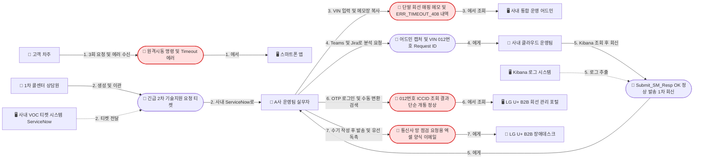
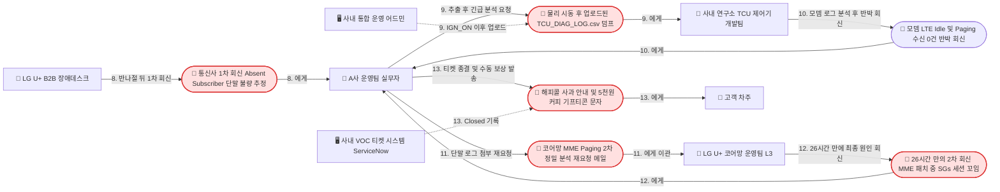
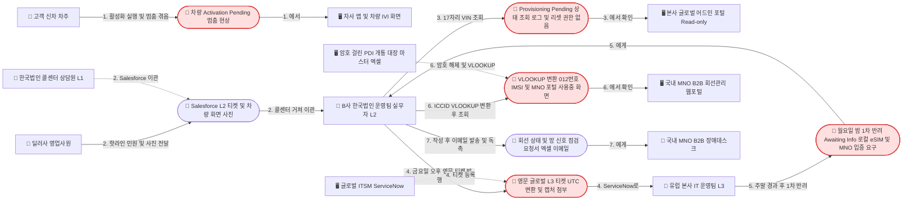
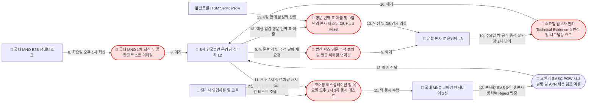

# P2: 원격제어 및 개통·활성화 장애 시 다자간(CS ↔ OEM/본사 ↔ MNO) 원인 규명 핑퐁 (As-is)

- **스토리 ID**: `P2-e2e-troubleshooting-as-is`
- **제목**: 원격제어 먹통(Timeout) 및 개통·프로비저닝 대기(Pending) 장애 발생 시 다자간 원인 규명 핑퐁 스토리 (As-is)
- **Storyteller**:
  - **Storyteller A**: 국내 완성차(A사) 커넥티드카 서비스 운영팀 실무자 (8년 차 과장)
  - **Storyteller B**: 수입차 한국법인(B사) 커넥티드카 운영팀 실무자
- **Moderator**: Domain Storytelling Facilitator
- **Modeler**: Domain Storytelling Modeler
- **Scope Factor**:
  - **Granularity**: **Fine-grained** (실무자의 시스템 접속, 식별 키값 수작업 변환, 화면 캡처, 엑셀 작성, 티켓/이메일 발송 및 반려·재요청 단계까지 상세 기록)
  - **Point in time**: **As-is** (현재 현업에서 겪는 26시간 4자 핑퐁 및 8일 3자 글로벌 핑퐁 현실)
  - **Domain purity**: **Digitalized** (ServiceNow, Salesforce, 사내 통합 운영 어드민, 글로벌 어드민 포털, Jira, Teams, Kibana/ELK, MNO B2B IoT 회선 관리 포털, 암호 걸린 PDI 개통 대장 마스터 엑셀, 이메일 등 실제 도구 명시)
- **출처 Transcript 경로**: [P2-e2e-troubleshooting-transcript.md](file:///Users/goodnews/Documents/1.Projects/OEM%20Dashboard/docs/01-domain-stories/transcripts/P2-e2e-troubleshooting-transcript.md)
- **작성 일자**: 2026-10-23
- **신뢰도 태그 규칙**: `[사실]`(근거 문서 확인 사실), `[추정]`(업계 표준·구조적 추론), `[가정]`(워크숍용 구체 시나리오·수치) 보존

---

## 1. Actor 목록

### 1.1 시나리오 A (국내 완성차 A사) 등장 Actor

| Actor ID | 이름 | 유형 | 역할 및 설명 |
|---|---|---|---|
| `A_Cust` | 👤 고객 (차주) | 사람 (👤) | 2024년식 SUV 소유자. 겨울철 출근길 야외 주차장에서 스마트폰 앱으로 원격시동을 3회 시도했으나 Timeout 실패를 겪고 강성 민원을 제기함 `[사실][가정]` |
| `A_CS` | 👤 1차 콜센터 상담원 | 사람 (👤) | 고객센터 L1 상담원. 구독 활성 상태와 계정-VIN 매핑 정상 여부를 1차 확인한 뒤 원인을 알 수 없어 2차 운영팀으로 긴급 티켓을 이관함 `[사실][추정]` |
| `A_Op` | 👤 A사 커넥티드카 운영팀 실무자 | 사람 (👤) | 2차 기술지원을 담당하는 서비스 운영팀 과장. 사내 어드민, 클라우드팀, 연구소 단말팀, 통신사 장애데스크 사이에서 26시간 동안 키값 변환과 로그 대조를 수행함 `[추정][가정]` |
| `G_Cloud` | 👥 사내 클라우드 플랫폼 운영팀 | 그룹/조직 (👥) | A사 IT 계열사 소속 서버 운영 조직. Kibana(ELK) 로그를 통해 API 게이트웨이 및 SMS 중계 발송(`Submit_SM_Resp OK`) 정상 여부를 확인함 `[사실][추정][가정]` |
| `G_RnD` | 👥 사내 연구소 TCU 제어기 개발팀 | 그룹/조직 (👥) | R&D 인포테인먼트·TCU 단말 개발 조직. 차량이 업로드한 `TCU_DIAG_LOG.csv`를 분석하여 모뎀 LTE Idle 상태 및 Paging 미수신 사실을 규명함 `[추정][가정]` |
| `G_MNO_Desk` | 👥 LG U+ B2B 전담 장애데스크 | 그룹/조직 (👥) | 통신사 기업고객 1차 장애 접수 창구. HLR/HSS 가입 상태와 SMS-C `Absent Subscriber` Spooling 이력만 보고 단말 불량으로 1차 회신함 `[추정][가정]` |
| `G_MNO_L3` | 👥 LG U+ 코어망 운영팀 (L3) | 그룹/조직 (👥) | 통신사 코어망 시그널링 정밀 분석 조직. LTE 교환기(MME) 정기 패치 중 발생한 SGs 세션 꼬임(Paging 누락)을 26시간 만에 최종 확인함 `[추정][가정]` |
| `S_App` | 🖥️ 스마트폰 앱 (마이현대류) | 시스템 (🖥️) | 고객이 원격시동 및 공조 제어(`RemoteStart`)를 실행하는 모바일 앱 `[사실]` |
| `S_SNOW_A` | 🖥️ 사내 VOC 티켓 시스템 (ServiceNow) | 시스템 (🖥️) | 1차 콜센터와 2차 운영팀 간 기술지원 티켓을 이관하고 최종 처리 결과를 기록하는 CS 포털 `[추정][가정]` |
| `S_OEM_Admin` | 🖥️ 사내 커넥티드카 통합 운영 어드민 | 시스템 (🖥️) | `VIN`으로 단말/회선 매핑(`IMEI`, `ICCID`, `012 번호`)과 원격제어 이력(`ERR_TIMEOUT_408`), 단말 덤프(`TCU_DIAG_LOG.csv`)를 조회하는 백오피스 포털 `[사실][추정][가정]` |
| `S_Jira_Teams` | 🖥️ 사내 메신저 (Teams) 및 Jira | 시스템 (🖥️) | 운영팀이 사내 클라우드팀 및 연구소 단말 개발팀에 로그 분석을 요청하고 회신받는 협업 도구 `[추정][가정]` |
| `S_Kibana` | 🖥️ Kibana (ELK 로그 시스템) | 시스템 (🖥️) | 사내 클라우드 플랫폼 운영팀이 앱 서버, API 게이트웨이, SMS 중계 게이트웨이 발송 로그를 조회하는 시스템 `[추정][가정]` |
| `S_MNO_Portal` | 🖥️ LG U+ B2B IoT 회선 관리 포털 | 시스템 (🖥️) | 공용 계정과 휴대폰 OTP로 접속하는 통신사 M2M 포털. `VIN` 조회 불가(`012 번호`/`ICCID`만 가능)하며 단순 개통 상태와 당월 데이터 사용량만 노출됨 `[사실][추정][가정]` |

### 1.2 시나리오 B (수입차 한국법인 B사) 등장 Actor

| Actor ID | 이름 | 유형 | 역할 및 설명 |
|---|---|---|---|
| `B_Cust` | 👤 고객 (신차 차주) | 사람 (👤) | 강남 전시장에서 신차를 인도받는 고객(또는 3년 무료 만료 후 스토어 연장 결제 고객). 차량 화면이 `Activation Pending`에서 멈춰 원격제어를 쓰지 못함 `[사실][가정]` |
| `B_Dealer` | 👤 딜러사 영업사원 | 사람 (👤) | 전시장 인도 현장에서 고객 항의를 받으며 딜러 핫라인과 콜센터에 긴급 민원을 넣고 차량 Pending 화면 사진을 전달함 `[가정]` |
| `B_CS` | 👤 한국법인 콜센터 상담원 (L1) | 사람 (👤) | 약관 동의 및 계정 매핑을 1차 확인한 후 로컬 CRM(Salesforce)을 통해 한국법인 운영팀(L2)으로 기술 지원 티켓을 이관함 `[추정][가정]` |
| `B_Op` | 👤 B사 한국법인 커넥티드 운영팀 실무자 (L2) | 사람 (👤) | Read-only 권한만 가진 한국법인 운영 담당자. 유럽 본사 L3와 국내 MNO 사이에서 8일간 엑셀 `VLOOKUP` 키값 변환, 한영 번역, 3자 테스트 조율을 수행함 `[추정][가정]` |
| `G_HQ_L3` | 👥 유럽 본사 IT 운영팀 (L3) | 그룹/조직 (👥) | 본사 클라우드 백엔드, 프로비저닝 서버(SM-DP+/eIM), 마스터 DB Write 권한을 가진 조직. 시차(1일 1턴)가 존재하며 한글 번역 캡처를 공식 증적으로 인정하지 않고 2회 반려함 `[추정][가정]` |
| `G_KR_MNO_Desk` | 👥 국내 MNO B2B 장애데스크 | 그룹/조직 (👥) | 국내 통신사 1차 장애 창구. 단순 개통 및 기지국 Attach 정상이라는 두 줄짜리 한글 텍스트 이메일만 회신함 `[추정][가정]` |
| `G_KR_MNO_Core` | 👥 국내 MNO 코어망/시그널링 엔지니어 (2선) | 그룹/조직 (👥) | 에스컬레이션을 통해 투입된 통신사 2선 엔지니어. 교환기(SMSC/PGW) 시그널링 및 전용 APN 패킷 트레이스를 통해 본사發 SMS 미인입과 본사 방화벽 Reject를 입증함 `[추정][가정]` |
| `S_IVI_App` | 🖥️ 자사 앱 (My App) 및 차량 IVI 화면 | 시스템 (🖥️) | 고객이 차량 연동 및 원격제어 활성화를 실행하고 `Activation Pending` 상태가 표시되는 접점 `[사실][가정]` |
| `S_SFDC` | 🖥️ 로컬 CRM 티켓 시스템 (Salesforce) | 시스템 (🖥️) | 한국법인 콜센터(L1)에서 한국법인 운영팀(L2)으로 로컬 기술 지원 티켓을 이관하는 시스템 `[추정][가정]` |
| `S_Global_Portal` | 🖥️ 본사 글로벌 차량·구독 관리 어드민 포털 | 시스템 (🖥️) | `VIN`으로 `IMEI`, `EID`, `ICCID` 및 `Provisioning Pending` 상태를 조회하는 Global Connected Vehicle Portal. 한국법인은 Read-only 권한만 보유 `[추정][가정]` |
| `S_SNOW_Global` | 🖥️ 글로벌 ITSM 티켓 시스템 (ServiceNow) | 시스템 (🖥️) | 한국법인(L2)이 유럽 본사(L3)에 영문으로 기술 지원 티켓을 발행하고 증적 첨부·반려 코멘트를 주고받는 시스템 `[추정][가정]` |
| `S_PDI_Excel` | 🖥️ PDI 개통 대장 마스터 엑셀 파일 | 시스템 (🖥️) | 팀 공용 폴더에 암호가 걸려 보관된 엑셀 파일. `VLOOKUP`으로 `ICCID`를 국내 `012 번호(MSISDN)`와 `IMSI`로 수동 변환할 때 사용 `[사실][추정][가정]` |
| `S_KR_MNO_Portal` | 🖥️ 국내 MNO B2B IoT 회선관리 웹포털 | 시스템 (🖥️) | `012 번호`로 조회 시 단순 `회선 상태: 사용중(정상 개통)`만 표시되는 국내 통신사 웹포털 `[추정][가정]` |

---

## 2. Work Object 목록

| Work Object ID | 이름 | 등장 시나리오 | 설명 및 포함 데이터 |
|---|---|---|---|
| `W_RemoteCmd` | 📄 원격시동 명령 및 Timeout 에러 (`ERR_TIMEOUT_408`) | 시나리오 A (`#A1`, `#A3`) | 고객이 아침 07:40에 3회 요청한 `RemoteStart` 트랜잭션(`Request ID` 3건). `SMS_TRIG_SENT` 이후 90초간 `TCU_CONN_ACK` 미수신으로 타임아웃 실패 처리됨 `[추정][가정]` |
| `W_VOC_Ticket_A` | 📄 긴급 2차 기술지원 요청 티켓 | 시나리오 A (`#A2`, `#A13`) | 1차 콜센터가 ServiceNow로 이관한 강성 VOC 티켓. 고객명, 연락처, 17자리 `VIN`, 상담 녹취 요약, 고객 앱 에러 캡처 화면 포함 `[사실][추정][가정]` |
| `W_KeyMemo_A` | 📄 단말/회선 매핑 정보 메모 | 시나리오 A (`#A3`, `#A6`) | 운영팀 실무자가 사내 어드민에서 `VIN`으로 조회해 메모장에 복사해 둔 `IMEI`, `ICCID`, `012-xxxx-xxxx(MSISDN)`, 개통 통신사(LG U+) 정보 `[사실][추정]` |
| `W_CloudLog_A` | 📄 클라우드 서버 로그 및 1차 회신 (`Submit_SM_Resp OK`) | 시나리오 A (`#A4`, `#A5`) | 사내 클라우드팀이 Kibana에서 확인한 로그 캡처. LG U+ SMS 중계 게이트웨이로 Wake-up 패킷 발송 후 0.2초 만에 `Submit_SM_Resp OK`를 수신했다는 회신 `[추정][가정]` |
| `W_MNO_Req_A` | 📄 통신사 망 점검 요청용 엑셀 양식 | 시나리오 A (`#A7`) | 발생 일시(`07:38~07:45`), `012 번호`, `IMEI`, `ICCID`, SMS 발송 성공 로그 캡처, 주차 위치(번지수 제외한 동 단위)를 수기 입력한 이메일 첨부 파일 `[추정][가정]` |
| `W_MNO_Resp1_A` | 📄 통신사 1차 회신 이메일 (`Absent Subscriber`) | 시나리오 A (`#A8`, `#A9`) | LG U+ 장애데스크가 반나절 만에 보낸 1차 답변. "HLR/기지국 특이 장애 없으나 SMS-C 착신 시도 시 단말 무응답(`Absent Subscriber`)으로 Spooling 됨, 차량 TCU 불량 추정" `[추정][가정]` |
| `W_TCU_Dump` | 📄 단말 상태·에러 덤프 로그 (`TCU_DIAG_LOG.csv`) | 시나리오 A (`#A9`, `#A10`, `#A11`) | 고객이 07:55에 물리 스마트키로 직접 시동(`IGN_ON`)을 걸어 차량이 서버로 업로드한 모뎀 내부 로그. 당시 모뎀이 Deep Sleep이 아닌 LTE Idle 상태였고 Paging 수신이 0건이었음을 증명 `[추정][가정]` |
| `W_MNO_Resp2_A` | 📄 코어망 2차 정밀 분석 회신 (MME SGs 세션 꼬임) | 시나리오 A (`#A11`, `#A12`) | LG U+ 코어망 운영팀(L3)이 26시간 만에 회신한 최종 원인. 새벽 LTE 교환기(MME) 정기 패치 중 일부 `012` 회선의 SGs 세션이 꼬여 Wake-up Paging이 누락됨 `[추정][가정]` |
| `W_Gifticon` | 📄 해피콜 사과 안내 및 5천 원 커피 기프티콘 | 시나리오 A (`#A13`) | 법적·약관상 차량용 IoT 단발성 장애 배상 기준 미흡으로 CS 운영 예산에서 수동 발송한 문자 보상 `[사실][추정][가정]` |
| `W_Pending_Alert` | 📄 차량 `Activation Pending` 화면 사진 및 L2 티켓 | 시나리오 B (`#B1`, `#B2`) | 신차 인도 현장에서 멈춘 인포테인먼트 화면 카톡 사진 1장과 `VIN`, 고객 글로벌 계정 ID가 담긴 Salesforce L2 이관 티켓 `[사실][추정][가정]` |
| `W_Global_Status` | 📄 글로벌 어드민 `Provisioning Pending` 캡처 | 시나리오 B (`#B3`, `#B4`) | 글로벌 포털에서 `VIN`으로 조회한 `IMEI`, `EID`, `ICCID` 및 `Provisioning Pending` 상태 화면 캡처 (Read-only 권한으로 하위 로그는 비노출) `[추정][가정]` |
| `W_L3_Ticket` | 📄 영문 글로벌 L3 기술 지원 티켓 (ServiceNow) | 시나리오 B (`#B4`, `#B5`, `#B9`, `#B10`, `#B13`) | 한국법인이 유럽 본사 L3에 발행한 영문 티켓. UTC 변환 시각과 증적을 첨부하며, 본사 L3로부터 2차례(`Awaiting Info`, `Technical Evidence 불인정`) 반려됨 `[추정][가정]` |
| `W_Vlookup_Key` | 📄 엑셀 `VLOOKUP` 변환 식별 키 (`012 번호`·`IMSI`) | 시나리오 B (`#B6`, `#B7`) | 암호 걸린 PDI 개통 대장 마스터 엑셀에서 20자리 `ICCID`로 검색해 찾아낸 국내 MNO용 `012 번호(MSISDN)`와 `IMSI` `[사실][추정][가정]` |
| `W_KR_MNO_Resp1` | 📄 국내 MNO 1차 한글 회신 이메일 및 번역 캡처 | 시나리오 B (`#B8`, `#B9`, `#B10`) | 국내 MNO 장애데스크가 보낸 두 줄짜리 한글 텍스트 이메일("로컬 eSIM 개통 및 기지국 Attach 정상")과 한국법인 실무자가 빨간 네모 박스·영문 주석을 달아 번역한 이미지 `[추정][가정]` |
| `W_Core_Dump_B` | 📄 코어망 교환기(SMSC/PGW) 시그널링 및 APN 세션 덤프 엑셀 | 시나리오 B (`#B11`, `#B12`, `#B13`) | 3자 동시 테스트 후 국내 MNO 코어망 엔지니어가 추출한 상세 로그 엑셀 및 영문 번역 표. 국제 SMS Hub發 Wake-up SMS 인입 0건 및 유럽 본사 방화벽 IP의 HTTPS 개통 패킷 Reject 사실을 입증 `[추정][가정]` |

---

## 3. 도메인 스토리 문장 및 문장별 Annotation

### 3.1 시나리오 A: 국내 완성차(A사) 원격시동 먹통 4자 핑퐁 스토리 (`#A1 ~ #A13`)

1. **`#A1` [D-Day 07:40]** 👤 **고객(차주)**이 아침 출근길 야외 주차장에서 🖥️ **스마트폰 앱(마이현대류)**으로 📄 **원격시동 및 공조 제어 명령(`RemoteStart`)**을 3회 연속 요청했으나 📄 **응답 시간 초과 에러(`Timeout`)**를 수신한다 `[사실][가정]`.
   - ⚠️ **Pain Point (`PP-05`)**: *"아침 7시 40분경 야외 주차장에서 스마트폰 앱(마이현대류)으로 원격시동 및 공조 제어를 3번 연속 눌렀는데 모두 '응답 시간 초과(Timeout)'가 떠서 어린아이와 얼어붙은 차에 그냥 탔다, 당장 원인을 밝혀라"* `[사실][가정]`

2. **`#A2` [D-Day 09:00, 티켓 접수]** 👤 **1차 콜센터 상담원**이 상담 화면에서 고객의 5년 무료 구독 활성 상태 및 앱 계정-차량(`VIN`) 정상 연동 여부를 확인한 뒤, 🖥️ **사내 VOC 티켓 시스템(ServiceNow)**을 통해 👤 **A사 커넥티드카 운영팀 실무자**에게 📄 **긴급/강성 2차 기술지원 요청 티켓(`VIN`, 상담 녹취 요약, 고객 앱 에러 캡처 포함)**을 이관한다 `[사실][추정][가정]`.

3. **`#A3` [+15분, 09:15]** 👤 **A사 커넥티드카 운영팀 실무자**가 🖥️ **사내 커넥티드카 통합 운영 어드민**에 17자리 `VIN`을 입력하여 조회한 📄 **단말/회선 매핑 정보(`IMEI`, `ICCID`, `012 번호`, 연식별 개통 통신사 LG U+)**를 메모장에 복사하고, 원격제어 이력 탭에서 3건의 `Request ID`가 `SMS_TRIG_SENT` 이후 90초간 `TCU_CONN_ACK` 미수신으로 📄 **`ERR_TIMEOUT_408` 실패 처리된 내역**을 확인한다 `[사실][추정][가정]`.
   - ⚠️ **Pain Point (`PP-05` — OEM 어드민의 무선망 가시성 부재)**: *"문제는 저희 운영 어드민에서는 차량의 '마지막 시동 OFF 시점(전날 밤 10시)'에 찍힌 배터리 전압(12.4V 정상)과 주차 위치만 보일 뿐, 지금 당장 이 차의 TCU 모뎀이 기지국에 붙어 있는지(Attach), 아니면 Deep Sleep 모드에 빠졌는지, Wake-up SMS가 단말에 도착은 했는지 전혀 볼 수가 없다는 점입니다."* `[추정][가정]`
   - 📝 **용어 메모**: `Request ID`(개별 원격제어 트랜잭션 식별자), `ERR_TIMEOUT_408`(`SMS_TRIG_SENT` 발송 후 90초 동안 차량 TCU의 데이터 세션 연결 응답 `TCU_CONN_ACK`가 오지 않아 타임아웃 처리된 코드).

4. **`#A4` [+30분, 09:30]** 👤 **A사 커넥티드카 운영팀 실무자**가 🖥️ **사내 메신저(Teams) 및 Jira**를 통해 👥 **사내 클라우드 플랫폼 운영팀**에게 📄 **어드민 화면 캡처, `VIN`, `012 번호`, 3건의 `Request ID`**를 전달하며 출근 시간대 클라우드 게이트웨이 큐 지연 및 서버 발송 로그 확인을 요청한다 `[사실][추정][가정]`.

5. **`#A5` [+1시간, 10:00]** 👥 **사내 클라우드 플랫폼 운영팀**이 🖥️ **Kibana(ELK)**에서 서버 상세 로그를 조회한 뒤, 👤 **A사 커넥티드카 운영팀 실무자**에게 📄 **"LG U+ SMS 중계 게이트웨이로 Wake-up 패킷을 던진 뒤 0.2초 만에 `Submit_SM_Resp OK`(발송 접수 완료)를 정상 수신했으니 OEM 서버는 100% 정상이며 통신사 무선망 또는 단말 문제로 추정된다"는 1차 회신 및 로그 캡처**를 전달한다 `[추정][가정]`.
   - 📝 **용어 메모**: `Submit_SM_Resp OK`는 통신사 SMS-C가 메시지 발송 요청을 접수했다는 SMPP 응답일 뿐, 실제 차량 단말(TCU)까지 도달했음을 보장하지 않는다.

6. **`#A6` [+1시간 20분, 10:20]** 👤 **A사 커넥티드카 운영팀 실무자**가 사내 공용 계정과 휴대폰 OTP 인증을 거쳐 🖥️ **LG U+ B2B IoT 회선 관리 포털**에 로그인한 뒤, 통신사 전산에 `VIN`이 없어 메모장에 복사해 둔 📄 **`012 번호(MSISDN)`와 `ICCID`**로 검색하지만 단순 개통 상태(`정상/일시정지 아님`)와 당월 누적 데이터 사용량(`14MB`)만 보일 뿐 기지국 Attach 및 SMS 도달 이력은 확인하지 못한다 `[사실][추정][가정]`.
   - ⚠️ **Pain Point (`PP-05` — VIN 조회 불가 및 코어망 로그 비노출)**: *"통신사 전산에는 저희 자동차 고유의 '차대번호(VIN)'라는 개념 자체가 아예 등록되어 있지 않기 때문에, 아까 사내 어드민에서 메모장에 따로 복사해 둔 `012-xxxx-xxxx` 착신번호(MSISDN)와 `ICCID`를 통신사 포털 검색창에 붙여넣어 조회해야만 합니다. ... 정작 장애 원인 규명에 핵심인 기지국 Attach/Detach 이력이나 Wake-up SMS Delivery Report는 포털에 전혀 나오지 않습니다."* `[사실][추정][가정]`
   - ⚠️ **Pain Point (`PP-04` 연계 & `PP-09` — 연식별 다중 MNO 3사 포털 파편화 및 3G 망 종료 차량 진퇴양난)**: *"같은 날 아침에 2020년식 차량이나 2014년식 구형 차량의 원격시동 먹통 VOC가 같이 넘어오면, 저는 모니터에 SKT, KT, LG U+ 3개 통신사의 B2B 포털을 각기 다른 브라우저로 띄워놓고 일일이 다른 OTP를 찍어가며 조회해야 합니다. ... 특히 2014년식 같은 구형 3G TCU 장착 차량이 통신 두절로 들어오면 SKT 2027년 말 3G 망 종료 예정이라 중계기 증설이나 망 최적화도 불가하고, 고객에게 수십만 원 내고 하드웨어를 바꾸시라고 안내할 수도 없어서 진퇴양난입니다."* `[사실][추정][가정]`
   - 🔀 **변형/예외 후보**: `[변형 스토리 A-2]` 2014년식 구형 3G 장착 차량의 기지국 출력 저하 및 3G 망 종료(Sunset) 관련 통신 두절 민원 처리 스토리.

7. **`#A7` [+1시간 40분, 10:40]** 👤 **A사 커넥티드카 운영팀 실무자**가 📄 **통신사 망 점검 요청용 엑셀 양식**에 발생 일시(`07:38~07:45`), `012 번호`, `IMEI`, `ICCID`, 클라우드팀의 SMS 발송 성공 로그 캡처, 차량 주차 위치(개인정보 문제로 번지수를 뺀 동 단위)를 수기로 입력하여 👥 **LG U+ B2B 전담 장애데스크**에 공용 이메일로 발송하고 유선 전화로 독촉한다 `[추정][가정]`.

8. **`#A8` [+4시간 30분, 13:30]** 👥 **LG U+ B2B 전담 장애데스크**가 점심시간이 지난 오후 1시 반경 👤 **A사 커넥티드카 운영팀 실무자**에게 📄 **"해당 012 회선 가입 상태(HLR/HSS) 및 기지국 장비 특이 장애 없으나, 07:40경 SMS-C 착신 시도 시 단말 무응답(`Absent Subscriber`)으로 실패하여 재전송 대기(Spooling) 처리됨. 당사 통신망은 정상이며 차량 TCU 모뎀 슬립 복귀 불량으로 판단됨"이라는 1차 회신 이메일**을 보낸다 `[추정][가정]`.
   - ⚠️ **Pain Point (`PP-05` — 완벽한 삼각 핑퐁 발생)**: *"고객은 분명히 '하늘이 뻥 뚫린 야외 지상 주차장에 댔다'고 하고, 사내 클라우드팀은 '우리는 통신사로 SMS를 정상 발송했다'고 하고, 통신사는 '망은 멀쩡한데 차(TCU)가 죽어 있어서 못 받은 거다'라고 하니 완벽한 삼각 핑퐁에 갇혀버린 겁니다."* `[추정][가정]`
   - 📝 **용어 메모**: `Absent Subscriber / Spooling`(SMS-C가 착신 단말로 호를 시도했으나 무응답으로 실패하여 큐에 재전송 대기 상태로 쌓인 현상).

9. **`#A9` [+5시간, 14:00]** 👤 **A사 커넥티드카 운영팀 실무자**가 🖥️ **사내 커넥티드카 통합 운영 어드민**에서 고객이 아침 07:55에 직접 물리 스마트키로 시동을 걸면서(`IGN_ON`) 서버로 올라온 📄 **단말 상태·에러 덤프 로그(`TCU_DIAG_LOG.csv`)**를 추출하여, 📄 **통신사 1차 회신 이메일**과 함께 🖥️ **Jira 및 사내 메신저**로 👥 **사내 연구소 TCU 제어기 개발팀**에 긴급 분석을 요청한다 `[추정][가정]`.
   - 🔀 **변형/예외 후보**: `[변형 스토리 A-1]` 만약 고객이 물리 시동(`IGN_ON`)을 걸지 않아 `TCU_DIAG_LOG.csv`가 서버로 올라오지 않았다면, 고객에게 직영 하이테크센터(정비소) 입고 및 스캐너 진단을 안내해야 하여 **5자 핑퐁**으로 확대됨 `[추정][가정]`.

10. **`#A10` [+6시간, 15:00]** 👥 **사내 연구소 TCU 제어기 개발팀**이 📄 **`TCU_DIAG_LOG.csv` 단말 모뎀 내부 로그**를 분석한 뒤, 👤 **A사 커넥티드카 운영팀 실무자**에게 📄 **"밤새 배터리 보호용 Deep Sleep에 빠진 적이 없고 07:40 당시 모뎀은 LTE 기지국에 정상 등록(Registered/Idle)된 상태였으며, 기지국으로부터 깨우기 호출(Paging) 신호를 받은 기록이 0건이므로 단말 불량이 아니라 통신사 교환기(MME) 2차 정밀 분석이 필요하다"는 반박 코멘트와 모뎀 상태 캡처**를 회신한다 `[추정][가정]`.

11. **`#A11` [+6시간 30분, 15:30]** 👤 **A사 커넥티드카 운영팀 실무자**가 📄 **단말 개발팀의 모뎀 로그 분석 결과 및 상태 캡처**를 첨부하여 👥 **LG U+ B2B 전담 장애데스크(및 LG U+ 코어망 운영팀 L3)**에 📄 **코어망 MME 시그널링 및 Paging 시도 상세 이력(2차 정밀 분석) 재요청 이메일**을 발송한다 `[추정][가정]`.
    - ⚠️ **Pain Point (`PP-05` — 1차 장애데스크의 권한 한계로 인한 이관 지연)**: *"통신사 장애데스크 1차 상담 인력은 코어망 시그널링 트레이스(Trace) 권한이 없다 보니 그 요청이 통신사 내부의 코어망 운영팀(L3)으로 또 이관되었고, 결국 그날 퇴근할 때까지도 답을 못 받았습니다."* `[추정][가정]`

12. **`#A12` [+26시간, 익일 11:00]** 👥 **LG U+ 코어망 운영팀(L3)**이 티켓 접수 후 꼬박 26시간 만에 👤 **A사 커넥티드카 운영팀 실무자**에게 📄 **"전날 새벽 관할 지역 LTE 교환기(MME) 정기 패치 작업 중 대기(Idle) 상태였던 일부 `012` 차량 회선의 SMS 연동 인터페이스(SGs 세션)가 일시적으로 꼬여, 가입 상태는 정상으로 보이나 SMS-C가 보낸 Wake-up 신호가 기지국으로 페이징(Paging)되지 않고 누락되었다"는 최종 2차 분석 회신 이메일**을 보낸다 `[추정][가정]`.
    - 📝 **용어 메모**: `SGs 인터페이스`(LTE MME와 MSC/SMS-C를 연결하여 LTE Idle 단말에 SMS Paging을 전달하는 코어망 인터페이스).

13. **`#A13` [+26시간 30분, 익일 11:30]** 👤 **A사 커넥티드카 운영팀 실무자**가 🖥️ **사내 VOC 티켓 시스템(ServiceNow)**에 최종 원인을 입력하고 👤 **고객(차주)**에게 📄 **해피콜(사과 안내) 및 CS 예산으로 구매한 5천 원짜리 커피 기프티콘 문자**를 수동 발송하며 티켓을 종결(`Closed`)한다 `[사실][추정][가정]`.
    - ⚠️ **Pain Point (`PP-05` — 차량용 IoT 회선 약관상 배상 기준 미흡 및 감정노동)**: *"전기통신사업법이나 저희 커넥티드카 이용약관상 차량용 IoT 회선과 부가서비스는 일반 휴대전화보다 통신 장애 손해배상 기준이 훨씬 약해서... 아침 출근길 단발성 타임아웃이나 월 1만 원 남짓 요금제 기준으로는 법적 배상 대상도 안 되고 계산해 봐야 몇백 원 수준이라 시스템상 보상 처리가 아예 불가능했습니다. 결국 저희 CS 운영 예산에서 수동으로 5천 원짜리 커피 기프티콘 하나를 문자로 발송해 드리며 거듭 죄송하다고 머리를 숙이는 걸로 티켓을 겨우 종결했습니다."* `[사실][추정][가정]`

---

### 3.2 시나리오 B: 수입차 한국법인(B사) 개통·활성화 Pending 3자(한국법인 ↔ 유럽본사 ↔ 국내MNO) 핑퐁 스토리 (`#B1 ~ #B13`)

1. **`#B1` [Day 1 금요일 오후]** 👤 **고객(신차 차주)**이 강남 전시장 인도 현장에서 🖥️ **자사 앱(My App) 및 차량 IVI 화면**으로 차량 연동 및 원격제어 활성화를 실행했으나, 차량 화면이 📄 **`활성화 대기 중(Activation Pending)` 상태**에서 멈추고 앱 원격 문열림이 작동하지 않는다 `[사실][가정]`.
   - 🔀 **변형/예외 후보**: `[변형 스토리 B-1]` 평택항 PDI 입항 시 수백 대 차량의 로컬 eSIM 프로파일(SGP.02/SGP.32) 일괄 전환 실패 건 및 3년 무료 만료 후 온라인 스토어(Store) 유료 연장 결제 시 권한 미반영 건에서도 동일한 핑퐁 발생 `[사실][추정][가정]`.

2. **`#B2` [Day 1 금요일 16:00]** 👤 **딜러사 영업사원**이 딜러 핫라인과 콜센터에 긴급 민원을 접수하고, 👤 **한국법인 콜센터 상담원(L1)**이 약관 동의와 계정 매핑을 1차 확인한 뒤 🖥️ **로컬 CRM 티켓 시스템(Salesforce)**을 통해 👤 **B사 한국법인 커넥티드 운영팀 실무자(L2)**에게 📄 **L2 기술 지원 티켓(`17자리 VIN`, 고객 글로벌 계정 ID, 고객 전화번호, 딜러가 찍은 차량 Pending 화면 사진 1장)**을 이관한다 `[추정][가정]`.

3. **`#B3` [Day 1 금요일 16:30]** 👤 **B사 한국법인 커넥티드 운영팀 실무자(L2)**가 🖥️ **본사 글로벌 차량·구독 관리 어드민 포털(Global Connected Vehicle Portal)**에 17자리 `VIN`을 입력하여 📄 **`IMEI`, `EID`, `ICCID` 및 원격제어 패키지의 `Provisioning Pending` 멈춤 상태**를 확인하나, 한국법인 계정(Read-only) 권한 한계로 본사 프로비저닝 서버(SM-DP+/eIM 및 백엔드)의 Wake-up 트리거 발송 로그를 볼 수 없고 마스터 DB 강제 재처리(`Reset`/`Re-trigger`)도 수행하지 못한다 `[추정][가정]`.
   - ⚠️ **Pain Point (`PP-10` — 한국법인 Read-only 권한 한계 및 본사 로그 비노출)**: *"왜 `Pending`에서 멈췄는지 세부 에러 코드나 본사 프로비저닝 서버가 차량 TCU로 보낸 Wake-up 트리거 발송 로그는 한국법인 권한으로는 아예 메뉴조차 안 보인다는 점입니다. 게다가 본사 마스터 DB에 직접 붙어서 꼬여 있는 `Pending` 상태를 강제로 `Reset`하거나 `Re-trigger`하는 쓰기 권한도 유럽 본사 L3 팀에만 있어서, 제가 어드민 포털에서 할 수 있는 건 화면을 멍하니 쳐다보는 것밖에 없었습니다."* `[추정][가정]`

4. **`#B4` [Day 1 금요일 17:00]** 👤 **B사 한국법인 커넥티드 운영팀 실무자(L2)**가 🖥️ **글로벌 ITSM 티켓 시스템(ServiceNow)**에 접속하여 `VIN`, `EID`, `ICCID`, 고객 계정 ID, 장애 발생 시각(UTC 기준으로 수동 변환), 📄 **글로벌 어드민 `Provisioning Pending` 캡처 이미지 및 차량 화면 사진**을 첨부해 👥 **유럽 본사 IT 운영팀(L3)** 앞으로 📄 **영문 글로벌 L3 기술 지원 티켓(강제 재처리 요청)**을 발행한다 `[추정][가정]`.
   - ⚠️ **Pain Point (`PP-10` — 유럽 본사와의 시차로 인한 주말 대기)**: *"한국 시간 금요일 오후 5시면 유럽 본사는 이제 막 금요일 오전 근무를 시작할 시간이라 바로 답이 올 리가 없었고, 딜러와 고객의 항의 전화를 받으며 월요일까지 꼼짝없이 기다려야 하는 지옥이 그때부터 시작됐습니다."* `[추정][가정]`

5. **`#B5` [Day 4 월요일 21:00]** 👥 **유럽 본사 IT 운영팀(L3)**이 주말이 지난 월요일 밤 9시(한국 시간)에 🖥️ **글로벌 ITSM 티켓 시스템(ServiceNow)**에서 📄 **영문 글로벌 L3 티켓을 `Awaiting Info(현업 확인 대기)`로 1차 반려**하며, 👤 **B사 한국법인 커넥티드 운영팀 실무자(L2)**에게 **"본사 서버는 금요일 해당 시각에 Wake-up 트리거(MT-SMS/IP Push)를 정상 발송했으나 차량 TCU로부터 ACK 및 HTTPS 세션 연결이 오지 않았으니, ① 평택항 PDI 로컬 eSIM 프로파일(`SGP.02/SGP.32`) `Enabled` 여부와 ② 한국 로컬 MNO 기지국 Attach 및 데이터 세션(PDP Context) 정상 여부를 먼저 입증하라"**고 요구한다 `[사실][추정][가정]`.

6. **`#B6` [Day 5 화요일 09:30]** 👤 **B사 한국법인 커넥티드 운영팀 실무자(L2)**가 국내 통신사 전산에 `VIN`이 없어 팀 공용 폴더의 암호 걸린 🖥️ **PDI 개통 대장 마스터 엑셀 파일**을 열어 `VLOOKUP`으로 20자리 `ICCID`를 검색해 📄 **국내 `012 사물통신 전화번호(MSISDN)`와 `IMSI`**로 변환한 뒤, 🖥️ **국내 MNO B2B IoT 회선관리 웹포털**에서 조회하지만 단순 **`회선 상태: 사용중(정상 개통)`**만 확인한다 `[사실][추정][가정]`.
   - ⚠️ **Pain Point (`PP-10` — 암호 걸린 마스터 엑셀 `VLOOKUP` 수작업 키값 변환)**: *"통신사 전산은 자동차의 `VIN(차대번호)`을 전혀 모르기 때문에 제가 먼저 키값을 변환해야 했습니다. 저는 본사 글로벌 어드민 포털에서 복사해 둔 20자리 `ICCID`와 `IMEI`를 들고, 저희 팀 공용 폴더에 있는 암호 걸린 'PDI 개통 대장 마스터 엑셀 파일'을 열어서 `VLOOKUP`으로 그 `ICCID`에 매핑된 국내 '012 사물통신 전화번호(MSISDN)'와 'IMSI'를 찾아냈습니다."* `[사실][추정][가정]`
   - 📝 **용어 메모**: `PDI 개통 대장 마스터 엑셀`(평택항 PDI 입항 차량의 `VIN`·`ICCID`와 국내 MNO의 `012 번호`·`IMSI` 매핑을 관리하기 위해 암호를 걸어 보관하는 수작업 파일).

7. **`#B7` [Day 5 화요일 10:30]** 👤 **B사 한국법인 커넥티드 운영팀 실무자(L2)**가 별도 엑셀 양식인 📄 **회선 상태 및 망 신호 점검 요청서(`012 번호`, `ICCID`, `IMEI`, 장애 시간대 기재)**를 작성하여 👥 **국내 MNO B2B 장애데스크**에 공용 이메일로 발송하고 전담 매니저에게 유선 전화로 독촉한다 `[추정][가정]`.

8. **`#B8` [Day 5 화요일 17:00]** 👥 **국내 MNO B2B 장애데스크**가 반나절 뒤 👤 **B사 한국법인 커넥티드 운영팀 실무자(L2)**에게 첨부파일 없이 본문에 한글 텍스트 두 줄로만 작성된 📄 **1차 회신 이메일("요청하신 012 회선 확인 결과, 로컬 eSIM 프로파일 개통 정상이며 현재 LTE 기지국 Attach 및 IP 할당 이력 정상으로 당사 망 특이사항 없습니다")**을 보낸다 `[추정][가정]`.

9. **`#B9` [Day 5 화요일 21:00]** 👤 **B사 한국법인 커넥티드 운영팀 실무자(L2)**가 📄 **MNO 포털 `사용중(정상)` 한글 화면 캡처 이미지(빨간 네모 박스 및 `Status: Active/Normal` 영문 주석 추가)**와 📄 **국내 MNO 1차 회신 한글 이메일의 영문 전문 번역본**을 🖥️ **글로벌 ITSM 티켓 시스템(ServiceNow)**에 첨부하여 👥 **유럽 본사 IT 운영팀(L3)**에 `In Progress`로 재요청한다 `[추정][가정]`.

10. **`#B10` [Day 6 수요일 22:00]** 👥 **유럽 본사 IT 운영팀(L3)**이 수요일 밤 🖥️ **글로벌 ITSM 티켓 시스템(ServiceNow)**에서 📄 **"한국 MNO가 말로만 정상이라고 한 한글 이메일 번역본이나 단순 가입 상태 캡처는 공식 기술적 증적(Technical Evidence)으로 인정할 수 없다"며 2차 반려**하고, 👤 **B사 한국법인 커넥티드 운영팀 실무자(L2)**에게 **"글로벌 중계망(SMS Hub)을 통해 발송한 Wake-up SMS가 한국 MNO 교환기(SMSC/PGW)에 도달해 차량으로 내려갔는지의 시그널링 로그와 차량 TCU가 본사 전용 APN으로 붙을 때 패킷 드롭 여부를 직접 뽑아오라"**고 요구한다 `[추정][가정]`.
    - ⚠️ **Pain Point (`PP-10` — 한글 이메일 번역본의 Technical Evidence 불인정 및 2차 반려)**: *"수요일 밤(또 하루가 날아갔죠) 본사 L3에서 두 번째 반려 코멘트가 달렸는데, '한국 MNO가 말로만 정상이라고 한 한글 이메일 번역본이나 단순 가입 상태 캡처는 기술적 증적(Technical Evidence)으로 인정할 수 없다'는 거였습니다. ... 가운데 낀 저는 통신망 엔지니어도 아닌데, 본사는 '한국 MNO가 패킷을 안 넘겨준다'고 하고 국내 통신사는 '우린 개통 정상이고 유럽 본사 서버에서 신호가 안 내려온다'고 우기니 정말 미쳐버릴 노릇이었습니다."* `[추정][가정]`
    - 📝 **용어 메모**: `Technical Evidence`(유럽 본사 L3가 로컬 MNO 구간의 무결성을 인정하기 위해 요구하는 표준 3GPP/GSMA 시그널링 로그 및 패킷 트레이스 증적).

11. **`#B11` [Day 7 목요일 09:30~14:00]** 👤 **B사 한국법인 커넥티드 운영팀 실무자(L2)**가 목요일 아침 국내 통신사 B2B 전담 매니저에게 요청해 👥 **국내 MNO 코어망/시그널링 엔지니어(2선 기술지원팀)**로 에스컬레이션하고, 📄 **본사 발송 타임스탬프(UTC→KST 변환)와 본사 전용 텔레매틱스 APN 명칭이 적힌 코어망 시그널링 추적 요청 메일**을 보낸 뒤, 오후 2시 정각에 👤 **딜러사 영업사원** 및 👤 **고객(신차 차주)**과 유선으로 조율하여 **'3자 동시 차량 재시도 테스트' 및 실시간 패킷 트레이스**를 진행한다 `[추정][가정]`.

12. **`#B12` [Day 7 목요일 19:00]** 👥 **국내 MNO 코어망/시그널링 엔지니어(2선)**가 목요일 저녁 👤 **B사 한국법인 커넥티드 운영팀 실무자(L2)**에게 📄 **교환기(SMSC/PGW) 시그널링 타임라인 및 APN 세션 로그 덤프 엑셀 파일**을 전달하며, **"차량 TCU는 본사 전용 APN으로 정상 접속해 IP까지 할당받았으나, 국제 SMS Hub에서 한국 MNO 관문 교환기로 들어온 본사發 Wake-up SMS(MT-SMS)는 0건이고, 차량이 보낸 상향 HTTPS 개통 요청은 유럽 본사 방화벽 IP에서 Reject(Reset) 당하고 있다"**는 사실을 입증한다 `[추정][가정]`.

13. **`#B13` [Day 8 금요일 새벽 ~ Day 9 토요일 09:00, 총 8일 소요]** 👤 **B사 한국법인 커넥티드 운영팀 실무자(L2)**가 📄 **코어망 시그널링 로그 엑셀의 핵심 컬럼을 영문 표로 번역·정리한 증적**을 금요일 새벽 🖥️ **글로벌 ITSM 티켓 시스템(ServiceNow)**에 제출하자, 금요일 밤 👥 **유럽 본사 IT 운영팀(L3)**이 **글로벌 SMS 게이트웨이 라우팅 오류 및 PDI 작업 당시 타임아웃으로 꼬인 본사 DB 상태값(SGP.02/SGP.32 RSP 완료 플래그 누락으로 인한 방화벽 Reject)**을 인정하고 본사 마스터 DB에서 프로비저닝 세션을 강제 초기화(`Hard Reset`)하여, 장애 발생 **8일 만인 토요일 아침**에 차량 화면의 `Activation Pending`이 풀리고 원격제어가 정상 활성화된다 `[추정][가정]`.
    - ⚠️ **Pain Point (`PP-10` — '인간 번역기 겸 핑퐁 메신저'의 무력감과 8일간의 고객 방치)**: *"결국 금요일 오후에 시작된 장애가 다음 주 토요일 아침, 꼬박 8일이 걸려서야 해결됐는데, 그 일주일 동안 저는 매일 아침저녁으로 고객과 딜러에게 전화해 똑같은 사과만 반복하며 욕받이를 해야 했습니다. ... 매번 `VIN`을 엑셀 `VLOOKUP`으로 `ICCID`와 `012 번호`로 바꾸고, 한글 이메일을 영어로 번역해 캡처 뜨고, 유럽 시차 때문에 하루에 한 턴씩만 오가는 ServiceNow 티켓 답변을 밤늦게까지 기다리는 '인간 번역기 겸 핑퐁 메신저' 노릇만 하고 있을 때 가장 큰 무력감을 느낍니다."* `[추정][가정]`

---

## 4. Mermaid 도메인 스토리 다이어그램 (As-is)

> [!IMPORTANT]
> 문장 수가 총 26개(`#A1~#A13`, `#B1~#B13`)이므로 가독성을 위해 시나리오별로 2개 구간씩 총 4개의 `flowchart LR` 다이어그램으로 분할하여 표기합니다. Pain Point가 발생한 핵심 Work Object 노드는 붉은색(`classDef pain fill:#ffe0e0,stroke:#d33`)으로 강조되어 있습니다.

### 4.1 시나리오 A (전반부 `#A1 ~ #A7`): 원격시동 Timeout 발생 및 OEM 서버 ↔ MNO 포털 수작업 조회

### 4.2 시나리오 A (후반부 `#A8 ~ #A13`): MNO 1차 회신 핑퐁, 연구소 단말 덤프 반박 및 26시간 만의 코어망 원인 규명

---

### 4.3 시나리오 B (전반부 `#B1 ~ #B7`): 신차 인도장 `Activation Pending` 발생, 유럽 본사 L3 1차 반려 및 마스터 엑셀 `VLOOKUP` 변환

### 4.4 시나리오 B (후반부 `#B8 ~ #B13`): 한글 회신 번역본 2차 반려, 3자 동시 패킷 트레이스 및 8일 만의 본사 DB 강제 초기화

---

## 5. Annotation 모음 (Pain Points · 단절 매트릭스 · 질문 · 변형 · 용어)

### 5.1 ⚠️ Pain Points 요약 (`PP-05`, `PP-09`, `PP-10`)

| Pain Point 코드 | 핵심 문제 정의 | 관련 문장 | 소요 시간 / 피해 규모 |
|---|---|---|---|
| **`PP-05`** | **원격제어 장애 시 OEM ↔ MNO 간 "우리 쪽은 정상" 1차 회신 핑퐁 및 배상 미흡** - OEM 어드민은 `SMS_TRIG_SENT`까지만 보이고, 클라우드팀은 `Submit_SM_Resp OK`만 확인하며, MNO B2B 포털은 `VIN` 조회조차 불가하고 단순 가입 상태만 노출됨. - MNO 1차 장애데스크는 `Absent Subscriber`만 보고 차량 단말 불량으로 책임을 전가하며, 연구소 단말 덤프(`TCU_DIAG_LOG.csv`)로 반박한 뒤에야 MNO 코어망 L3에서 MME 패치 중 SGs 세션 꼬임(Paging 누락)을 찾아냄. - 차량용 IoT 회선의 약관상 배상 기준 미흡으로 5천 원 커피 기프티콘 수동 발송에 그침. | `#A3`, `#A5`, `#A6`, `#A7`, `#A8`, `#A9`, `#A10`, `#A11`, `#A12`, `#A13` | **26시간 소요** (4개 조직 핑퐁, 출근길 골든타임 10분 상실) |
| **`PP-09`** (`PP-04` 연계) | **연식별 다중 통신사(3사) B2B 포털 파편화 및 3G 망 종료(Sunset) 차량 진퇴양난** - 다년 수주 주기로 연식별 공급 통신사(SKT/KT/LG U+)가 달라 실무자가 3개 포털에 개별 OTP로 로그인하고 상이한 엑셀 양식을 수기 작성해야 함. - 2014년식 등 구형 3G 차량은 2027년 말 SKT 3G 종료 예정으로 망 최적화도 불가하고 고객에게 수십만 원 하드웨어 유상 교체도 안내하기 어려움. | `#A6` | **상시 수작업 중복** 및 구형 차량 CS 해결 불가 |
| **`PP-10`** | **수입차 한국법인의 본사 DB 권한 부재, 마스터 엑셀 `VLOOKUP` 변환 및 본사 L3의 한글 증적 불인정 반려** - 한국법인은 글로벌 포털 Read-only 권한뿐이라 본사 서버 발송 로그 조회나 `Pending` 강제 리셋이 불가능함. - 국내 MNO 조회를 위해 암호 걸린 PDI 개통 대장 엑셀에서 `VLOOKUP`으로 `ICCID` → `012 번호`를 수동 변환해야 함. - 국내 MNO의 두 줄짜리 한글 이메일과 포털 캡처를 영문 번역해 올려도 유럽 본사 L3에서 "공식 Technical Evidence 불인정"으로 2회 반려하여, 3자 동시 테스트 및 코어망 시그널링 엑셀 번역까지 거쳐야 해결됨. | `#B3`, `#B4`, `#B5`, `#B6`, `#B8`, `#B9`, `#B10`, `#B11`, `#B12`, `#B13` | **8일(일주일 남짓) 소요** (시차 1일 1턴 + 2회 반려, 한국법인 실무자의 '인간 번역기' 화) |

### 5.2 구간별 단절 지점 매트릭스 (As-is 병목 구조)

| 단절 차원 | 국내 완성차 (A사) 운영 환경 | 수입차 한국법인 (B사) 운영 환경 | 근본 병목 요약 |
|---|---|---|---|
| **1. 식별자(Key) 단절** | OEM 어드민(`VIN`, `Request ID`) ↔ MNO 포털(`VIN` 미존재, 메모장에 복사한 `012 번호`·`ICCID`로 수동 조회, 3사별 필수 키 상이) | 본사 글로벌 포털(`VIN`, `EID`, `ICCID`) ↔ 암호 걸린 PDI 마스터 엑셀 `VLOOKUP` 수동 변환 ↔ 국내 MNO 포털(`012 번호`, `IMSI`) | **차량 식별자(`VIN`)와 통신 식별자(`012 MSISDN`/`ICCID`/`IMSI`) 간 자동 매핑 브릿지 부재** |
| **2. 타임스탬프 및 언어/증적 단절** | 사내 클라우드(Kibana), 단말 덤프(`TCU_DIAG_LOG.csv`), 통신사 교환기(SMS-C/MME) 로그의 시각을 수기로 대조 | 한국 시각(KST) ↔ 유럽 본사(UTC) 수동 변환. 국내 MNO 한글 이메일 번역본을 본사 L3가 **공식 Technical Evidence로 불인정**하여 반려 | **글로벌(UTC·3GPP 표준 시그널링 코드) ↔ 로컬(KST·한글 자유양식 메일) 간 증적 포맷 불일치** |
| **3. 로그 가시성(Observability) 단절** | OEM 서버 발송(`Submit_SM_Resp OK`)과 단말 수신 사이 **MNO 코어망(SMS-C → MME SGs → 기지국 Paging) 구간 블랙박스화**. 차량 로그는 물리 시동(`IGN_ON`) 전까지 업로드 안 됨 | 한국법인은 Read-only로 본사 SM-DP+/eIM 발송 로그 조회 불가. **국제 SMS Hub → 국내 MNO 관문 인입 여부** 및 **본사 전용 APN 방화벽 Reject 여부** 가시성 전무 | **클라우드 발송 이후부터 차량 모뎀 도달 사이의 MNO 코어망·국제 중계망 시그널링 가시성 부재** |
| **4. 제어/조치 권한(Action) 단절** | MNO 1차 장애데스크에 코어망 트레이스 권한이 없어 L3 코어망팀 이관에 만 하루 소요 | 한국법인에 본사 DB `Pending` 강제 초기화(`Hard Reset`) 및 `Re-trigger` 권한 전무 | **운영 실무자에게 안전한 원격 세션 리셋(`Session Reset` / `Re-trigger`) 권한 및 즉시 에스컬레이션 도구 부재** |

### 5.3 ❓ 미해결 질문 (Open Questions)

1. **❓ [질문 1 — MNO 코어망 시그널링 API 연동 범위 및 지연 시간]**: 통신 3사(SKT, KT, LG U+) 코어망의 시그널링 데이터(MME Paging 성공 여부, SGs 인터페이스 상태, SMS-C Delivery Report, 전용 APN PDP Context 상태)를 외부(OEM 통합 진단 대시보드)로 API 연동할 때, 통신사 내부 보안·망분리 정책상 허용 가능한 데이터 수준과 조회 응답 속도(Near Real-time 연동 vs On-demand 실시간 Trace)는 어디까지인가?
2. **❓ [질문 2 — 글로벌 본사 ITSM 연동 및 Re-trigger 권한 위임 거버넌스]**: 수입차 유럽 본사(HQ)의 글로벌 ITSM(ServiceNow)에 국내 MNO가 보증하는 '영문 표준 기술 증적 리포트(Technical Evidence Pack)'를 자동 첨부하거나, 한국법인 운영팀에 제한적인 프로비저닝 `Re-trigger` 실행 권한을 위임받기 위해 필요한 본사 보안·거버넌스 승인 절차는 무엇인가?

### 5.4 🔀 변형 및 예외 스토리 후보 (Variations & Exceptions)

- **🔀 [변형 스토리 A-1] 고객이 물리 시동(`IGN_ON`)을 걸지 않은 장기 주차 상태에서의 원격제어 먹통 건 (`#A9` 변형)**:
  - 차량이 깨어나지 않아 `TCU_DIAG_LOG.csv` 덤프 파일 자체가 서버로 업로드되지 않으며, 결국 고객에게 직영 하이테크센터(정비소) 입고 및 스캐너 진단을 안내해야 해서 **5자 핑퐁(운영팀 ↔ 클라우드팀 ↔ 통신사 ↔ 정비소 ↔ 단말연구소)**으로 확대되는 시나리오.
- **🔀 [변형 스토리 A-2] 2014년식 구형 3G 차량의 기지국 출력 저하 및 3G 망 종료(Sunset) 민원 응대 (`#A6` 변형, `PP-09`)**:
  - 2027년 말 SKT 3G 망 종료를 앞두고 기지국 노후화·출력 저하로 통신 두절이 발생했으나 망 증설이 불가하고, 고객에게 수십만 원 상당의 LTE/5G TCU 하드웨어 유상 교체도 강요하지 못해 발생하는 장기 미결 분쟁 시나리오.
- **🔀 [변형 스토리 B-1] 평택항 PDI 센터 대량 입항 차량의 로컬 eSIM(SGP.02/SGP.32) 일괄 전환 실패 건 (`#B1` 변형)**:
  - 입항 차량 수백 대의 선적 모드를 해제하고 로컬 MNO 프로파일로 일괄 전환(RSP)할 때 일부 차량이 타임아웃으로 개통 실패하여 출고가 보류되는 B2B 대량 장애 시나리오.

### 5.5 📝 용어 메모 (Ubiquitous Language)

| 용어 | 도메인 정의 |
|---|---|
| **`Request ID`** | 고객이 스마트폰 앱에서 원격제어(`RemoteStart` 등)를 요청할 때 OEM 클라우드 서버가 생성하는 개별 제어 트랜잭션 식별자 |
| **`ERR_TIMEOUT_408`** | OEM 앱 서버가 Wake-up SMS(`SMS_TRIG_SENT`) 발송 후 90초 동안 차량 TCU로부터 데이터 세션 연결 응답(`TCU_CONN_ACK`)을 받지 못해 타임아웃 실패 처리된 에러 코드 |
| **`Submit_SM_Resp OK`** | OEM 클라우드 SMS 중계 게이트웨이가 통신사 SMS-C로 단문 발송을 요청(`Submit_SM`)했을 때 통신사 SMS-C가 "메시지 접수 완료"를 응답한 SMPP 코드 (단말 실제 도달을 의미하지 않음) |
| **`Absent Subscriber` / `Spooling`** | 통신사 SMS-C가 착신 단말(차량 TCU)로 메시지를 내려보내려 했으나 단말 무응답으로 실패하여 SMS-C 큐에 재전송 대기(Spooling)로 쌓인 상태 |
| **`SGs 인터페이스`** | LTE 패킷 교환기(MME)와 SMS/회선교환 측을 연결해 LTE 대기(Idle) 단말에 SMS 페이징(Paging)을 전달하는 코어망 인터페이스. 패치 등으로 세션이 꼬이면 가입 상태는 정상이어도 Wake-up SMS 페이징이 누락됨 |
| **`TCU_DIAG_LOG.csv`** | 차량에 물리적 시동(`IGN_ON`)이 걸려 데이터 세션이 연결될 때 차량 TCU가 OEM 서버로 업로드하는 단말 모뎀 내부 상태·에러 덤프 파일 |
| **`Provisioning Pending` / `Activation Pending`** | 수입차 신차 인도 또는 온라인 스토어 연장 결제 시 본사 프로비저닝 서버(SM-DP+/eIM 및 백엔드)와 차량 TCU 간 활성화 핸드셰이크가 완료되지 않아 대기 중으로 고착된 상태 |
| **`PDI 개통 대장 마스터 엑셀`** | 수입차 한국법인 운영팀이 평택항 PDI 입항 차량의 `VIN`·`ICCID`와 국내 MNO의 `012 번호(MSISDN)`·`IMSI` 매핑을 관리하기 위해 팀 공용 폴더에 암호를 걸어 보관하며 `VLOOKUP`으로 조회하는 수작업 파일 |
| **`Technical Evidence (기술적 증적)`** | 유럽 본사 L3 엔지니어가 로컬 MNO 구간 무결성을 인정하기 위해 요구하는 표준 3GPP/GSMA 시그널링 로그(국제 SMS Hub 인입 이력, PDP Context/APN 세션 로그, 패킷 트레이스 등). 단순 한글 이메일 번역본이나 포털 캡처는 불인정됨 |
