# 03. 서브도메인 및 경계(Bounded Context 후보) 지도

> **작성 기준**: `P1-big-picture` 도메인 스토리텔링 워크숍 기록 (문장 #1~#27) 및 `00-fact-base.md`
> **작성자**: Domain Storytelling Listener (시니어 소프트웨어 아키텍트 / DDD 전문가)
> **목적**: 차량 생애주기 전체를 다루는 Coarse-grained 도메인 스토리(P1)에 Domain Storytelling & DDD 경계 발견 휴리스틱을 적용하여 **서브도메인(Subdomain) 및 Bounded Context 후보**를 도출하고, 경계 간(Context Mapping) 마찰 지점과 향후 MNO B2B 솔루션(가칭 OEM Dashboard)의 전략적 포지셔닝(Core/Supporting/Generic)을 분석합니다.

---

## 1. 경계 발견 휴리스틱 (Boundary Heuristics) 적용 기준

Domain Storytelling에서 하나의 거대한 스토리를 여러 서브도메인(Bounded Context 후보)으로 나눌 때 다음 4가지 휴리스틱을 적용했습니다:

1. **용어의 의미 변화 (Ubiquitous Language Shift)**: 동일한 단어('개통', '고객', '휴면', '해지')나 차량을 부르는 식별자(`IMEI/ICCID` → `VIN` → `012 MSISDN` → `고객 구독 계정`)가 바뀌는 지점.
2. **Actor 집단 변화 (Actor Group Shift)**: 주로 협업하는 주체가 부품사·공장·PDI 기술팀 → 카마스터·고객 → 빌링담당·MNO 정산팀 → 고객센터·장애데스크·본사 L3 → 법무·인증팀·규제기관으로 바뀌는 지점.
3. **트리거 및 작동 주기 변화 (Trigger & Cadence Shift)**:
   - 물리적 물류 이벤트 단위 (라인오프, 평택항 입항, 차량 인도)
   - 고객 라이프사이클 이벤트 단위 (가입, 5년 만료, 중고 매매, 폐차)
   - 재무/운영 배치 주기 (월별 도매 청구서 대사, 분기/반기 장기 미교신 직권 해지, 다년 수주 및 3G 망 종료)
   - 비동기 돌발 이벤트 (겨울철 출근길 원격시동 장애, 스토어 결제 후 활성화 먹통)
4. **Work Object 변환 지점 (Work Object Transformation)**: 앞 단계의 산출물이 다음 단계에서 전혀 다른 형태의 입력물(예: `차량-단말 매핑 데이터` → `012 회선 개통/휴면 요청` → `고객 서비스 구독권` → `월별 도매 청구 대사 파일`)로 변환되는 지점.

---

## 2. 도출된 6대 서브도메인 (Bounded Context 후보) 카탈로그

P1의 27개 도메인 스토리 문장을 분석한 결과, 총 **6개의 서브도메인 후보(SD-01 ~ SD-06)**가 식별되었습니다. 특히 우리는 **"완성차 OEM의 비즈니스 관점"**과 **"국내 MNO가 OEM 담당자에게 제공할 B2B 소프트웨어(OEM Dashboard) 관점"**에서 Core / Supporting / Generic 분류가 서로 역전되거나 달라진다는 점에 주목해야 합니다 `[추론]`.

### 2.1 요약 매트릭스

| ID | 서브도메인 후보명 | 포함 문장 (P1) | 핵심 식별자 (Key ID) | 작동 주기 / 트리거 | OEM 관점 분류 (잠정) | MNO B2B 솔루션 관점 분류 (잠정) | 연결된 Pain Point |
|---|---|---|---|---|---|---|---|
| **SD-01** | **단말-차량 매핑 및 개통·프로비저닝** *(Device-Vehicle Provisioning & RSP)* | #1~#4, #6, #20, #21 | `ICCID`, `IMSI`, `IMEI`, `VIN`, `012 번호` | 이벤트 기반 (납품, 라인오프, PDI 입항, 출고, 인도) | **Supporting** (차량 인도·품질 검사를 뒷받침하는 인프라) | **Core** (eSIM/RSP, 시험개통·물류휴면·정식활성화 상태 자동화의 핵심) | `PP-01`, `PP-10`(일부) |
| **SD-02** | **고객 온보딩 및 구독·소유권 생애주기** *(Customer Subscription & Ownership Lifecycle)* | #5, #11~#15, #22, #23 | `고객계정ID`, `VIN`, `구독상품ID`, `자동차등록증` | 이벤트 + 만기 도래 (인도 가입, 5년 만료, 중고 명의이전) | **Core** (차주 디지털 경험 및 유료 구독 수익화의 핵심) | **Supporting** (OEM 구독 상태 변화와 MNO 회선 요금제/상태를 연동하는 어댑터) | `PP-02`, `PP-06`, `PP-07` |
| **SD-03** | **B2B 회선 과금·트래픽 풀링 및 다중 통신사 정산 대사** *(Wholesale Billing, Traffic Pooling & Reconciliation)* | #7, #8, #16, #17 | `청구년월`, `MNO코드`, `012 번호`, `VIN`, `데이터풀ID` | 정기 배치 (월별 청구·대사, 분기/반기 미교신 정리, OTA 배포 시) | **Supporting / Generic** (비차별화 백오피스 재무·정산 업무이나 수작업 고통 극심) | **Core** (OEM 실무자의 최대 시간 소모처인 다중망 대사·좀비회선·풀링 가시성 해결) | `PP-01`, `PP-03`, `PP-04`, `PP-08` |
| **SD-04** | **다자간 서비스·망 장애 진단 및 에스컬레이션** *(Multi-party Diagnostics & Incident Escalation)* | #9, #10, #24 | `티켓ID`, `VIN`, `012 번호`, `ICCID`, `서버로그ID` | 실시간/비동기 돌발 (고객 장애 민원 접수 시) | **Supporting** (고객센터 CS 및 서비스 신뢰도 유지) | **Core** (단말-통신망-OEM서버 구간 통합 진단으로 핑퐁 제거 및 SLA 차별화) | `PP-05`, `PP-10` |
| **SD-05** | **차량 SW 배포(OTA) 및 통신망 세대 전환 관리** *(OTA Campaign & Network Sunset Management)* | #8(일부), #18, #19, #27(일부) | `OTA캠페인ID`, `VIN`, `TCU HW버전`, `망세대(3G/LTE/5G)` | 캠페인/프로젝트 주기 (리콜·OTA 배포, 2027 3G 종료) | **Core (OTA) / Supporting (3G 종료)** (SDV 전환의 핵심 역량) | **Supporting** (대규모 OTA 트래픽 제어 및 3G 종료 대상 회선 식별·전환 지원) | `PP-03`, `PP-09`, `PP-11`(일부) |
| **SD-06** | **국내 법규·개인정보·사이버보안 규제 준수** *(Regulatory, Privacy & CSMS Compliance)* | #5(일부), #25~#27 | `약관동의버전`, `LBS신고번호`, `CSMS인증번호`, `VIN` | 법령 시행일 / 감사 이벤트 / 차량 인도·OTA 시점 | **Supporting (필수 규제)** (위반 시 판매중지·과징금 리스크) | **Generic / Supporting** (규제 감사 증적 로그 및 로컬 법규 준수 인프라 지원) | `PP-11` |

---

## 3. 서브도메인별 상세 분석 (휴리스틱 및 마찰 지점)

### SD-01. 단말-차량 매핑 및 개통·프로비저닝 (Device-Vehicle Provisioning & RSP)
- **포함 스토리 문장**: P1 **#1, #2, #3, #4, #6** (국내 A사), **#20, #21** (수입차 B사)
- **주요 Actor**: 부품 협력사(모비스 등), 생산공장(검사 설비·품질담당자), 수입차 본사 조달팀, 수입차 한국법인 PDI 기술팀, OEM 커넥티드카 운영팀, 통신사(MNO), 본사 개통 서버(SM-DP/SM-SR/eIM)
- **핵심 Work Object 및 변환**:
  - `SIM·단말 식별정보 매핑 목록(ICCID·IMSI·IMEI)` (#1) ＋ 공장 라인오프 `차대번호(VIN)` (#2) ➔ **`차량-단말 매핑 데이터(VIN-TCU 원장)`**로 변환
  - 국내차: `시험 개통 요청` (#3) ➔ `012 법인 회선(개통)` ➔ `EOL 첫 교신 신호` (#3) ➔ `회선 일시정지(휴면 전환) 요청 및 물류모드` (#4) ➔ 인도 시 `정식 활성화(휴면 해제) 요청 및 TCU 활성화 설정` (#6)
  - 수입차: `부트스트랩 프로파일 내장 eUICC + 선적 휴면 모드` (#20) ➔ 평택항 입항 시 `선적 모드 해제 + 로컬 프로파일 다운로드(RSP, SGP.02/SGP.32) 및 개통 요청` (#21)
- **경계 설정 근거 (휴리스틱)**:
  - **Actor & Trigger**: 고객(차주)이 등장하기 전(또는 인도 직전 백엔드 트리거), 공장 라인오프·출고장·해상 선적·평택항 PDI 등 물리적 제조·물류 이벤트에 의해 움직입니다.
  - **용어**: 여기서의 '개통'은 소비자 서비스 가입이 아니라 **망 개통(012 번호 할당 또는 eUICC 로컬 프로파일 활성화)**을 뜻합니다.
- **잠정 분류 및 근거**:
  - *OEM 관점*: **Supporting** — 차량 제조·물류·인도를 지원하는 필수 기반이나 차량 자체의 상품성을 결정하는 영역은 아님.
  - *MNO B2B 솔루션 관점*: **Core** — MNO가 OEM에 제공하는 핵심 가치(회선 프로비저닝 API, SGP.02/SGP.32 RSP 오케스트레이션, 물류 휴면 상태 동기화)가 집중된 도메인 `[추론]`.
- **경계 간 인터페이스 마찰 (Pain Point)**:
  - **[SD-01 ↔ SD-03 마찰 (`PP-01`)]**: 물리적 차량의 '물류모드'가 재고 이동이나 PDI 점검 중 현장에서 풀렸을 때, MNO 전산의 '회선 휴면' 상태와 어떻게 상호작용하는지 가시성이 없어 사후에 월별 청구서(SD-03) 단계에서 과금 귀책 분쟁이 터집니다 `[가정]`.
  - **[SD-01 ↔ SD-04 마찰 (`PP-10`)]**: 수입차 PDI나 스토어 활성화 시 본사 개통 서버와 국내 MNO 사이의 RSP/활성화 명령(Push SMS/IP) 누락이 발생해도 한국법인 운영팀이 확인할 수 없습니다 `[추정][가정]`.

---

### SD-02. 고객 온보딩 및 구독·소유권 생애주기 (Customer Subscription & Ownership Lifecycle)
- **포함 스토리 문장**: P1 **#5, #11, #12, #13, #14, #15** (국내 A사), **#22, #23** (수입차 B사)
- **주요 Actor**: 고객(신차 차주 / 전 차주 / 새 차주), 카마스터(딜러), OEM 운영팀(마케팅/빌링/서버), OEM 고객센터 상담원, 외부: 국토부 자동차등록사업소/구청(연동 단절), 국내 통신사(Personal eSIM의 경우)
- **핵심 Work Object 및 변환**:
  - 인도 시: `위치기반·개인정보 동의서 + 커넥티드 서비스 가입 신청` (#5) ➔ **`기본 5년 무료 구독권`** 또는 수입차 **`기능별 차등 무료 패키지 / VIN 귀속형 구독권`** (#22)
  - 인포테인먼트 확장 시: `스트리밍 데이터 상품 신청` (#8) 또는 고객 직접 `차량용 Personal eSIM 요금제 신청` (#23)
  - 5년 만료 도래 시: `유료 전환 안내문 및 결제 동의 요청` (#11) ➔ 동의 시 `유료 구독 신청 및 결제 정보` (#12) / 미동의 시 `유료 기능 차단 + 라이트(기본 안전) 서비스 전환` (#13)
  - 중고차 거래 시: `자동차 명의이전 등록(미연동)` (#14) ➔ 새 차주의 `자동차등록증 사본 + 신분증 제출` (#15) ➔ 전 차주 `강제 해지 처리 및 안내 문자` + 새 차주 `신규 가입 및 소유자 변경 승인` (#15)
- **경계 설정 근거 (휴리스틱)**:
  - **용어 & Work Object**: 차량이 단순 하드웨어(`TCU/012 회선`)에서 **'차주 계정과 연결된 구독 서비스 계약'**으로 바뀝니다. 여기서 '고객'은 법인이 아닌 자연인(차주)입니다.
- **잠정 분류 및 근거**:
  - *OEM 관점*: **Core** — 고객 접점(앱/스토어), 무료→유료 전환율 방어, 브랜드 경험 및 부가 수익 창출의 핵심 도메인.
  - *MNO B2B 솔루션 관점*: **Supporting** — 차주와의 B2C 구독 계약 자체는 OEM 소유이나(단, Personal eSIM은 MNO B2C), OEM의 구독 상태 변화(무료 만료 미전환 시 요금제 하향/정지 요청 #13, 명의이전 해지 #15)를 받아 MNO 회선 상태를 지체 없이 변경해 주는 **연동 인터페이스(Context Map)**로서 중요함 `[추론]`.
- **경계 간 인터페이스 마찰 (Pain Point)**:
  - **[딜러/출고 ↔ SD-02 마찰 (`PP-02`)]**: 무료 5년 기산 기준이 '출고일'인지 '최초 가입일'인지 혼선이 있고 딜러 안내가 늦어지면 고객 무료 기간 손실 민원이 발생합니다 `[사실][가정]`.
  - **[SD-02 ↔ SD-03 마찰 (`PP-06`)]**: 5년 무료 만료 후 고객이 유료 전환을 거부했을 때(#12, #13), 라이트 서비스(SOS) 유지를 위해 회선을 남겨두면 OEM이 MNO 회선 고정비를 계속 떠안아야 하고, 통신사에 요금제 하향·정지·해지 목록을 추려 보내는 작업이 번거롭습니다 `[사실][추정]`.
  - **[외부 국토부 등록원부 ↔ SD-02 마찰 (`PP-07`)]**: 국토부 자동차 명의이전 데이터가 OEM에 자동 연동되지 않아 전 차주가 새 차주의 차량 위치를 조회·원격제어하는 심각한 보안 사고가 나고, 고객센터가 팩스/앱으로 등록증과 신분증을 수작업 검수해야 합니다 `[사실][추정]`.

---

### SD-03. B2B 회선 과금·트래픽 풀링 및 다중 통신사 정산 대사 (Wholesale Billing, Traffic Pooling & Reconciliation)
- **포함 스토리 문장**: P1 **#7, #8, #16, #17** (그리고 #4의 과금 귀책 실랑이, #13의 미전환 차량 비용 정리)
- **주요 Actor**: 통신사(MNO B2B 정산팀 — 연식별 최대 3사), OEM 커넥티드카 운영팀(정산/회선 관리 담당자), OEM 빌링 담당, 외부: 구청 자동차 말소 등록 시스템(연동 단절), 폐차장/차주
- **핵심 Work Object 및 변환**:
  - 월별 배치: 각 통신사의 `B2B 회선 도매 청구서 및 회선 대사 자료(상이한 양식)` (#7) + `스트리밍 구독료 도매 정산` (#8) + `데이터 풀링(용량 공유) 한도 정산` (#8) + 폐차 미신고 `좀비 회선 유지비 청구서` (#16)
  - 분기/반기 배치: 통신사의 `장기 미교신(무트래픽) 회선 목록` (#17) + OEM 내부 `차량 상태 및 무료기간 만료 여부 대조` ➔ `직권 해지 요청(일괄)` (#17)
- **경계 설정 근거 (휴리스틱)**:
  - **Trigger & Cadence**: 실시간 트랜잭션이 아니라 **월별 청구 주기** 및 **분기/반기 정리 주기**로 돌아가며, 개별 차량이 아닌 **수백만 회선의 집합(Pool & Batch)과 원장 대사(Reconciliation)**를 다룹니다.
  - **용어**: 여기서의 '고객'은 차주가 아니라 **B2B 도매 요금을 납부하는 OEM 법인**이며, 핵심 관심사는 '원장 정합성', '풀링 한도', '비용 누수(좀비 회선/재고차 과금)'입니다.
- **잠정 분류 및 근거**:
  - *OEM 관점*: **Supporting (또는 Generic)** — 재무/정산 백오피스 업무이나, 연식별 다중 통신사(3사) 파편화와 폐차 미연동 때문에 운영팀 실무자의 공수를 가장 심각하게 갉아먹는 병목 구간 `[사실][추정]`.
  - *MNO B2B 솔루션 관점*: **Core (최우선 문제 발견 영역)** — Storyteller가 P2 최우선 과제로 지목한 구간(A5 첫째 항목). 회선 상태-차량 상태 불일치 탐지, 재고 중 비정상 트래픽 알림, 장기 미교신 좀비 회선 자동 판별, 청구 대사 표준화는 OEM Dashboard가 가장 즉각적인 ROI를 줄 수 있는 핵심 영역입니다 `[추론]`.
- **경계 간 인터페이스 마찰 (Pain Point)**:
  - **[다중 MNO ↔ SD-03 마찰 (`PP-04`)]**: 다년 수주 주기로 연식·차종별 통신사(3사)가 나뉘어 매월 각기 다른 양식의 청구서와 회선 대사 자료를 수작업으로 맞춰봐야 합니다 `[사실][추정][가정]`.
  - **[외부 말소등록 ↔ SD-03 마찰 (`PP-08`)]**: 폐차 말소 등록이 연동되지 않아 고철이 된 차의 012 회선이 '좀비 회선'으로 남아 매달 유지비가 누수되고, 분기/반기마다 장기 미교신 목록을 받아 수작업으로 직권 해지해야 합니다 `[사실][추정][가정]`.
  - **[SD-05(OTA) ↔ SD-03 마찰 (`PP-03`)]**: 대규모 제어기 OTA 배포로 기가바이트급 트래픽이 발생할 때 고객에게 과금할 수 없어 데이터 풀링 계약 한도나 별도 비용으로 OEM이 떠안아야 합니다 `[사실][추정]`.

---

### SD-04. 다자간 서비스·망 장애 진단 및 에스컬레이션 (Multi-party Diagnostics & Incident Escalation)
- **포함 스토리 문장**: P1 **#9, #10** (국내 A사), **#24** (수입차 B사) / **P2 `#A1 ~ #A13` (국내 A사 26시간 핑퐁), `#B1 ~ #B13` (수입차 B사 8일 핑퐁)**
- **주요 Actor**: 고객(차주), 딜러사 영업사원, OEM 고객센터 상담원(1차), OEM 커넥티드카 운영팀(국내 A사 / 수입차 B사 한국법인 — 2차), 사내 클라우드 플랫폼 운영팀, 사내 연구소(R&D) TCU 제어기 개발팀, 통신사 B2B 장애데스크(1선) 및 코어망/시그널링 운영팀(2선/L3), 유럽 본사 IT 운영팀(수입차 L3)
- **핵심 Work Object 및 변환**:
  - **국내차(P2 시나리오 A)**: `원격시동 Timeout 민원` (#A1) ➔ `2차 기술지원 티켓(VIN)` (#A2) ➔ `어드민 조회(Request ID, ERR_TIMEOUT_408) 및 VIN→012/ICCID 메모장 변환` (#A3) ➔ `클라우드 Kibana 로그(Submit_SM_Resp OK)` (#A5) ➔ `3사 B2B 포털 OTP 조회 및 망 점검 엑셀 발송` (#A6, #A7) ➔ `MNO 1차 회신(Absent Subscriber / Spooling)` (#A8) ➔ `물리 시동(IGN_ON) 후 TCU_DIAG_LOG.csv 추출 및 연구소 반박(LTE Idle, Paging 0건)` (#A9, #A10) ➔ `MNO 코어망 L3 2차 정밀 분석(MME 정기 패치 중 SGs 세션 꼬임 확인)` (#A11, #A12) ➔ `5천 원 커피 기프티콘 수동 보상 종결` (#A13)
  - **수입차(P2 시나리오 B)**: `인도장/스토어 Activation Pending 민원` (#B1, #B2) ➔ `본사 글로벌 포털 Read-only 조회(Provisioning Pending)` (#B3) ➔ `영문 ServiceNow L3 티켓(UTC 변환)` (#B4) ➔ `본사 L3 1차 반려(로컬 eSIM 및 기지국 Attach 입증 요구)` (#B5) ➔ `암호 걸린 PDI 개통 대장 엑셀 VLOOKUP(ICCID→012/IMSI 변환) 및 MNO 망 점검 요청` (#B6, #B7) ➔ `MNO 1차 두 줄 한글 회신 및 영문 번역/빨간 박스 캡처 재제출` (#B8, #B9) ➔ `본사 L3 2차 반려(Technical Evidence 불인정, 국제 SMS Hub 및 전용 APN 패킷 로그 요구)` (#B10) ➔ `MNO 코어망 2선 에스컬레이션 및 3자 동시 테스트` (#B11) ➔ `코어망 시그널링/APN 덤프 엑셀 확보 및 영문 표 제출(국제 SMS Hub 미인입 + 본사 방화벽 HTTPS Reject 입증)` (#B12, #B13) ➔ `본사 DB Hard Reset으로 8일 만에 해결` (#B13)
- **경계 설정 근거 (휴리스틱)**:
  - **Trigger & Actor**: 겨울철 출근 시간 원격시동 실패나 구독 결제/인도 직후 활성화 먹통 같은 **실시간 고객 민원(Incident)**에 의해 트리거되며, CS 상담원·운영팀·클라우드팀·단말연구소·통신사 장애데스크/코어망팀·해외 본사 L3가 티켓과 로그를 주고받는 전형적인 트러블슈팅 컨텍스트입니다.
- **잠정 분류 및 근거**:
  - *OEM 관점*: **Supporting** — 서비스 품질 및 고객 만족도 방어 영역.
  - *MNO B2B 솔루션 관점*: **Core** — Storyteller가 P2 최우선 과제로 지목한 두 번째 구간(A5 둘째 항목). 단말(TCU)-통신망(012/eSIM/MME Paging/SGs/전용 APN)-OEM 클라우드(또는 본사 서버/국제 SMS Hub) 구간의 End-to-End 5-Hop 연결 상태와 시그널링 증적을 한눈에 보여주는 진단 플랫폼은 26시간~8일짜리 다자간 핑퐁을 끝내는 핵심 차별화 가치입니다 `[추론]`. *(상세 설계는 `docs/06-e2e-dashboard-blueprint.md` 참조)*
- **경계 간 인터페이스 마찰 (Pain Point)**:
  - **[OEM 운영팀 ↔ 클라우드팀 ↔ 단말연구소 ↔ MNO 장애데스크/코어망 L3 4자 마찰 (`PP-05`, `PP-05a~c`)]**: `VIN ↔ 012` 식별자 단절, 3사 포털 OTP 파편화, 그리고 `Submit_SM_Resp OK`(서버 발송)와 `Absent Subscriber`(단말 무응답) 사이의 MME `SGs` 페이징 블랙박스화로 인해 26시간이 소요됩니다 `[사실][추정][가정]`.
  - **[수입차 한국법인 ↔ 유럽 본사 L3 ↔ 국내 MNO 3자 마찰 (`PP-10`, `PP-10a~c`)]**: 한국법인에 본사 DB Write/Log 권한이 없고, 암호 엑셀 `VLOOKUP` 수작업과 KST↔UTC 시차, 그리고 한글 1차 회신 캡처의 `Technical Evidence` 불인정 반려가 겹쳐 해결에 8일이 소요됩니다 `[사실][추정][가정]`.

---

### SD-05. 차량 SW 배포(OTA) 및 통신망 세대 전환 관리 (OTA Campaign & Network Sunset Management)
- **포함 스토리 문장**: P1 **#8(후반부), #18, #19, #27(후반부)**
- **주요 Actor**: OEM 소프트웨어 배포팀, OEM 커넥티드카 운영팀, OEM 서비스센터, 통신사(3G 망 종료 추진 MNO 등), 구형 3G 차량 차주, 일반 OTA 대상 차주
- **핵심 Work Object 및 변환**:
  - OTA 배포: `SW 업데이트 사전 공지문` (#27) + `대규모 제어기 OTA 패키지` (#8) ➔ `데이터 풀링 트래픽 소진` (#8)
  - 3G 망 종료: 통신사의 `3G 망 종료 일정 통보 및 전환 협조 요청` (#18) ➔ OEM/서비스센터의 `서비스 종료 예고 안내문` (#19) ➔ `물리적 TCU 하드웨어 교체 비용 분쟁` (#19)
- **경계 설정 근거 (휴리스틱)**:
  - **Actor & Trigger**: 개별 고객 요청이 아니라 OEM SW 배포팀의 **리콜/품질 개선 캠페인** 또는 통신사의 **주파수/망 세대 종료(3G Sunset)**라는 기술 인프라 이벤트에 의해 차량군(Cohort) 단위로 움직입니다.
- **잠정 분류 및 근거**:
  - *OEM 관점*: **Core (OTA) / Supporting (망 종료 대응)** — SDV(소프트웨어 중심 자동차)에서 제어기 OTA는 핵심 경쟁력이나, 막대한 데이터 비용과 구형 3G 하드웨어 교체 분쟁이라는 부작용을 동반함.
  - *MNO B2B 솔루션 관점*: **Supporting (전환/트래픽 오케스트레이션)** — Storyteller가 P2 과제로 지목한 세 번째 구간(A5 셋째 항목)의 일부로, OTA 캠페인 시 데이터 풀링 잔여량 예측·제어 및 3G 단말 장착 활성 회선 식별·고지 관리 기능으로 연결됨 `[추론]`.
- **경계 간 인터페이스 마찰 (Pain Point)**:
  - `PP-03` (대규모 제어기 OTA 트래픽 비용 부담) 및 `PP-09` (2012~2015년형 3G TCU 차량의 망 종료 시 OTA 전환 불가로 인한 HW 교체 비용 책임 공방) `[사실][추정]`.

---

### SD-06. 국내 법규·개인정보·사이버보안 규제 준수 (Regulatory, Privacy & CSMS Compliance)
- **포함 스토리 문장**: P1 **#5(약관 동의), #25, #26, #27**
- **주요 Actor**: 수입차 한국법인(법무·운영·인증팀), 수입차 해외 본사(DPO·R&D팀·개발팀), 방송미디어통신위원회(구 방통위), 개인정보보호위원회, 국토교통부(한국교통안전공단), 고객(차주) 및 실제 운전자(가족·대리기사)
- **핵심 Work Object 및 변환**:
  - 위치/개인정보: `위치기반서비스사업 신고서` (#25) + `개인정보 국외 이전 동의서 및 제3자 제공 동의서` (#25) + 개인정보위의 `국외 이전 적정성 및 운전자 동의 사각지대 점검 질의` (#26) ➔ 본사 DPO 행 `한국 개인정보위 소명 자료 요청` (#26)
  - 자동차관리법(CSMS/OTA): 본사 R&D팀의 `CSMS 인증서 및 SW 업데이트 안전기준 적합성 기술문서` (#27) ➔ 국토부 제출 + 고객 행 `SW 업데이트 사전 공지문` (#27) + 본사 개발팀 행 `로컬 규제 반영 개발 요청서` (#27)
- **경계 설정 근거 (휴리스틱)**:
  - **Actor & Trigger**: 방통위·개인정보위·국토부 등 **국내 규제기관의 법령 시행 및 점검**에 의해 움직이며, 특히 수입차 한국법인이 해외 본사(DPO/R&D/개발팀)를 설득해 한국 고유 법규를 글로벌 아키텍처에 반영해야 하는 독특한 조직 경계를 가집니다.
- **잠정 분류 및 근거**:
  - *OEM(특히 수입차 법인) 관점*: **Supporting (Mandatory Compliance)** — 미준수 시 국내 판매중지나 과징금을 맞는 생존 필수 영역이나 본사 우선순위에서 소외됨.
  - *MNO B2B 솔루션 관점*: **Generic / Supporting** — OEM 자체 약관 화면이나 차량 CSMS 인증은 OEM 영역이나, 국내 로컬 통신사 프로파일 전환(영구 로밍 해소)이나 국내 로컬 부가서비스 연동을 통해 국외 이전 리스크를 줄이는 간접적 가치와 맞닿아 있음 `[추론]`.
- **경계 간 인터페이스 마찰 (Pain Point)**:
  - **[수입차 한국법인 ↔ 해외 본사 개발팀/DPO 마찰 (`PP-11`)]**: 차주 외 실운전자(가족·대리기사) 동의 사각지대 소명, 국외 이전 고지, 2025년 8월 시행 자동차관리법 CSMS·OTA 사전 공지 의무를 시스템에 반영하려 해도 글로벌 판매 비중 문제로 본사 개발 우선순위에서 밀려 제때 반영받기 어렵습니다 `[사실][추정][가정]`.

---

## 4. 서브도메인 경계 및 컨텍스트 매핑 개요도 (Mermaid Flowchart)

> **다이어그램 표기 원칙**: Mermaid 파서 오류 방지를 위해 모든 노드 및 서브그래프 라벨을 큰따옴표(`""`)로 감싸고 라벨 내부에 소괄호를 사용하지 않았습니다. 점선 화살표(`-.->`)는 **자동 연동 단절 또는 심각한 조직·시스템 간 마찰(Pain Point)이 발생하는 경계 인터페이스**를 나타냅니다.

```mermaid
flowchart TB
    subgraph EXT_GOV["외부 공공 및 규제 기관 컨텍스트"]
        MOLIT_REG["국토부 및 지자체 자동차 등록·말소 원부"]
        REG_BODIES["방통위 / 개인정보위 / 국토부 교통안전공단"]
    end

    subgraph EXT_MNO["다중 이동통신사 MNO 컨텍스트 — 연식별 3사 및 글로벌 MNO"]
        MNO_PROV["MNO 개통·프로비저닝 및 eSIM RSP 서버"]
        MNO_BILL["MNO B2B 도매 과금·풀링 및 미교신 추출 전산"]
        MNO_NOC["MNO B2B 장애데스크 및 3G 망 종료 추진팀"]
    end

    subgraph EXT_HQ["해외 본사 글로벌 컨텍스트 — 수입차 B사"]
        HQ_IT["본사 개통서버 및 글로벌 L3 IT 운영팀"]
        HQ_RND["본사 R&D / 개발팀 / 개인정보보호책임자 DPO"]
    end

    subgraph OEM_DOMAINS["완성차 OEM 및 수입차 한국법인 커넥티드카 도메인 경계"]
        subgraph SD01["SD-01 단말-차량 매핑 및 개통·프로비저닝 — 문장 #1~#4, #6, #20, #21"]
            P1_MAP["부품사 SIM·IMEI 매핑 및 공장 라인오프 VIN 매핑"]
            P1_EOL["012 시험 개통·EOL 첫 교신 및 물류모드·휴면 전환"]
            P1_PDI["평택항 PDI 선적모드 해제 및 로컬 프로파일 RSP 전환"]
            P1_ACT["인도 시 회선 정식 활성화 및 TCU 설정 배포"]
        end

        subgraph SD02["SD-02 고객 온보딩 및 구독·소유권 생애주기 — 문장 #5, #11~#15, #22, #23"]
            P2_JOIN["신차 인도 약관 동의 및 5년 무료 / 차등 패키지 가입"]
            P2_RENEW["5년 만료 유료 전환 동의 또는 라이트 전환·회선 정리"]
            P2_USED["중고차 등록증 수작업 검수·전 차주 강제해지·명의변경"]
            P2_ESIM["스트리밍 데이터 상품 및 고객 직접 Personal eSIM 개통"]
        end

        subgraph SD03["SD-03 B2B 회선 과금·트래픽 풀링 및 정산 대사 — 문장 #7, #8, #16, #17"]
            P3_RECON["연식별 다중 MNO 월별 청구서 및 회선 원장 수작업 대사"]
            P3_POOL["스트리밍 도매 정산 및 대규모 OTA 데이터 풀링 정산"]
            P3_ZOMBIE["폐차 미신고 좀비 회선 적발 및 장기 미교신 직권 해지"]
        end

        subgraph SD04["SD-04 다자간 서비스·망 장애 진단 및 에스컬레이션 — 문장 #9, #10, #24"]
            P4_CS["고객센터 1차 상담 및 OEM 운영팀 2차 기술지원 티켓"]
            P4_DIAG["OEM 서버 로그 확인 및 MNO 망 점검 / 본사 L3 티켓 발송"]
        end

        subgraph SD05["SD-05 차량 SW 배포 OTA 및 통신망 세대 전환 — 문장 #8, #18, #19, #27"]
            P5_OTA["대규모 제어기 OTA 캠페인 배포 및 사전 공지문 발송"]
            P5_3G["3G 망 종료 대상 차량 고지 및 TCU HW 교체 분쟁 대응"]
        end

        subgraph SD06["SD-06 국내 법규·개인정보·사이버보안 규제 준수 — 문장 #5, #25~#27"]
            P6_PRIV["방통위 LBS 신고·국외 이전 동의 및 운전자 동의 소명"]
            P6_CSMS["자동차관리법 CSMS 인증·SW 기술문서 제출 및 로컬 개발 요청"]
        end
    end

    %% SD-01 내부 및 외부 흐름
    P1_MAP -->|"차량-단말 매핑 데이터"| P1_EOL
    P1_EOL <-->|"시험 개통 및 휴면 전환 요청"| MNO_PROV
    P1_PDI <-->|"로컬 프로파일 다운로드 SGP.02 / SGP.32"| MNO_PROV
    P1_PDI <-->|"부트스트랩 해제 연동"| HQ_IT
    P2_JOIN -->|"가입 완료 트리거 — PP-02 기산일 혼선"| P1_ACT
    P1_ACT <-->|"휴면 해제 및 활성화 설정"| MNO_PROV

    %% SD-01 <-> SD-03 마찰
    P1_EOL -.->|"PP-01 재고·PDI 중 물류모드 풀림 과금 귀책 실랑이"| P3_RECON

    %% SD-02 <-> 외부 국토부 및 SD-03 마찰
    MOLIT_REG -.->|"PP-07 명의이전 미연동 — 전 차주 원격제어 보안사고"| P2_USED
    MOLIT_REG -.->|"PP-08 폐차 말소 미연동 — 좀비 회선 유지비 누수"| P3_ZOMBIE
    P2_RENEW -.->|"PP-06 유료 전환 거부 시 요금제 하향·정지·해지 요청"| MNO_PROV

    %% SD-03 <-> MNO 정산 마찰
    MNO_BILL -.->|"PP-04 연식별 3사 상이한 양식 청구서 및 대사 자료"| P3_RECON
    MNO_BILL -->|"분기·반기 장기 미교신 회선 목록"| P3_ZOMBIE
    P3_ZOMBIE -->|"수작업 대조 후 직권 해지 요청"| MNO_BILL

    %% SD-05 <-> SD-03 및 MNO 마찰
    P5_OTA -.->|"PP-03 기가바이트급 트래픽 발생 — 데이터 풀링 한도 소진"| P3_POOL
    MNO_NOC -.->|"PP-09 3G 망 종료 통보 및 HW 교체 비용 분쟁"| P5_3G

    %% SD-04 다자간 장애 에스컬레이션 마찰
    P4_CS -->|"기술 지원 티켓"| P4_DIAG
    P4_DIAG -.->|"PP-05 회선 조회 요청 및 정상 회신 핑퐁"| MNO_NOC
    P4_DIAG -.->|"PP-10 영문 L3 티켓 — 시차·권한부재·본사↔MNO 핑퐁"| HQ_IT

    %% SD-06 규제 및 본사 우선순위 마찰
    P6_PRIV -->|"LBS 신고서 및 개인정보위 소명"| REG_BODIES
    P6_CSMS -->|"CSMS 인증서 및 SW 적합성 문서"| REG_BODIES
    P6_PRIV -.->|"소명 자료 요청"| HQ_RND
    P6_CSMS -.->|"PP-11 한국 법규 반영 개발 요청 — 글로벌 우선순위 밀림"| HQ_RND
```

---

## 5. 아키텍트 관점의 Context Mapping 인사이트 및 P2 후속 질문

### 5.1 핵심 아키텍처 인사이트 (`[추론]`)
1. **원장(Single Source of Truth)의 삼중 분열**:
   - **물리적 차량/소유권 원장**은 국토부(자동차등록원부: 신규·명의이전·말소)에 있고,
   - **차량-단말-서비스 구독 원장**은 OEM 운영 시스템(`VIN` ↔ `IMEI/ICCID` ↔ `차주 계정`)에 있으며,
   - **회선 상태 및 과금 원장**은 연식별로 쪼개진 복수의 MNO(`012 MSISDN` ↔ `ICCID/IMSI` ↔ `개통/휴면/해지/요금제`)에 분산되어 있습니다.
   - 이 세 원장 사이에 **이벤트 기반 실시간 동기화(Event-driven Synchronization)가 전무**하기 때문에, 재고차 과금 분쟁(`PP-01`), 다중 통신사 수작업 대사(`PP-04`), 중고차 전 차주 원격제어 보안 사고(`PP-07`), 폐차 좀비 회선 누수(`PP-08`)라는 4대 구조적 문제가 동시에 발생합니다.
2. **수입차 한국법인의 '샌드위치 아키텍처(Sandwich Context)'**:
   - 수입차 한국법인(B사)은 **글로벌 표준화(단일 SKU, 본사 클라우드, 본사 DB 권한 독점)**를 추구하는 유럽 본사(Upstream)와 **로컬 특수성(국내 통신사 RSP 개통, 방통위/개인정보위/국토부 규제, 한국 고객의 즉각적 CS 기대)**을 요구하는 한국 시장(Downstream) 사이에 끼어 있습니다.
   - 그러나 한국법인 운영팀에는 **관찰 가능성(Observability: 본사↔로컬 MNO 간 RSP/Push 명령 추적)과 제어권(Control: 본사 DB 수정 및 로컬 규제 UI 변경)**이 모두 결여되어 있습니다(`PP-10`, `PP-11`).

### 5.2 P2 세션을 위한 후속 질문 (서브도메인 경계 및 인터페이스 검증)
1. **[SD-01 ↔ SD-03] 차량-단말 매핑 원장의 마스터 소유자**: 공장 라인오프 시 생성된 `VIN-ICCID-IMEI-012번호` 매핑 테이블은 OEM 내부의 어느 시스템(생산 MES vs 커넥티드 운영 DB vs 빌링 시스템)이 마스터(System of Record)를 쥐고 있으며, 불량 TCU 교체(A/S)로 단말이 바뀌면 이 매핑은 누가 어떻게 갱신하는가?
2. **[SD-02 ↔ SD-01] 무료 만료 미전환 차량의 회선 처리 분기 규칙**: 문장 #13에서 미전환 차량에 대해 '라이트(기본 안전) 서비스만 남기는 경우'와 '통신사에 요금제 하향 또는 회선 정지/해지 요청을 보내는 경우'를 가르는 정확한 비즈니스 규칙(차종/연식/SOS 탑재 여부/경과 기간)은 무엇인가?
3. **[SD-01 ↔ EXT_HQ] 수입차 PDI의 RSP 트리거 메커니즘**: 문장 #21에서 평택항 PDI 기술팀이 진단기로 선적 모드를 해제할 때, 국내 통신사 로컬 프로파일 다운로드(SGP.02/SGP.32)는 차량이 직접 부트스트랩 로밍망으로 본사 개통서버에 붙어 받아오는가, 아니면 PDI 센터의 로컬 네트워크/시스템이 국내 통신사 API를 직접 호출하는가?
