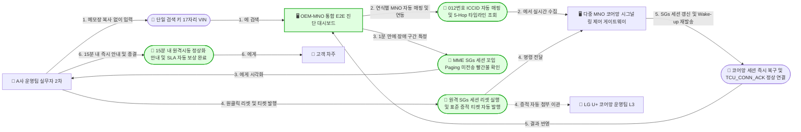
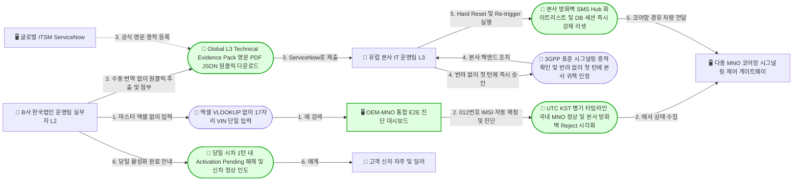

# P4: OEM-MNO 통합 End-to-End 구간 진단 대시보드 도입 후 장애 해결 스토리 (To-be)

- **스토리 ID**: `P4-e2e-diagnostic-dashboard-to-be`
- **제목**: OEM-MNO 통합 End-to-End 구간 진단 대시보드(OEM Dashboard) 도입을 통한 다자간 핑퐁 제거 및 즉시 원인 규명 스토리 (To-be)
- **기반 인터뷰**:
  - **Storyteller A**: 국내 완성차(A사) 커넥티드카 서비스 운영팀 실무자 (8년 차 과장)
  - **Storyteller B**: 수입차 한국법인(B사) 커넥티드카 운영팀 실무자
- **Moderator**: Domain Storytelling Facilitator
- **Modeler**: Domain Storytelling Modeler
- **Scope Factor**:
  - **Granularity**: **Fine-grained** (`VIN` 단일 검색, 5-Hop 시그널링 타임라인 조회, 원격 세션 리셋 실행, 영문 표준 기술 증적 원클릭 다운로드 및 티켓 첨부까지 상세 단계)
  - **Point in time**: **To-be** (`OEM-MNO 통합 E2E 진단 대시보드` 도입 후의 목표 업무 프로세스)
  - **Domain purity**: **Digitalized** (OEM-MNO 통합 E2E 진단 대시보드, 다중 MNO 코어망 시그널링 API 게이트웨이, 사내/글로벌 ServiceNow 연동 등 디지털 도구 명시)
- **출처 Transcript 및 As-is 스토리**:
  - Transcript: [P2-e2e-troubleshooting-transcript.md](file:///Users/goodnews/Documents/1.Projects/OEM%20Dashboard/docs/01-domain-stories/transcripts/P2-e2e-troubleshooting-transcript.md)
  - As-is 스토리: [P2-e2e-troubleshooting-as-is.md](file:///Users/goodnews/Documents/1.Projects/OEM%20Dashboard/docs/01-domain-stories/P2-e2e-troubleshooting-as-is.md)
- **작성 일자**: 2026-10-23

---

## 1. Actor 목록 (To-be)

| Actor ID | 이름 | 유형 | 역할 및 설명 (As-is 대비 변화) |
|---|---|---|---|
| `A_Cust` | 👤 고객 (차주) | 사람 (👤) | 원격시동 Timeout(국내차) 또는 신차/스토어 `Activation Pending`(수입차)을 겪은 고객. As-is의 26시간~8일 방치 대신 15분~당일(시차 1턴) 내 정상 서비스와 명확한 안내를 제공받음 |
| `A_CS` | 👤 1차 콜센터 상담원 | 사람 (👤) | 대시보드가 공유하는 **실시간 한글 원인 분류 코드**(음영지역 / 배터리 보호 Deep Sleep / 통신망 일시 지연)를 첫 통화에서 바로 확인하여 고객에게 정확히 안내함 |
| `A_Op` | 👤 A사 커넥티드카 운영팀 실무자 (2차) | 사람 (👤) | 메모장 키값 복사나 3사 포털 개별 OTP 로그인, 4자 핑퐁 없이 대시보드에서 `VIN` 단일 검색으로 1분 만에 장애 구간을 특정하고 원격 세션 리셋을 실행함 |
| `B_Op` | 👤 B사 한국법인 커넥티드 운영팀 실무자 (L2) | 사람 (👤) | 암호 걸린 마스터 엑셀 `VLOOKUP`이나 한글 이메일 수동 번역 노가다('인간 번역기')에서 벗어나, 대시보드에서 `VIN` 검색 후 영문 표준 기술 증적 팩을 원클릭 추출해 본사 L3 반려를 원천 차단함 |
| `S_E2E_Dash` | 🖥️ OEM-MNO 통합 E2E 진단 대시보드 (OEM Dashboard) | 시스템 (🖥️) | **[신규 핵심 플랫폼]** `VIN` 단일 검색으로 차량-통신 식별자(`012 번호`·`ICCID`·`IMSI`·`EID`·연식별 MNO)를 자동 매핑하고, `[앱 ↔ OEM/본사 클라우드 ↔ 국제 SMS Hub ↔ MNO 코어망(SMS-C/MME/PGW) ↔ 차량 TCU]` 전 구간 시그널링 타임라인(KST/UTC 병기) 시각화, 원격 세션 리셋(`Re-trigger`), 영문/국문 표준 기술 증적 리포트 원클릭 출력을 제공함 |
| `S_MNO_API` | 🖥️ 다중 MNO 코어망 시그널링 & 제어 게이트웨이 | 시스템 (🖥️) | 통신 3사(SKT/KT/LG U+)의 SMS-C, MME(SGs Paging), PGW/UPF(전용 APN 세션), eSIM 상태(SGP.02/SGP.32)를 표준화된 3GPP 코드로 대시보드에 연동하고 원격 세션 리셋을 수행하는 인터페이스 |
| `G_MNO_L3` | 👥 MNO 코어망 운영팀 (L3) | 그룹/조직 (👥) | 1차 장애데스크의 수기 이메일 핑퐁 없이, 대시보드가 자동 발행한 표준 시그널링 증적 티켓을 즉시 수신하여 코어망 장비(MME 패치 오류 등) 후속 조치를 수행함 |
| `G_HQ_L3` | 👥 유럽 본사 IT 운영팀 (L3) | 그룹/조직 (👥) | 한국법인이 첨부한 공식 `Global L3 Technical Evidence Pack(영문 PDF/JSON, 3GPP 표준 코드)`을 확인하고, 반려 없이 첫 턴에 본사 방화벽/SMS Hub 화이트리스트 및 DB 세션을 즉시 리셋함 |
| `S_SNOW` | 🖥️ 사내 및 글로벌 ITSM (ServiceNow) | 시스템 (🖥️) | 대시보드에서 생성된 국문/영문 표준 기술 증적 리포트가 자동(또는 원클릭) 첨부되어 귀책 조직(MNO L3 또는 유럽 본사 L3)으로 즉시 전달되는 티켓 시스템 |

> [!TIP]
> **As-is 대비 참여 Actor 단순화**:
> - **국내 완성차(시나리오 A)**: 장애의 원인이 통신사 MME SGs 세션 꼬임임이 대시보드에서 1분 만에 판별되므로, 무관한 **👥 사내 클라우드 플랫폼 운영팀**, **👥 사내 연구소 TCU 제어기 개발팀**, **👥 MNO 1차 B2B 장애데스크**를 거치는 불필요한 핑퐁 루프가 완전히 제거됩니다.
> - **수입차 한국법인(시나리오 B)**: **🖥️ 암호 걸린 PDI 개통 대장 마스터 엑셀**, **👥 국내 MNO 1차 장애데스크(두 줄 한글 이메일)**, **👤 딜러/고객 3자 동시 현장 테스트 조율** 과정이 완전히 제거됩니다.

---

## 2. Work Object 목록 (To-be)

| Work Object ID | 이름 | 등장 시나리오 | 설명 및 포함 데이터 |
|---|---|---|---|
| `WT_VIN_Query` | 📄 단일 검색 키 (`17자리 VIN`) | 시나리오 A (`#TA1`), 시나리오 B (`#TB1`) | 실무자가 대시보드 검색창에 입력하는 유일한 식별자. 메모장 복사나 마스터 엑셀 `VLOOKUP`이 필요 없음 |
| `WT_Auto_Map` | 📄 차량-통신 식별자 자동 매핑 헤더 | 시나리오 A (`#TA2`), 시나리오 B (`#TB2`) | `VIN` 입력 즉시 1초 만에 한 줄로 매핑되는 `VIN ↔ IMEI ↔ EID ↔ ICCID ↔ IMSI ↔ 012 번호(MSISDN) ↔ 담당 MNO(SKT/KT/LGU+) ↔ 망 세대(3G/LTE/5G)` 통합 정보 |
| `WT_5Hop_View_A` | 📄 5-Hop E2E 시그널링 타임라인 뷰 (국내차) | 시나리오 A (`#TA2`, `#TA3`) | `[1. 앱 명령 접수(RCV_OK: 녹색)] → [2. OEM 클라우드 발송(Submit_SM_Resp OK: 녹색)] → [3. MNO SMS-C 접수(녹색)] → [4. MNO MME SGs Paging 미전송(세션 꼬임: 빨간불)] → [5. 차량 TCU 모뎀(LTE Idle 대기중 / Paging 미수신: 노란불)]`이 한눈에 대조되는 진단 화면 |
| `WT_Session_Reset` | 📄 원격 SGs/회선 세션 리셋 및 Wake-up 재발송 명령 | 시나리오 A (`#TA4`, `#TA5`) | 실무자가 대시보드에서 클릭하여 MNO 코어망의 꼬인 SGs/PDP 세션을 강제 갱신(Detach/Re-attach 유도)하고 차량으로 Wake-up 신호를 즉시 재발송(`Re-trigger`)하는 제어 트랜잭션 |
| `WT_Auto_Ticket_A` | 📄 MNO 코어망 L3 표준 장애 티켓 (시그널링 증적 포함) | 시나리오 A (`#TA4`, `#TA5`) | 수기 엑셀 작성 없이 대시보드에서 원클릭으로 MNO 코어망 L3팀에 자동 발행되는 티켓. 구간별 타임스탬프와 MME SGs Paging 누락 시그널링 증적이 포함됨 |
| `WT_Timeline_B` | 📄 글로벌-로컬 E2E 타임라인 뷰 (UTC/KST 병기) | 시나리오 B (`#TB2`) | 국내 MNO 구간(`로컬 eSIM Enabled: 녹색`, `LTE Attach OK: 녹색`, `전용 APN IP 할당 OK: 녹색`, `TLS Handshake 통과: 녹색`)과 글로벌 본사 구간(`국제 SMS Hub MT-SMS 미인입: 빨간불`, `본사 클라우드 방화벽 MQTT CONNACK Reject: 빨간불`)을 UTC와 KST 병기 타임스탬프로 시각화한 화면 |
| `WT_Evidence_Pack` | 📄 Global L3 Technical Evidence Pack (영문 PDF/JSON) | 시나리오 B (`#TB3`, `#TB4`) | 유럽 본사 L3의 반려를 원천 차단하는 공식 영문 기술 증적 패키지. 3GPP/GSMA 표준 시그널링 코드(`Attach Status`, `PDP Context ID`, `MT-SMS Delivery Receipt`, `Firewall Reject Trace`)와 UTC 타임스탬프가 MNO 코어망 보증 포맷으로 수록됨 |
| `WT_HQ_Reset` | 📄 본사 방화벽/SMS Hub 화이트리스트 및 세션 강제 리셋 | 시나리오 B (`#TB4`, `#TB5`, `#TB6`) | 영문 표준 증적을 확인한 유럽 본사 L3가 첫 턴에 반려 없이 즉시 실행하는 글로벌 SMS 라우팅 복구 및 마스터 DB 프로비저닝 세션 초기화(`Hard Reset`) 조치 |

---

## 3. To-be 도메인 스토리 문장 (`#TA1~#TA6`, `#TB1~#TB6`)

### 3.1 To-be 시나리오 A: 국내 완성차(A사) 원격시동 Timeout 15분 내 즉시 해결 (`#TA1 ~ #TA6`)

1. **`#TA1` [D-Day 09:00, 티켓 접수 즉시]** 👤 **A사 커넥티드카 운영팀 실무자(2차)**가 1차 콜센터로부터 원격시동 Timeout(`ERR_TIMEOUT_408`) 기술지원 티켓을 넘겨받자마자, 🖥️ **OEM-MNO 통합 E2E 진단 대시보드** 검색창에 📄 **17자리 차대번호(`VIN`)**만 입력한다.
   - ✨ **해소된 Pain Point (`PP-05`, `PP-09`)**: 사내 어드민에서 `012 번호`와 `ICCID`를 메모장에 따로 복사하거나 연식별 공급 통신사(SKT/KT/LG U+)를 구별해 3개 브라우저에 개별 OTP로 로그인하던 수작업이 완전히 사라진다.

2. **`#TA2` [+10초, 09:00:10]** 🖥️ **OEM-MNO 통합 E2E 진단 대시보드**가 🖥️ **다중 MNO 코어망 시그널링 & 제어 게이트웨이**와 연동하여 해당 차량의 연식별 통신사(LG U+)·`012 번호(MSISDN)`·`ICCID`·`IMEI`를 📄 **차량-통신 식별자 자동 매핑 헤더**로 즉시 표시하고, `[앱 명령 접수(RCV_OK)] → [OEM 클라우드 발송(Submit_SM_Resp OK)] → [MNO SMS-C 접수] → [MNO MME/SGs Paging 송출] → [차량 TCU 모뎀 상태]`로 이어지는 📄 **5-Hop E2E 시그널링 타임라인 뷰**를 한 화면에 조회한다.

3. **`#TA3` [+1분, 09:01]** 👤 **A사 커넥티드카 운영팀 실무자(2차)**가 📄 **5-Hop E2E 시그널링 타임라인 뷰**에서 ① 앱 명령 접수(`녹색 정상`), ② OEM 클라우드 발송(`Submit_SM_Resp OK, 0.2초: 녹색 정상`), ⑤ 차량 TCU 모뎀 상태(`LTE Registered/Idle 정상 대기, 배터리 12.4V: 녹색 정상`)임을 확인함과 동시에, 4번째 구간인 **`[MNO MME SGs 세션 꼬임 - 기지국 Paging 미전송]` 구간에 빨간불(장애 원점)이 켜진 것**을 1분 만에 확인한다.
   - ✨ **해소된 Pain Point (`PP-05`)**: 사내 클라우드팀(Kibana 조회 1시간 소요)이나 사내 연구소 단말 개발팀(`TCU_DIAG_LOG.csv` 추출 및 분석 2시간 소요)에 문의할 필요가 없으며, 통신사 1차 장애데스크의 "단말 무응답(`Absent Subscriber`) 추정"이라는 잘못된 1차 회신에 속아 하루를 허비하는 삼각·사각 핑퐁이 원천 차단된다.

4. **`#TA4` [+3분, 09:03]** 👤 **A사 커넥티드카 운영팀 실무자(2차)**가 🖥️ **OEM-MNO 통합 E2E 진단 대시보드**에서 📄 **'원격 SGs/회선 세션 리셋 및 Wake-up 재발송(`Re-trigger`)' 버튼**을 클릭하여 실행하고, 동시에 버튼 하나로 📄 **'구간별 타임스탬프·3GPP 시그널링 증적 리포트'가 첨부된 표준 장애 티켓**을 👥 **LG U+ 코어망 운영팀(L3)** 앞으로 자동 발행한다.

5. **`#TA5` [+5분, 09:05]** 🖥️ **다중 MNO 코어망 시그널링 & 제어 게이트웨이**가 해당 `012` 회선의 꼬인 MME SGs 세션을 즉시 강제 갱신(Re-attach)하고 Wake-up SMS를 재발송하여 차량 TCU가 `TCU_CONN_ACK` 데이터 세션을 정상 연결하며, 👥 **LG U+ 코어망 운영팀(L3)**은 1차 장애데스크를 거치지 않고 수신한 📄 **표준 장애 티켓(시그널링 증적)**을 통해 새벽 MME 패치 중 발생한 SGs 세션 오류를 즉시 인지하고 코어망 일괄 보정 작업을 접수한다.

6. **`#TA6` [+15분, 09:15 종결]** 👤 **A사 커넥티드카 운영팀 실무자(2차)**(및 실시간 한글 상태 코드를 공유받은 👤 **1차 콜센터 상담원**)가 원격시동 정상 작동을 확인한 뒤, 👤 **고객(차주)**에게 **"아침 07:40 통신사 지역 교환기 세션 일시 지연으로 발생했으며 현재 원격 리셋으로 즉시 정상화 완료됨"**을 명확히 안내하고 약관·SLA 기준에 따른 자동 보상 처리를 완료하여 **티켓 접수 15분 만에 종결(`Closed`)**한다 (As-is 26시간 → **To-be 15분, 99% 단축**).

---

### 3.2 To-be 시나리오 B: 수입차 한국법인(B사) 개통·활성화 Pending 당일(시차 1턴) 해결 (`#TB1 ~ #TB6`)

1. **`#TB1` [Day 1 금요일 16:00, 티켓 접수 즉시]** 신차 인도장(또는 온라인 스토어 연장 결제 직후)에서 차량 화면이 `Activation Pending`에서 멈춘 민원이 접수되자, 👤 **B사 한국법인 커넥티드 운영팀 실무자(L2)**가 암호 걸린 PDI 개통 대장 마스터 엑셀을 여는 대신 🖥️ **OEM-MNO 통합 E2E 진단 대시보드** 검색창에 📄 **17자리 `VIN`**만 입력한다.
   - ✨ **해소된 Pain Point (`PP-10`)**: 팀 공용 폴더의 암호 걸린 마스터 엑셀에서 `VLOOKUP`으로 20자리 `ICCID`를 `012 번호`와 `IMSI`로 수동 변환하던 번거로운 작업이 완전히 제거된다.

2. **`#TB2` [+1분, Day 1 금요일 16:01]** 🖥️ **OEM-MNO 통합 E2E 진단 대시보드**가 📄 **`VIN ↔ IMEI ↔ EID ↔ ICCID ↔ IMSI ↔ 국내 012 번호` 자동 매핑 헤더**와 함께, **UTC 및 한국 시간(KST)이 나란히 병기된** 📄 **글로벌-로컬 E2E 타임라인 뷰**를 화면에 시각화한다. 실무자는 국내 MNO 구간(`① 로컬 eSIM SGP.02/SGP.32 Active: 녹색`, `② LTE 기지국 Attach OK: 녹색`, `③ 본사 전용 APN IP 할당 OK: 녹색`, `④ TLS Handshake 통과: 녹색`)은 100% 정상이나, 글로벌 본사 구간인 **`[⑤ 본사 글로벌 SMS Hub → 국내 MNO 관문 MT-SMS 미수신(0건): 빨간불]`** 및 **`[⑥ 유럽 본사 클라우드 방화벽 MQTT CONNACK / HTTPS 개통 요청 Reject: 빨간불]`**에 장애가 발생했음을 1분 만에 확인한다.
   - ✨ **해소된 Pain Point (`PP-10`)**: 한국법인 Read-only 권한 한계로 어디서 막혔는지 몰라 국내 MNO에 1·2차로 나누어 사정하고 딜러·고객과 오후 2시 '3자 동시 차량 재시도 테스트'를 조율하던 8일간의 소모전이 사라진다.

3. **`#TB3` [+5분, Day 1 금요일 16:05]** 👤 **B사 한국법인 커넥티드 운영팀 실무자(L2)**가 한글 화면 캡처나 수동 영문 번역 없이 🖥️ **OEM-MNO 통합 E2E 진단 대시보드**에서 📄 **'Global L3 Technical Evidence Pack (영문 PDF/JSON, 3GPP 표준 시그널링 코드 및 UTC 타임스탬프 공식 보증 포맷)'**을 원클릭 다운로드하여, 🖥️ **글로벌 ITSM(ServiceNow)**의 👥 **유럽 본사 IT 운영팀(L3)** 티켓에 첨부·발행한다.
   - ✨ **해소된 Pain Point (`PP-10`)**: 한글 포털 캡처에 빨간 네모 박스를 치고 두 줄짜리 한글 이메일을 영어로 번역해 올렸다가 본사 L3로부터 *"공식 Technical Evidence 불인정"*으로 2차례 반려당하던 '인간 번역기'의 설움이 완전히 해결된다.

4. **`#TB4` [Day 1 금요일 18:00, 유럽 본사 금요일 오전 근무 시간]** 👥 **유럽 본사 IT 운영팀(L3)**이 🖥️ **글로벌 ITSM(ServiceNow)** 티켓에 첨부된 📄 **`Global L3 Technical Evidence Pack` (국내 MNO 코어망이 보증한 3GPP 표준 `Attach/PDP Context OK`, `International SMS Hub Inbound: 0`, `HQ Firewall CONNACK Reject` 로그)**을 확인하고, 로컬 구간 입증 요구(`Awaiting Info`) 반려 없이 **첫 턴에 즉시 유럽 본사 측 귀책을 인정**한다.

5. **`#TB5` [Day 1 금요일 18:30]** 👥 **유럽 본사 IT 운영팀(L3)**이 즉시 📄 **본사 클라우드 방화벽/글로벌 SMS Hub 화이트리스트 갱신 및 본사 마스터 DB의 꼬인 프로비저닝 세션 강제 리셋(`Hard Reset` 및 `Re-trigger`)**을 실행하여, 글로벌 중계망과 국내 MNO 코어망을 통해 차량 TCU로 개통 활성화 명령이 즉시 전달된다.

6. **`#TB6` [Day 1 금요일 19:00, 당일 시차 1턴 내 해결]** 차량 IVI 화면의 `Activation Pending`이 즉시 `Active`로 전환되어 앱 원격 문열림이 정상 작동하고, 👤 **B사 한국법인 커넥티드 운영팀 실무자(L2)**는 전시장 현장의 딜러 및 👤 **고객(신차 차주)**에게 **장애 접수 당일(3시간 내, 유럽 시차 1턴)**에 정상 인도 완료를 안내하며 티켓을 종결한다 (As-is 8일 소요 → **To-be 당일 1턴 내 해결**).

---

## 4. Mermaid 도메인 스토리 다이어그램 (To-be)

> [!NOTE]
> To-be 다이어그램에서는 As-is의 붉은색 Pain Point 노드들이 제거되고, 핵심 해결 수단인 **OEM-MNO 통합 E2E 진단 대시보드**와 **자동 생성 증적/원격 리셋 Work Object**가 초록색(`classDef resolved fill:#e0ffe0,stroke:#2a2,stroke-width:2px`)으로 강조됩니다.

### 4.1 To-be 시나리오 A (`#TA1 ~ #TA6`): 국내 완성차 원격시동 Timeout 15분 내 즉시 진단 및 원격 세션 리셋

### 4.2 To-be 시나리오 B (`#TB1 ~ #TB6`): 수입차 한국법인 `Provisioning Pending` 영문 표준 증적 원클릭 추출 및 당일(시차 1턴) 해결

---

## 5. As-is 대비 제거된 Pain Point 및 성과 비교표

| 비교 항목 | As-is (현재 다자간 핑퐁 현실) | To-be (`OEM-MNO 통합 E2E 진단 대시보드` 도입 후) | 제거된 Pain Point 및 기대 효과 |
|---|---|---|---|
| **1. 식별자 조회 및 키값 변환** | - **국내차**: 사내 어드민에서 `VIN` 조회 후 메모장에 `012 번호`·`ICCID` 복사 → 연식별 3사 포털 개별 OTP 로그인 후 붙여넣기 - **수입차**: 암호 걸린 `PDI 개통 대장 마스터 엑셀`을 열어 `VLOOKUP`으로 `ICCID` → `012 번호`·`IMSI` 수동 변환 | - **공통**: 대시보드 검색창에 **`17자리 VIN`(또는 `Request ID`, `ICCID`) 단 하나만 입력**하면 `VIN ↔ IMEI ↔ EID ↔ ICCID ↔ IMSI ↔ 012 번호 ↔ 연식별 담당 MNO(3G/LTE/5G)` 1초 내 자동 매핑 | **`PP-05`, `PP-09`, `PP-10` 식별자 단절 해소** - 메모장 복사·붙여넣기, 3사 포털 개별 OTP 로그인, 암호 엑셀 `VLOOKUP` 수작업 100% 제거 |
| **2. 구간별 시그널링 가시성 (Observability)** | - OEM은 `Submit_SM_Resp OK`(발송 접수)까지만 보고, MNO 포털은 단순 `가입 정상`만 노출되어 **MNO 코어망(SMS-C ↔ MME SGs Paging ↔ 기지국 ↔ 전용 APN) 구간이 블랙박스화**됨 - 차량 단말 로그는 고객이 물리 시동(`IGN_ON`)을 걸기 전까지 확인 불가 | - **`[앱] → [OEM/본사 클라우드] → [국제 SMS Hub] → [MNO SMS-C] → [MNO MME SGs Paging] → [전용 APN/방화벽] → [차량 TCU]` E2E 타임라인(KST/UTC 병기)** 한 화면 제공 - 어느 Hop에서 신호가 끊겼거나 Reject 되었는지 빨간불로 1분 내 즉시 특정 | **`PP-05`, `PP-10` 블랙박스 및 핑퐁 제거** - 무관한 부서(사내 클라우드팀, 단말 연구소, MNO 1차 장애데스크)를 거치는 4자 핑퐁 및 3자 동시 현장 테스트 조율 제거 |
| **3. 글로벌 본사 L3 / 코어망 L3 증적 제출** | - 국내 MNO의 두 줄짜리 한글 이메일과 한글 포털 캡처에 빨간 네모 박스·영문 주석을 달아 번역 제출 → 유럽 본사 L3에서 **"공식 Technical Evidence 불인정"으로 2회 반려** ('인간 번역기' 노릇) | - 버튼 하나로 **3GPP/GSMA 표준 시그널링 코드와 UTC 타임스탬프가 보증된 `Global L3 Technical Evidence Pack (영문/국문 PDF·JSON)`** 원클릭 다운로드 및 티켓 자동 첨부 | **`PP-10` 영문 L3 반려 원천 차단** - 수동 한영 번역·캡처 편집 노가다 제거 및 유럽 본사 L3의 첫 턴 즉시 승인 유도 |
| **4. 장애 복구 액션 및 소요 시간 (Lead Time)** | - **국내차**: MNO L3 이관 및 원인 규명에 **26시간 소요** (출근길 골든타임 상실, 수동 기프티콘 발송) - **수입차**: 유럽 시차(1일 1턴) + 2회 반려 + 코어망 덤프 번역으로 **8일(일주일 남짓) 소요** | - **국내차**: 대시보드에서 **'원격 SGs/회선 세션 리셋 및 Wake-up 재발송'** 즉시 실행 → **15분 내 해결 (99% 단축)** - **수입차**: 첫날 영문 표준 증적 제출로 본사 방화벽/DB 즉시 리셋 → **당일(시차 1턴, 3시간 내) 해결 (95% 이상 단축)** | **고객 체감 품질 극대화 및 운영 비용 절감** - 1차 콜센터 상담원에게도 실시간 한글 원인 분류 코드를 공유하여 첫 통화 응대 및 약관·SLA 기반 즉각 보상 실현 |
