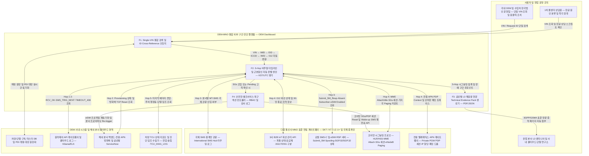

# 06. OEM-MNO 통합 End-to-End 구간 진단 대시보드 설계 블루프린트

> **문서 성격**: `P2-e2e-troubleshooting` 도메인 스토리텔링 워크숍(국내 완성차 시나리오 `#A1~#A13`, 수입차 한국법인 시나리오 `#B1~#B13`)에서 발굴된 실무 병목에 기반한 **To-Be 솔루션 아키텍처 및 기능 명세서**
> **작성자**: Domain Storytelling Listener (시니어 소프트웨어 아키텍트 / DDD 전문가)
> **목적**: *"원격제어·구독 활성화 장애 시 다자간 원인 규명 핑퐁 문제를 OEM사, 통신사 시스템, 네트워크 시스템 등과 연동해서 어디서 문제가 생겼는지 한눈에 볼 수 있는 대시보드/플랫폼을 만들면 어떨까?"*라는 질문에 대해, 현업 실무자(Storyteller A·B)가 요구한 데이터 필드·표준 시그널링 코드·증적 리포트·복구 액션을 완벽히 반영한 설계 청사진을 제시합니다.
> **신뢰도 태그 규칙**: 도메인 스토리에서 확인된 현상과 요구사항은 `[사실]`/`[추정]`/`[가정]`을 표기하고, 아키텍트의 시스템 설계안은 `[설계]`로 구분합니다.

---

## 1. Executive Summary: 왜 지금 26시간(국내 OEM) / 8일(수입차 법인)이 걸리는가?

겨울철 출근길 **원격시동(골든타임 10분)** 먹통이나 신차 인도장·온라인 스토어 결제 직후 **개통 활성화 대기(`Activation Pending`)** 장애가 발생했을 때, 현재 국내 완성차(A사)는 **4개 조직 간 26시간**, 수입차 한국법인(B사)은 **국경 간 3개 조직 사이에서 8일(약 192시간)** 동안 소모적인 핑퐁을 겪고 있습니다 `[추정][가정]`.

P2 도메인 스토리(`#A1~#A13`, `#B1~#B13`) 분석을 통해 입증된 **4대 구조적 단절(Structural Disconnections)**은 다음과 같습니다:

| 단절 차원 | 국내 완성차 (A사) 실무 현실 (`#A1~#A13`) | 수입차 한국법인 (B사) 실무 현실 (`#B1~#B13`) | 대시보드 핵심 해결 방향 (`[설계]`) |
|---|---|---|---|
| **① 식별자(ID) 및 포털 단절** | - OEM 어드민은 `VIN`/`Request ID` 기준이나 MNO 포털은 `VIN` 미존재 (`#A3, #A6`)<br>- 메모장에 `012 번호`·`ICCID`를 복사해 연식별 **3사(SKT/KT/LGU+) 포털에 각각 OTP 로그인** 및 상이한 엑셀 양식(`IMSI` vs `012`) 수기 작성 (`#A6, #A7`) | - 본사 글로벌 포털에는 `VIN`/`EID`/`ICCID`만 존재 (`#B3`)<br>- 공용 폴더의 암호 걸린 **'PDI 개통 대장 마스터 엑셀'**을 열어 **`VLOOKUP`으로 `ICCID` → `012 번호`·`IMSI` 수동 변환** (`#B6`) | **ID Cross-Reference Bridge**:<br>`VIN` 단일 검색 시 `IMEI ↔ EID ↔ ICCID ↔ IMSI ↔ 012(MSISDN) ↔ 담당 MNO/망세대` 실시간 자동 매핑 및 라우팅 |
| **② 타임존·언어·증적 포맷 단절** | - 클라우드 서버 로그(Kibana), MNO 교환기 이력, 차량 시동(`IGN_ON`) 후 올라온 `TCU_DIAG_LOG.csv`의 타임스탬프를 실무자가 수기로 대조 (`#A5, #A8, #A9`) | - **KST ↔ UTC 시차 수동 변환** 및 주말·야간 대기 (`#B4, #B5`)<br>- MNO 1차 두 줄 한글 이메일과 포털 캡처(빨간 박스+영문 주석)를 번역해 올려도 유럽 본사 L3가 **"공식 `Technical Evidence` 불인정"**으로 2차 반려 (`#B8~#B10`) | **KST/UTC Dual-Timeline & Evidence Pack**:<br>전 구간 타임스탬프 KST/UTC 병기 정렬 및 **3GPP/GSMA 표준 시그널링 코드 기반 영문 PDF/JSON 증적 리포트 원클릭 생성** |
| **③ 코어망 가시성(Observability) 단절** | - OEM 클라우드는 `Submit_SM_Resp OK`(SMS-C 접수)만 보고 "정상 발송" 주장 (`#A5`)<br>- MNO 1차 데스크는 HLR 정상 및 `Absent Subscriber(Spooling)`만 보고 "차량 단말 슬립 불량" 판정 (`#A8`)<br>- 실제 원인인 **MME 패치 중 `SGs` 인터페이스 꼬임(기지국 Paging 0건)**은 코어망 L3 분석까지 26시간 소요 (`#A10~#A12`) | - 한국법인은 Read-only 권한이라 본사 Wake-up 발송 로그 조회 불가 (`#B3`)<br>- 실제 원인인 **글로벌 `SMS Hub` 미인입(0건)** 및 **본사 전용 APN 방화벽의 상향 HTTPS `Reject/Reset`**을 밝히기 위해 딜러·고객·MNO 코어망 2선 엔지니어 **'3자 동시 테스트'** 수행 (`#B11~#B12`) | **5-Hop End-to-End Signaling Pinpointer**:<br>`[앱] → [OEM/본사 서버] → [SMS-C/RSP] → [MNO 코어망 MME Paging/SGs/전용 APN PGW] → [차량 TCU]` 5구간 상태 및 단절 지점(Red) 즉시 시각화 |
| **④ 제어 및 복구 권한(Action) 단절** | - MNO 1차 장애데스크는 시그널링 트레이스 및 세션 리셋 권한이 없어 코어망 L3로 이관 대기 (`#A11~#A12`)<br>- 차량 미시동 시 정비소 입고까지 5자 핑퐁 확대 위험 (`#A9`) | - 한국법인에는 본사 마스터 DB의 꼬인 `Provisioning Pending`을 초기화(`Hard Reset`)하거나 `Re-trigger`할 Write 권한이 전무하여 8일간 사과 전화만 반복 (`#B3, #B13`) | **Safe Self-Service Recovery Actions**:<br>1차 운영자 권한 내에서 안전한 **코어망 SGs/PDP 세션 Reset, Wake-up SMS 재전송, eSIM/프로비저닝 Re-trigger** 원클릭 실행 |

### 기대 효과 (As-Is vs To-Be MTTR 비교)
- **국내 완성차 (시나리오 A)**: 4개 부서 간 수동 캡처·엑셀 메일 핑퐁 **26시간 ➔ `VIN` 단일 조회 후 1분 내 원인(Hop 4 MME SGs 세션 꼬임) 특정 및 5분 내 코어망 세션 리셋 완료** `[설계]`
- **수입차 한국법인 (시나리오 B)**: 암호 엑셀 `VLOOKUP` + 영문 번역 반려 + 3자 동시 테스트 **8일(192시간) ➔ 첫날 5분 내 원인(Hop 3 국제 SMS Hub 미인입 + Hop 2 본사 방화벽 Reject) 특정 및 원클릭 영문 `Technical Evidence Pack` 첨부로 본사 L3 첫 턴(24시간 내) 즉시 해결** `[설계]`

---

## 2. End-to-End 5-Hop 진단 모델 (State & Hop Definition)

원격제어 명령(`RemoteStart`, `DoorUnlock` 등)과 구독·개통 프로비저닝(`RSP / Activation`) 트랜잭션이 거치는 전체 경로를 **5개의 표준 Hop**으로 정의하고, 각 Hop에서 수집해야 할 핵심 텔레메트리와 신호등(`Green` / `Amber` / `Red`) 판정 로직을 설계합니다 `[설계]`.

### 2.1 5-Hop 구간별 수집 데이터 및 상태 판정 명세

| Hop 구간 | 책임 주체 (Actor / System) | 수집 이벤트 및 핵심 상태 필드 (Telemetry Fields) | 🟢 정상 (Green) 조건 | 🟡 경고 (Amber) 조건 | 🔴 장애 (Red) 조건 |
|---|---|---|---|---|---|
| **Hop 1**<br>**[앱 & 사용자 요청]** | 고객 스마트폰 앱 / 차량 IVI / 1차 콜센터 CRM | - `request_id` (트랜잭션 ID), `command_type` (`RemoteStart`, `Provisioning` 등)<br>- `app_rcv_timestamp` (`RCV_OK` 시각)<br>- `subscription_status` (5년 무료 / 유료 활성 / 라이트 / 만료)<br>- `account_vin_binding` (계정-VIN 매핑 정상 여부) | - `RCV_OK` 정상 접수<br>- 구독 권한 `Active` 및 계정-VIN 바인딩 일치 (`#A2, #B2`) | - 동일 고객 3분 내 연속 재시도 (3회 이상 클릭 `#A1`)<br>- 무료 만료 유예기간 또는 명의이전 대기 상태 | - 앱 인증 토큰 만료 / API 게이트웨이 진입 전 클라이언트 에러<br>- 구독 권한 차단(라이트 전환 차량의 유료 명령 시도) |
| **Hop 2**<br>**[OEM / 해외본사 클라우드]** | 국내 OEM 클라우드(Kibana) / 수입차 유럽 본사 백엔드 & 방화벽 | - `cloud_proc_status` (API 게이트웨이 처리 및 큐 지연 시간)<br>- `wakeup_trig_sent_ts` (`SMS_TRIG_SENT` 또는 IP Push 발송 시각)<br>- `prov_db_state` (`Active` vs `Provisioning Pending` 고착 여부 `#B3`)<br>- `hq_firewall_tcp_resp` (차량 상향 HTTPS 패킷에 대한 본사 서버/방화벽 `200 OK` vs `TCP Reset/Reject` 여부 `#B12`) | - 클라우드 큐 지연 < 1초<br>- `SMS_TRIG_SENT` 정상 발송<br>- 상향 HTTPS 세션 `200 OK` 및 `TCU_CONN_ACK` 수신 | - 출근 시간대 API 게이트웨이 큐 지연 (3~15초)<br>- `Provisioning Pending` 5분 이상 지속 | - OEM 클라우드 내부 타임아웃/5xx 에러<br>- **본사 방화벽/서버가 차량 상향 HTTPS 패킷을 `Reject / TCP Reset` 차단** (`#B12`) |
| **Hop 3**<br>**[글로벌/로컬 SMS-C & eSIM RSP]** | 국제 SMS 중계망(`SMS Hub`) / 국내 MNO `SMS-C` / eSIM 서버(`SM-DP+/eIM`) | - `smpp_submit_resp` (OEM→SMS-C 발송 접수 코드: `Submit_SM_Resp OK` `#A5`)<br>- `intl_sms_hub_inbound` (해외본사→국내 MNO 관문 SMS 인입 건수 `#B12`)<br>- `smsc_delivery_state` (`Delivered` vs `Spooling / Absent Subscriber` `#A8`)<br>- `esim_profile_state` (로컬 프로파일 `SGP.02/SGP.32` `Enabled` vs `Disabled` 및 PDI 전환 시각 `#B5, #B12`) | - `Submit_SM_Resp OK` (< 0.5초)<br>- 국제 SMS Hub → 국내 SMS-C 정상 인입<br>- 로컬 eSIM 프로파일 `Enabled` | - SMS-C 일시 `Spooling` (1회 재전송 대기 중)<br>- PDI 로컬 프로파일 다운로드 진행 중 | - **해외본사發 Wake-up SMS가 국제 `SMS Hub`에서 누락되어 국내 MNO SMS-C 인입 0건** (`#B12`)<br>- 로컬 eSIM 프로파일 `Disabled` 또는 RSP 타임아웃 고착 |
| **Hop 4**<br>**[MNO 코어망: MME / SGs / 전용 APN PGW]** | 국내 MNO (SKT/KT/LGU+) `HLR/HSS`, `MME`, `eNodeB`, 전용 APN `PGW/UPF` | - `hlr_line_status` (`012` 회선 가입 상태: 정상/휴면/정지/해지 `#A6, #B6`)<br>- `mme_attach_state` (단말 망 등록 상태: `LTE Attached/Idle` vs `Detached` `#A10`)<br>- `sgs_interface_state` (MME↔MSC/SMS-C 간 `SGs` 세션 정상 여부 `#A12`)<br>- `enodeb_paging_count` (기지국 실제 Paging 송출 횟수 및 응답 여부 `#A10`)<br>- `private_apn_pdp_state` (본사 전용 APN `PDP Context` 활성 및 사설 IP 할당 여부 `#B12`)<br>- `network_gen_cell_status` (`3G/LTE/5G` 구분 및 3G 기지국 출력 저하/종료 예정 지역 여부 `#A6`) | - HLR `Active`, MME `Attached/Idle`<br>- **`SGs` 세션 정상 및 기지국 Paging 정상 송출 (> 0건)**<br>- 전용 APN `PDP Context Active` 및 IP 할당 완료 | - 약전계 지역 (RSRP 불량) 또는 핸드오버 중 페이징 지연<br>- **구형 `3G` 단말 장착 차량 + 2027 3G Sunset 대상 기지국 출력 저하 지역** (`#A6`) | - **MME 패치 등으로 `SGs` 세션이 꼬여 SMS-C 요청에도 기지국 Paging 송출 0건** (`#A10, #A12`)<br>- 전용 APN `PGW` 라우팅/터널 단절 또는 미판매 재고 휴면 미해제 |
| **Hop 5**<br>**[차량 TCU & eUICC]** | 차량 내장 `TCU` 모뎀 / `eUICC` / 차량 배터리 및 CAN 제어기 | - `mt_sms_ack` (단말의 Wake-up SMS 실제 수신 확인 `Delivery Report`)<br>- `tcu_power_mode` (`Normal` / `Sleep` / 배터리 보호 `Deep Sleep` `#A3, #A10`)<br>- `last_ign_off_voltage` (마지막 시동 OFF 시점 배터리 전압, 예: `12.4V` `#A3`)<br>- `tcu_conn_ack_ts` (깨어난 TCU의 OEM/본사 서버 데이터 세션 연결 시각 `#A3`)<br>- `tcu_diag_log_uploaded` (`IGN_ON` 시 `TCU_DIAG_LOG.csv` 업로드 여부 `#A9`) | - 단말 `MT-SMS Delivery Receipt` 응답 완료<br>- 배터리 전압 정상(≥ 12.0V) 및 `TCU_CONN_ACK` 90초 내 수립 | - 장기 주차로 배터리 보호 `Deep Sleep` 진입 직전(전압 < 11.8V)<br>- 지하주차장 진입 후 `Detached` (마지막 주차 위치 기반 추정) | - 지하 다층 주차장 등 완전 음영지역으로 기지국 Paging 무응답<br>- 차량 보조배터리 방전 / `Deep Sleep` 모뎀 전원 차단<br>- TCU 모뎀 펌웨어 행(Hang) 또는 하드웨어 불량 |

---

### 2.2 대표 장애 패턴 5종 자동 판별 매트릭스 (Root-Cause Pinpointing Matrix)

대시보드는 5개 Hop의 상태 조합을 분석하여 실무자와 1차 콜센터 상담원에게 **즉각적인 근본 원인 분류(Root-Cause Classification)**를 제시합니다 `[설계]`.

| 장애 패턴 | Hop 1<br>앱 요청 | Hop 2<br>OEM/본사 서버 | Hop 3<br>SMS-C / RSP | Hop 4<br>MNO 코어망 | Hop 5<br>차량 TCU | 자동 판정 결과 및 실무자/상담원 조치 가이드 |
|---|---|---|---|---|---|---|
| **패턴 ①**<br>**음영지역 주차 또는 차량 배터리 Deep Sleep**<br>*(차량/환경 요인)* | 🟢 정상<br>(`RCV_OK`) | 🟢 정상<br>(`SMS_TRIG_SENT`) | 🟡 대기<br>(`Submit_SM OK` → `Spooling`) | 🟢 정상<br>(`SGs OK`, **기지국 Paging N회 정상 송출**) | 🔴 무응답<br>(Paging ACK 없음 / `Detached` 또는 저전압) | **[판정: 차량 음영지역 또는 배터리 절전 모드]**<br>- 통신사 망(Paging 송출 완료)과 OEM 서버는 모두 정상입니다.<br>- **1차 콜센터 안내**: "현재 차량이 지하주차장 등 전파 음영지역에 있거나 배터리 보호 절전(Deep Sleep) 상태로 확인됩니다. 직접 시동을 걸면 정상 복귀됩니다." |
| **패턴 ②**<br>**MNO 코어망 MME `SGs` 세션 꼬임 / Paging 누락**<br>*(P2 시나리오 A `#A12`)* | 🟢 정상<br>(`RCV_OK`) | 🟢 정상<br>(`SMS_TRIG_SENT`) | 🟡 착시 주의<br>(`Submit_SM OK` → `Absent Subscriber`) | 🔴 **장애**<br>(MME `Idle`이나 **`SGs` 세션 불량으로 기지국 Paging 0건**) | 🟢 정상 대기<br>(`LTE Registered / Idle`, 전압 12.4V) | **[판정: MNO 코어망 교환기(MME SGs) 페이징 누락]**<br>- ⚠️ **1차 회신 착시 방지**: SMS-C에 `Absent Subscriber`가 찍혔으나 기지국 Paging 송출 자체가 0건이므로 **차량 단말 불량이 아닙니다**.<br>- **조치**: 대시보드에서 `[SGs/MME 세션 Reset]` 실행 또는 MNO 코어망 L3로 증적 즉시 전송. |
| **패턴 ③**<br>**글로벌 `SMS Hub` 라우팅 누락 (국제 관문 미인입)**<br>*(P2 시나리오 B `#B12` 전반)* | 🟢 정상<br>(앱/IVI 활성화 요청) | 🟡 본사 주장<br>(본사 서버 `Wake-up Sent` 기록) | 🔴 **장애**<br>(**국제 `SMS Hub` → 국내 MNO SMS-C 인입 0건**) | 🟢 정상<br>(로컬 eSIM `Enabled`, LTE `Attached`, 전용 APN 정상) | 🟢 정상 대기<br>(전용 APN IP 할당 완료, 명령 대기 중) | **[판정: 해외본사 ↔ 국제 SMS 중계망(SMS Hub) 구간 누락]**<br>- 국내 MNO 망은 100% 정상이나 본사가 보낸 Wake-up SMS가 한국 관문 교환기에 도착하지 않았습니다.<br>- **조치**: `[영문 Technical Evidence Pack]`을 생성해 유럽 본사 L3에 국제 SMS Hub 라우팅 점검 요청. |
| **패턴 ④**<br>**본사 클라우드 DB 상태 꼬임 및 전용 APN 방화벽 `Reject`**<br>*(P2 시나리오 B `#B12~#B13` 후반)* | 🟢 정상<br>(인도장/스토어 요청) | 🔴 **장애**<br>(`Provisioning Pending` 고착 + **본사 방화벽 `TCP Reset/Reject`**) | 🟢/🟡<br>(로컬 eSIM `Enabled`, PDI 타임아웃 이력) | 🟢 정상<br>(기지국 `Attached`, **전용 APN `PGW` 상향 패킷 정상 라우팅**) | 🟢 정상 발신<br>(차량 TCU가 전용 APN으로 HTTPS 요청 송신 중) | **[판정: 해외본사 백엔드 DB 상태 꼬임 및 방화벽 차단]**<br>- 차량 TCU가 국내 MNO 전용 APN을 통해 상향 HTTPS 패킷을 정상 송신 중이나, **유럽 본사 서버 IP에서 `TCP Reset/Reject`로 거부**하고 있습니다.<br>- **조치**: 본사 L3에 패킷 드롭 증적 제출 및 `[본사 프로비저닝 Re-trigger / DB Reset]` 실행. |
| **패턴 ⑤**<br>**PDI 로컬 eSIM 미전환 또는 구형 3G 망 종료(Sunset) 품질 저하**<br>*(P2 `#B5`, `#A6`)* | 🟢 정상 | 🟢 정상 | 🔴/🟡<br>(로컬 eSIM `Disabled` 또는 3G 회선) | 🔴/🟡<br>(로컬 망 Attach 불가 또는 **3G 기지국 출력 저하/종료 예정 지역**) | 🔴 연결 실패<br>(부트스트랩 로밍 고착 또는 3G 신호 미약) | **[판정: PDI 로컬 프로파일 미전환 또는 3G Sunset 지역 품질 저하]**<br>- (수입차) 평택항 PDI에서 `SGP.02/SGP.32` 프로파일이 `Enabled`로 전환되지 않았습니다 → `[eSIM RSP 상태 재동기화]` 실행.<br>- (구형 3G차) 2027년 3G 종료 대상 기지국 출력 저하 지역입니다 → 3G 전환/보상 안내 스크립트 연결. |

---

## 3. 시스템 연동 아키텍처 (Integration Architecture)

흩어져 있는 OEM 사내 시스템, 해외 본사 포털/ITSM, 그리고 국내 통신 3사(SKT, KT, LG U+)의 코어망·회선 관리 시스템을 단일 인터페이스로 묶는 **통합 진단 플랫폼 아키텍처**입니다 `[설계]`.

### 3.1 연동 대상 시스템 상세

1. **OEM / 수입차 법인 측 연동 대상 (OEM & NSC Side)**:
   - **차량·단말·구독 마스터 원장**: `VIN`, 차종/연식, 출고/인도일, 구독 상태(5년 무료/유료/라이트/차등 패키지), 장착 TCU `IMEI`·`eUICC(EID)`·`ICCID` 매핑 원장 (`#A2, #A3, #B3`).
   - **원격명령 및 프로비저닝 게이트웨이 로그**: `Request ID`, `RCV_OK`, `SMS_TRIG_SENT`, `Submit_SM_Resp`, `TCU_CONN_ACK`, `ERR_TIMEOUT_408` 타임스탬프 및 본사 전용 APN 방화벽 응답(`200 OK` / `TCP Reset`) 로그 (`#A3, #A5, #B12`).
   - **PDI 개통 및 출고 매핑 DB**: 수입차 한국법인이 암호 걸린 엑셀(`PDI 개통 대장 마스터 엑셀`)로 수동 관리하던 평택항 PDI 입항 차량의 `VIN ↔ EID ↔ ICCID ↔ 국내 012 MSISDN ↔ IMSI` 매핑 데이터 (`#B6`).
   - **차량 단말 진단 로그 수집기**: 차량 시동(`IGN_ON`) 또는 주기적 리포트로 올라오는 마지막 배터리 전압, 주차 위치(행정동), `TCU_DIAG_LOG.csv` 요약 파라미터 (`#A3, #A9, #A10`).
   - **티켓/ITSM 시스템 (양방향 Webhook/API)**: 국내 OEM CS/기술지원 포털(ServiceNow, Jira) 및 수입차 로컬 CRM(Salesforce) ↔ 유럽 본사 글로벌 ITSM(ServiceNow L3) (`#A2, #A4, #B2, #B4`).

2. **국내 MNO(통신 3사) 및 글로벌 중계망 연동 대상 (MNO & Network Side)**:
   - **3사 B2B IoT 회선 관리 게이트웨이 (SKT / KT / LG U+)**: `012 MSISDN`·`ICCID`·`IMSI` 기준 회선 개통 상태(시험개통/물류휴면/정상사용중/일시정지/해지), 요금제, 당월 데이터 사용량, 망 세대(`3G/LTE/5G`) (`#A6, #B6`).
   - **SMS-C 및 국제 SMS Hub 시그널링 어댑터**: OEM/본사發 Wake-up SMS의 국제 관문 인입 여부(`International SMS Hub Inbound`), SMS-C 접수(`Submit_SM_Resp`), 착신 단말 전달 상태(`Delivered` vs `Spooling / Absent Subscriber` Cause Code) (`#A5, #A8, #B10, #B12`).
   - **코어망 시그널링 요약 프로브 (MME / HLR / HSS / eNodeB Probe)**: 실시간 또는 On-demand 조회 시점의 단말 망 등록 상태(`Attached/Idle/Detached`), **MME↔MSC 간 `SGs` 인터페이스 세션 상태**, **기지국(`eNodeB`) 실제 Paging 송출 카운트 및 타임스탬프**, 서빙 기지국 행정동 위치 및 무선 품질/3G 노후 상태 요약 (`#A10, #A11, #A12`).
   - **전용 텔레매틱스 APN 게이트웨이 (`Private PGW / UPF`)**: 차량 TCU의 전용 APN `PDP Context / PDU Session` 수립 상태, 할당된 사설 IP, 상·하향(Uplink/Downlink) 패킷 바이트 수 및 본사 서버 구간의 `TCP Reset / ICMP Drop` 감지 요약 (`#B5, #B10, #B12`).
   - **eSIM 원격 프로비저닝 서버 (`GSMA SGP.02 SM-DP/SM-SR` & `SGP.32 SM-DP+/eIM`)**: 로컬 MNO 프로파일 다운로드 성공 여부, 현재 프로파일 상태(`Enabled` / `Disabled`), 마지막 상태 변경 시각 (`#B3, #B5, #B12`).

---

### 3.2 ID Cross-Reference Bridge (식별자 자동 매핑 및 타임존 정규화 엔진)

실무자가 메모장에 `012 번호`를 복사하거나 암호 걸린 엑셀에서 `VLOOKUP`을 돌리고 3사 포털에 개별 OTP로 로그인하는 수작업(`PP-05a`, `PP-10a`)을 완전히 제거하는 핵심 브릿지 테이블 구조입니다 `[설계]`.

| 식별자 계층 | 필드명 (Column) | 예시 값 (국내차 A사 / 수입차 B사) | 원천 소유 시스템 (Source of Truth) | 대시보드 브릿지 역할 |
|---|---|---|---|---|
| **차량 식별자** | `vin` (PK) | `KMHXX00XXXX000001` / `WBAXX00XXXX000002` | OEM 차량 마스터 / 본사 글로벌 포털 | **실무자 단일 검색 키** (17자리 차대번호) |
| **차종·연식·규제 메타** | `model_year_meta` | `2024년식 SUV` / `2014년식 세단(3G)` | OEM 차량 마스터 | 연식별 공급 MNO 자동 판별 및 3G Sunset 대상 경고 |
| **단말 하드웨어 ID** | `tcu_imei` | `35890110XXXXXXX` | 부품사 납품 원장 / 라인오프 매핑 | MNO IMEI-유심 매칭 검증 및 단말 덤프 로그 매칭 키 |
| **eUICC 칩 ID** | `euicc_eid` | `89049032XXXXXXXXXXXX` (32자리) | TCU 제조사 / 본사 eIM 서버 | 수입차 `SGP.02/SGP.32` 로컬 프로파일(RSP) 상태 조회 키 |
| **SIM 프로파일 ID** | `sim_iccid` | `89820675XXXXXXXXXXXX` (19~20자리) | MNO 개통 원장 / PDI 개통 대장 | 글로벌 포털(`VIN-ICCID`)과 국내 MNO(`ICCID-012`)를 잇는 **핵심 연결 고리** |
| **망 가입자 식별자** | `mno_imsi` | `45006XXXXXXXXXX` / `45008XXXXXXXXXX` | 국내 MNO HLR/HSS | 코어망(MME Paging, SGs, PGW) 시그널링 트레이스 필수 키 (`#A6, #B6`) |
| **사물통신 착신번호** | `msisdn_012` | `012-1234-5678` | 국내 MNO B2B 회선 관리 전산 | SMS-C Wake-up 도달 이력 및 B2B 회선 상태 조회 키 |
| **담당 통신사 라우팅** | `mno_routing_code` | `LGU_LTE` / `KT_5G` / `SKT_3G` | ID Bridge 자동 매핑 규칙 | **3사 개별 OTP 로그인 없이 해당 MNO 어댑터 API로 자동 라우팅** |

---

### 3.3 통합 시스템 연동 아키텍처 다이어그램 (Mermaid)

> **표기 규칙 준수**: 모든 노드 및 서브그래프 라벨을 큰따옴표(`""`)로 감싸고 소괄호를 배제했습니다.



---

## 4. 핵심 기능 4대 모듈 상세 명세 (Key Features)

### F1. Single-VIN Unified Search (단일 차대번호 통합 검색 및 다중 통신사 자동 라우팅)
- **해결하는 Pain Point**: `PP-04`, `PP-05a` (메모장 `012` 복사 및 3사 포털 개별 OTP 로그인), `PP-10a` (암호 걸린 PDI 개통 대장 엑셀 `VLOOKUP` 수작업)
- **기능 상세 (`[설계]`)**:
  1. **Universal Search Bar**: 실무자가 `VIN`(17자리), `Request ID`, `012 번호(MSISDN)`, `ICCID`, `IMEI` 중 **어느 값 하나만 입력**해도 상단 헤더 카드에 **6대 핵심 식별자(`VIN - IMEI - EID - ICCID - IMSI - 012 MSISDN`)와 차종·연식·담당 통신사(SKT/KT/LGU+)·망 세대(3G/LTE/5G)**를 1초 내에 한 줄로 펼쳐 보여줍니다.
  2. **PDI 개통 대장 자동 흡수 (Excel-Free)**: 수입차 평택항 PDI 센터에서 로컬 프로파일(`SGP.02/SGP.32`) 개통이 일어나는 즉시 MNO 개통 원장과 본사 `VIN-ICCID` 매핑을 DB로 자동 동기화하여, 암호 걸린 엑셀 파일과 `VLOOKUP`을 완전히 폐기합니다 (`#B6`).
  3. **Multi-MNO SSO & Auto-Routing**: 차량 연식에 따라 2020년식(SKT/KT), 2024년식(LG U+), 2025년식(KT) 회선이 섞여 있어도 백엔드에서 해당 통신사 어댑터 API를 자동 호출하므로, 실무자가 브라우저 3개를 띄우고 휴대폰 OTP를 반복 입력할 필요가 없습니다 (`#A6`).
  4. **KST ↔ UTC Dual-Timestamp Normalizer**: 국내 클라우드/MNO 로그(KST)와 유럽 본사/글로벌 SMS Hub 로그(UTC)를 수집 즉시 밀리초(`ms`) 단위로 정규화하여, 화면의 모든 타임라인에 **`2026-10-23 07:40:12 KST (2026-10-22 22:40:12 UTC)`** 형태로 병기합니다 (`#B4, #B11`, Round 4).

---

### F2. 5-Hop Visual Timeline & Root-Cause Pinpointer (구간별 시그널링 타임라인 및 원인 핀포인터)
- **해결하는 Pain Point**: `PP-05b` (`Submit_SM_Resp OK` vs `Absent Subscriber` 착시 및 MME SGs 블랙박스), `PP-05c` (물리 시동 전 단말 귀책 판별 불가), `PP-09` (3G 종료 지역 파악 불가), `PP-10c` (국제 SMS Hub 및 전용 APN 방화벽 블랙박스)
- **기능 상세 (`[설계]`)**:
  1. **5-Hop 신호등 파이프라인 뷰**: 화면 상단에 `Hop 1 [앱] ➔ Hop 2 [OEM/본사 서버] ➔ Hop 3 [SMS-C/RSP] ➔ Hop 4 [MNO 코어망] ➔ Hop 5 [차량 TCU]` 5개 박스를 배치하고, 정상 구간은 🟢 `Green`, 지연/주의 구간은 🟡 `Amber`, 신호가 끊긴 최초 단절 구간은 🔴 `Red (Root-Cause Pinpoint)` 배지로 강조합니다.
  2. **"가짜 단말 무응답(`Absent Subscriber`)" 자동 간파 로직**:
     - 기존에는 SMS-C에 `Absent Subscriber`가 찍히면 MNO 1차 장애데스크가 무조건 "차량 TCU 슬립 복귀 불량 또는 음영지역"이라고 잘못 회신했습니다 (`#A8`).
     - 대시보드는 **Hop 3의 `Absent Subscriber`**와 **Hop 4의 `MME Attach State` 및 `eNodeB Paging Count`**를 교차 검증합니다.
     - 만약 **`MME State == Registered (Idle)`인데 `eNodeB Paging Count == 0`이고 `SGs State == Detached/Error`**이면, 차량이 물리 시동(`IGN_ON`)을 걸어 `TCU_DIAG_LOG.csv`를 올리기 전이라도 즉시 **"🔴 MNO 코어망 MME SGs 세션 오류 (차량 단말 정상 대기 중, 기지국 Paging 미송출)"**로 정확히 판정합니다 (`#A10, #A12`).
  3. **국경 간(Cross-Border) 블랙박스 가시화**:
     - 수입차 `Provisioning Pending` 발생 시, **① 로컬 eSIM 프로파일 `Enabled` 여부**, **② 국제 SMS Hub → 국내 MNO SMS-C 인입 건수(`0건` 여부)**, **③ 전용 APN `PDP Context` IP 할당 상태**, **④ 차량 상향 HTTPS 패킷에 대한 본사 방화벽 `TCP Reset/Reject` 응답 코드**를 한 화면에 대조하여 3자 동시 테스트 없이도 1분 만에 귀책을 특정합니다 (`#B11~#B12`).
  4. **1차 콜센터 상담원용 '한글 친화적 원인 요약 배너'**:
     - 통신 전문 용어를 모르는 L1 콜센터 상담원 화면에는 *"현재 원격시동 실패 원인: [통신망 교환기 일시 세션 지연] — 고객 과실이나 차량 고장이 아니므로 정비소 입고 안내 금지, 즉시 세션 리셋 후 재시도 안내 또는 약관/내규 보상 쿠폰 발송"*처럼 명확한 한글 응대 가이드를 실시간 노출합니다 (`Storyteller A Round 4 요구사항`).

---

### F3. Global L3 Technical Evidence Pack Generator (글로벌 본사/귀책부서 제출용 표준 기술 증적 생성기)
- **해결하는 Pain Point**: `PP-10b` (국내 MNO 한글 두 줄 회신 및 빨간 박스 화면 캡처가 유럽 본사 L3에서 "공식 `Technical Evidence` 불인정"으로 2차례 반려되는 문제), `PP-05` (사내 클라우드·연구소·MNO 간 엑셀/캡처 수작업 전달)
- **기능 상세 (`[설계]`)**:
  1. **One-Click Official Evidence Export (`PDF` / `JSON` / `CSV`)**:
     - 실무자가 한글 화면을 캡처해 빨간 네모 박스를 치고 영어로 번역할 필요 없이, **`[📄 Generate L3 Technical Evidence Pack (EN/KR)]`** 버튼 하나만 누르면 **국내 MNO 코어망 시스템이 디지털 서명(System-certified)한 3GPP/GSMA 표준 시그널링 증적 리포트**가 즉시 생성됩니다 (`Storyteller B Round 4 요구사항`).
  2. **ServiceNow / Jira Direct Attachment**:
     - 생성된 영문 PDF 및 JSON 패킷 요약본을 글로벌 ITSM(`ServiceNow` L3 티켓)이나 사내 `Jira` 티켓에 API로 즉시 첨부하고, 영문 표준 기술 코멘트(Root-Cause Summary)를 자동 기입합니다.
  3. **영문 표준 기술 증적 (`Technical Evidence Pack`) JSON 스키마 예시**:
     ```json
     {
       "evidence_pack_id": "TEP-20261023-KR-B00912",
       "generated_at_utc": "2026-10-23T08:15:30Z",
       "generated_at_kst": "2026-10-23T17:15:30+09:00",
       "certifying_mno": "KR_MNO_LGUPLUS_CORE_PROBE_V2",
       "vehicle_identifiers": {
         "vin": "WBAXX00XXXX000002",
         "imei": "358901109988776",
         "euicc_eid": "89049032001122334455667788990011",
         "iccid": "89820675123456789012",
         "imsi": "450061234567890",
         "msisdn": "82-12-XXXX-XXXX"
       },
       "esim_rsp_evidence_gsma": {
         "standard": "GSMA_SGP32_v1.0",
         "local_profile_state": "ENABLED",
         "pdi_activation_timestamp_utc": "2026-10-16T05:20:11Z"
       },
       "core_network_3gpp_signaling": {
         "hlr_hss_subscription": "ACTIVE_NORMAL",
         "eps_mm_state": "EMM_REGISTERED_IDLE",
         "sgs_association_state": "SGS_ASSOCIATED_OK",
         "serving_plmn_id": "450-06",
         "rat_type": "EUTRAN_LTE",
         "private_apn_name": "telematics.oem-hq.global.mnc006.mcc450.gprs",
         "pdp_context_status": "ACTIVE",
         "allocated_ue_ip": "10.142.88.21"
       },
       "cross_border_traffic_verification": {
         "inspection_window_utc": "2026-10-16T07:30:00Z to 2026-10-16T08:00:00Z",
         "intl_sms_hub_mt_sms_inbound_count": 0,
         "smsc_mt_forward_sm_status": "NOT_RECEIVED_FROM_INTL_HUB",
         "uplink_https_packets_from_tcu": 14,
         "hq_destination_ip": "195.XX.XX.104:443",
         "downlink_response_from_hq_firewall": "TCP_RST_REJECT (3GPP_PGW_FLOW_TRACE)"
       },
       "automated_root_cause_verdict": {
         "fault_domain": "HOP2_HQ_BACKEND_AND_HOP3_INTL_SMS_HUB",
         "local_kr_mno_status": "VERIFIED_NORMAL_NO_FAULT",
         "recommended_l3_action": "1. Reset stuck Provisioning_Pending flag in HQ Master DB. 2. Allow TCU IP/TLS session on HQ Telematics Firewall. 3. Check International SMS Hub routing to KR PLMN 450-06."
       }
     }
     ```

---

### F4. Safe Self-Service Recovery Actions (안전한 원격 세션 리셋 및 재동기화 제어)
- **해결하는 Pain Point**: `PP-05` (MNO 코어망 L3 수동 리셋까지 26시간 대기), `PP-10c` (한국법인에 Reset/Re-trigger 권한이 없어 8일간 대기)
- **기능 상세 (`[설계]`)**:
  1. **Action 1 — `[🔄 MNO 코어망 SGs / 데이터 세션 Soft Reset]`**:
     - 시나리오 A(`#A12`)처럼 MME 정기 패치 후 `SGs` 세션이 꼬였거나 전용 APN `PDP Context`가 유령 세션(Ghost Session)으로 고착된 경우, 운영팀 실무자가 버튼 클릭 한 번으로 MNO 코어망에 **`Cancel Location / Detach & Re-attach 유도 신호`**를 보내 차량 모뎀이 기지국 및 교환기 세션을 즉시 갱신하도록 만듭니다.
  2. **Action 2 — `[📨 Wake-up SMS 강제 재발송 (Direct Trigger)]`**:
     - 일시적 무선 페이징 실패나 SMS-C `Spooling` 대기 건에 대해, 90초 타임아웃 후 멈춰 있는 세션을 깨우기 위해 MNO SMS-C 큐를 플러시(Flush)하고 즉시 Wake-up SMS를 재전송합니다.
  3. **Action 3 — `[⚡ 프로비저닝 Re-trigger & eSIM RSP 상태 재동기화]`**:
     - 시나리오 B(`#B3, #B13`)처럼 국내 MNO 망과 로컬 eSIM(`Enabled`)은 정상임이 시스템으로 검증(`Green`)되었으나 본사 백엔드만 `Provisioning Pending`에 걸려 있는 경우, 한국법인 운영자(L2)가 본사 마스터 DB 전체 Write 권한 없이도 **안전하게 검증된 단일 차량 프로비저닝 재시도(`Safe Re-trigger API`)**를 호출할 수 있게 합니다.
  4. **안전장치 (Guardrails & RBAC)**:
     - 차량이 **주행 중(`IGN_ON / Moving`)일 때는 코어망 세션 Reset 버튼을 자동 비활성화(Disabled)**하여 주행 중 안전(eCall/내비)에 영향을 주지 않도록 방어합니다.
     - 모든 원격 액션은 회선당 1일 최대 3회로 Rate-limit을 걸고 감사 로그(Audit Trail)에 실행자와 사유를 기록합니다.

---

## 5. 화면 레이아웃 구상 (ASCII / Markdown Wireframe)

실무자가 `VIN`을 검색했을 때 단일 화면에서 **① 6대 식별자 브릿지, ② 5-Hop 신호등 핀포인터, ③ KST/UTC 통합 시그널링 타임라인, ④ 원클릭 증적 출력 및 원격 복구 액션**을 수행하는 상세 대시보드 와이어프레임입니다 `[설계]`.

```text
+======================================================================================================+
| 🚗 OEM-MNO E2E Connected Car Diagnostics Platform                        [User: A사/B사 운영팀 L2]   |
+======================================================================================================+
| 🔍 통합 검색: [ KMHXX00XXXX000001                  ] [조회]  (지원키: VIN / Request ID / 012 / ICCID)|
|               🕒 조회 시간대: [ 2026-10-22 07:30 ~ 08:00 ]  🌐 타임존 표시: [x] KST + UTC 병기       |
+------------------------------------------------------------------------------------------------------+
| 📋 [F1] 차량 · 단말 · 다중 통신사 ID Cross-Reference 카드 (엑셀 VLOOKUP & 3사 OTP 로그인 자동 대체)  |
| ---------------------------------------------------------------------------------------------------- |
| • 차대번호(VIN) : KMHXX00XXXX000001 (2024년식 SUV)   • 구독 상태 : 🟢 5년 무료 활성 (계정 연동 정상) |
| • 단말 IMEI     : 35890110XXXXXXX                    • eUICC EID : 89049032001122334455667788990011  |
| • 유심 ICCID    : 89820675123456789012               • 가입 IMSI : 450061234567890                   |
| • 착신 012 번호 : 012-1234-5678                      • 담당 MNO  : 🟣 LG U+ (LTE / 전용 APN 정상)    |
+======================================================================================================+
| 🎯 [F2] End-to-End 5-Hop 신호등 파이프라인 & 자동 원인 판별 (Root-Cause Pinpointer)                  |
| ---------------------------------------------------------------------------------------------------- |
|  +--------------+     +----------------+     +-----------------+     +----------------+     +------+ |
|  | 🟢 Hop 1     |     | 🟢 Hop 2       |     | 🟡 Hop 3        |     | 🔴 Hop 4 [장애]|     |🟢Hop5| |
|  | 스마트폰 앱  | ==> | OEM/본사 서버  | ==> | SMS-C / eSIM    | ==> | MNO 코어망     | =X= | 차량 | |
|  | RCV_OK (3건) |     | SMS_TRIG_SENT  |     | Submit_SM OK    |     | SGs 세션 꼬임! |     | TCU  | |
|  | 권한 정상    |     | 큐 지연 0.1초  |     | (Spooling 대기) |     | 기지국Paging 0건|     | Idle | |
|  +--------------+     +----------------+     +-----------------+     +----------------+     +------+ |
|                                                                                                      |
|  🚨 [자동 판정 결과 — 패턴 ② : MNO 코어망 교환기(MME SGs 인터페이스) 페이징 누락]                    |
|  • 상세 근거: OEM 서버는 Wake-up SMS를 정상 발송(Submit_SM_Resp OK)했고, 차량 TCU 모뎀도 현재        |
|    LTE 기지국에 정상 대기(Registered/Idle, 배터리 12.4V) 중입니다. 그러나 MNO LTE 교환기(MME)의      |
|    SGs 세션 불량으로 기지국(eNodeB) Paging 송출이 0건에 그쳐 SMS-C에 가짜 'Absent Subscriber'가      |
|    기록되었습니다. (※ 차량 단말 불량이나 지하주차장 음영이 아님!)                                    |
|  • 💬 [1차 콜센터 상담원 안내 가이드]: "차량 결함이 아닌 통신망 교환기 일시 세션 지연입니다.         |
|    정비소 입고 안내 불필요. 운영팀에서 즉시 세션 리셋 후 재시도 안내 예정입니다."                    |
+======================================================================================================+
| ⏱️ [F2] 구간별 시그널링 상세 타임라인 (KST / UTC Dual-Timestamp)          [트랜잭션: REQ-2026-0740A] |
| ---------------------------------------------------------------------------------------------------- |
| 시각 (KST / UTC)               | Hop   | 발생 시스템       | 시그널링 이벤트 / 표준 코드    | 상태   |
| ------------------------------ | ----- | ----------------- | ------------------------------ | ------ |
| 07:40:01.102 (22:40:01.102 Z)  | Hop 1 | 고객 스마트폰 앱  | RemoteStart 요청 접수 (RCV_OK) | 🟢 정상|
| 07:40:01.215 (22:40:01.215 Z)  | Hop 2 | OEM 클라우드 GW   | Wake-up 발송 (SMS_TRIG_SENT)   | 🟢 정상|
| 07:40:01.410 (22:40:01.410 Z)  | Hop 3 | LGU+ SMS-C 관문   | SMPP Submit_SM_Resp: 0 (OK)    | 🟢 정상|
| 07:40:01.850 (22:40:01.850 Z)  | Hop 4 | LGU+ MME (OO구)   | SGs_Paging_Req ➔ SGs_Detached  | 🔴 실패|
| 07:40:02.000 (22:40:02.000 Z)  | Hop 4 | 기지국 (eNodeB)   | RF Paging 송출 건수: 0건       | 🔴 누락|
| 07:40:05.000 (22:40:05.000 Z)  | Hop 3 | LGU+ SMS-C 큐     | Absent Subscriber ➔ Spooling   | 🟡 대기|
| 07:41:31.215 (22:41:31.215 Z)  | Hop 2 | OEM 클라우드 서버 | TCU_CONN_ACK 미수신 (ERR_408)  | 🔴 만료|
| [참고: Hop 5 차량 상태]        | Hop 5 | 차량 TCU / 모뎀   | EMM_REGISTERED_IDLE / 12.4V    | 🟢 정상|
+======================================================================================================+
| 🛠️ [F3 & F4] 원클릭 증적 출력 및 셀프서비스 복구 액션 (차량 정차 상태 확인됨: IGN_OFF — 실행 가능)  |
| ---------------------------------------------------------------------------------------------------- |
|  [ 🔄 Action 1: MNO 코어망 SGs/MME 세션 Soft Reset ]   [ 📨 Action 2: Wake-up SMS 즉시 재전송 ]      |
|  [ ⚡ Action 3: 본사 프로비저닝 / eSIM Re-trigger  ]   [ 📄 F3: 영문 Technical Evidence Pack (PDF) ] |
|  [ 🔗 ServiceNow / Jira 티켓에 표준 증적 자동 첨부 ]                                                 |
+======================================================================================================+
```

---

## 6. 단계별 도입 로드맵 (Phased Implementation Roadmap)

통신 3사 코어망 연동의 보안·망분리 장벽과 해외 본사 IT 거버넌스 승인 일정을 고려하여, 실무자의 고통을 가장 빠르게 덜어주는 **3단계 점진적 구축 전략**을 제안합니다 `[설계]`.

| 단계 (Phase) | 목표 및 범위 | 핵심 구현 내용 | 해결되는 Pain Point 및 기대 효과 |
|---|---|---|---|
| **Phase 1**<br>**단일 MNO 코어망 가시화 & ID 브릿지 자동화**<br>*(단기: 1~3개월)* | **엑셀 `VLOOKUP`·메모장 복사 제거 및 주력 MNO 코어망 시그널링 가시화** | - **ID Cross-Reference DB 구축**: OEM `VIN` 원장 및 수입차 `PDI 개통 대장 엑셀`을 DB화하여 `VIN ↔ IMEI ↔ EID ↔ ICCID ↔ IMSI ↔ 012` 단일 검색 구현 (`F1`)<br>- **주력 MNO 1곳 코어망 프로브 연동**: 단순 B2B 가입 상태 외에 `SMS-C Delivery/Spooling 코드`, `MME Attach/SGs 상태`, `전용 APN PGW 세션` On-demand 조회 API 연동 (`F2`)<br>- **KST/UTC 타임존 자동 병기 뷰어** 적용 | - 암호 걸린 엑셀 `VLOOKUP` 및 수기 키값 변환 시간 **0초화** (`PP-05a, PP-10a`)<br>- `Submit_SM_Resp OK` vs `Absent Subscriber` 착시로 인한 1차 오판 즉시 차단 (`PP-05b`) |
| **Phase 2**<br>**OEM/본사 게이트웨이 통합 & 영문 Evidence Pack**<br>*(중기: 4~6개월)* | **End-to-End 5-Hop 완성 및 유럽 본사 L3 1차 통과용 표준 증적 자동화** | - **OEM 클라우드(Kibana) & 국제 SMS Hub 로그 통합**: Hop 1~5 전체 타임라인을 단일 화면에 정렬 (`F2`)<br>- **Global L3 Technical Evidence Pack Generator (`F3`)**: 3GPP/GSMA 표준 시그널링 코드와 전용 APN 패킷 트레이스 요약이 담긴 **영문 공식 PDF/JSON 리포트 원클릭 출력** 및 ServiceNow/Jira API 자동 첨부<br>- **1차 콜센터 상담원용 한글 원인 분류 배너** 연동 | - 수입차 한국법인의 한글 이메일 영문 번역 노가다 및 본사 L3의 `Technical Evidence` 불인정 반려 완전 해소 (`PP-10b`)<br>- 수입차 장애 해결 기간 **8일 ➔ 24시간 이내**로 단축 |
| **Phase 3**<br>**다중 MNO(3사) 표준 어댑터 & 원격 복구 액션**<br>*(장기: 7~12개월)* | **통신 3사 완전 통합(OTP 제거) 및 1차 운영자 셀프서비스 복구 완성** | - **SKT · KT · LG U+ 3사 표준 진단 어댑터 완성**: 연식별 다중 통신사 및 `3G/LTE/5G` 망 세대(3G Sunset 출력 저하 지역 포함) 단일 포털 통합 조회 (`PP-04, PP-09`)<br>- **Safe Self-Service Recovery Actions (`F4`)**: 주행 상태(`IGN_ON`) 안전장치가 결합된 **코어망 SGs/PDP 세션 Soft Reset**, **Wake-up SMS 재전송**, **본사 프로비저닝 `Re-trigger`** API 연동 | - 연식별 3사 포털 개별 OTP 로그인 및 엑셀 양식 노가다 완전 폐기 (`PP-04`)<br>- 국내 완성차 4자 핑퐁 **26시간 ➔ 5분 내 셀프 복구** 달성 (`PP-05`) |

---

## 7. 아키텍트 후속 기술 검증 질문 (Next Technical Discovery Questions)

다음 워크숍이나 기술 검토 회의에서 MNO 코어망 엔지니어 및 OEM 클라우드/보안팀과 확정해야 할 기술 질문입니다:
1. **[MNO 코어망 조회 방식 — Streaming vs On-Demand Pull]**: 수백만 회선 전체의 `MME Paging / SGs` 시그널링 로그를 실시간 스트리밍 수집하는 것은 트래픽·보안 부담이 크므로, 평시에는 B2B 기본 상태만 유지하다가 **실무자가 대시보드에서 특정 `VIN`을 검색한 순간(On-Demand) 해당 `IMSI/012`의 최근 24시간 코어망(SMS-C/MME/PGW) 시그널링 요약만 Pull API로 가져오는 구조**가 MNO 내부 망분리 정책상 가장 현실적인가?
2. **[본사 방화벽 `TCP Reset` 감지 위치]**: 시나리오 B(`#B12`)에서 차량 상향 HTTPS 개통 패킷이 유럽 본사 방화벽에서 `Reject/Reset`되는 현상은 **국내 MNO의 전용 APN 관문(`Private PGW`) 패킷 미러링/플로우 로그**에서 자동 감지하여 대시보드 Hop 2/Hop 4에 즉시 표시할 수 있는가?
3. **[원격 세션 Reset 안전 조건]**: 대시보드에서 `MNO 코어망 SGs/PDP 세션 Soft Reset`을 호출할 때, 해당 차량이 현재 고속도로 주행 중이거나 eCall 긴급통화 중이 아님을 어떤 플래그(예: OEM 서버의 마지막 `IGN_OFF` 상태 + PGW 실시간 활성 트래픽 임계치 이하)로 이중 검증할 것인가?
