# 커넥티드카 관제 플랫폼 개인정보보호 및 정보보안 규격서
## (Connected Car Privacy & Security Compliance Guide)

> **문서 번호**: SEC-COMP-2026-001  
> **버전**: v1.0  
> **최초 작성일**: 2026-10-23  
> **주관 부서**: CPO/CISO 조직 커넥티드카 정보보안/컴플라이언스팀  
> **적용 대상**: LG U+ B2B 모빌리티 사업부, OEM 협력사(국내 A사, 유럽 B사 한국법인), 관제 플랫폼 개발 및 운영팀 전체  

---

## 1. 개요 및 컴플라이언스 기본 원칙 (Executive Summary)

### 1.1 목적 및 배경
본 문서는 LG U+ 및 자동차 OEM(국내 완성차 A사, 수입차 한국법인 B사 등)이 공동 운영하는 **'커넥티드카 End-to-End 통합 구간 진단 대시보드'** 내에서 차주(차량 소유주) 및 실제 운전자의 개인정보(PII)와 개인위치정보를 안전하게 보호하고, 국내외 주요 법령을 완벽하게 준수하기 위한 기술적·관리적 보안 규격을 규정합니다.

대시보드의 핵심 목적은 **통신·차량 E2E 장애(원격시동 타임아웃, 신차 개통 지연 등)를 골든타임(5분~당일) 내에 신속히 진단·해결**하는 것이지만, **"장애 진단 편의를 이유로 차주의 사생활과 헌법상 통신비밀이 침해되어서는 절대로 안 된다"**는 대원칙을 견지합니다.

### 1.2 관련 법령 및 규제 기준
본 가이드는 다음의 국내외 법률 및 컴플라이언스 기준에 직접적인 법적 근거를 둡니다:

| 관련 법령 / 규정 | 주요 적용 조항 | 대시보드 플랫폼 적용 사항 |
|---|---|---|
| **개인정보 보호법** | 제2조(정의), 제3조(원칙), 제28조의2(가명정보의 처리), 제28조의8(국외 이전), 제29조(안전조치의무) | - 최소 수집 및 처리의 원칙 준수<br>- 차주명, 일반 휴대폰 번호(010), 계정 ID 수집 및 화면 표출 원천 배제<br>- 단말/망 식별자의 가명화 및 화면 마스킹<br>- 글로벌 본사 리포트 전송 시 국외 이전 요건 충족 |
| **위치정보의 보호 및 이용 등에 관한 법률** | 제15조(위치정보 수집 제한), 제18조(개인위치정보의 이용·제공 제한), 제23조(안전조치의무) | - **정밀 GPS 위경도 좌표(Lat/Lon) 표출 절대 금지**<br>- 기지국(Cell ID) 매핑 **행정동 단위(Coarse Location)**로 추상화 표기<br>- 차량의 실시간/과거 주행 궤적(Breadcrumbs) 조회 차단 |
| **통신비밀보호법 & 전기통신사업법** | 제3조(통신비밀보호), 제30조(전기통신업무상 비밀누설 금지), 제83조(통신자료 제공) | - 통신 세션 로그 및 시그널링 데이터의 비인가 열람 통제<br>- 패킷 페이로드(내용) 배제 및 순수 네트워크 헤더/상태 코드만 취급 |
| **EU GDPR** | 제44조~제50조 (제3국 데이터 이전), 제5조(Data Minimisation) | - 유럽 본사(L3)로 전송되는 증적 리포트의 **Zero PII Principle** 적용<br>- 개인 식별 요소가 제거된 순수 3GPP/GSMA 표준 시그널링 증적만 전송 |

---

## 2. 개인정보(PII) 및 식별자 취급 원칙 (Data Governance)

### 2.1 식별자 계층 분류 및 결합 분리 원칙 (Separation of Concerns)
커넥티드카 데이터는 기기/통신 식별자와 소유자(개인) 식별자로 엄격히 분리하여 관리해야 합니다.

```mermaid
flowchart LR
    subgraph PII_DOMAIN["[A영역: 차주 개인정보 원장 - 대시보드 접근 차단]"]
        OWNER_NAME["차주 성명"]
        OWNER_PHONE["연락처 (010-XXXX-XXXX)"]
        OWNER_ADDR["상세 주소 (주민등록지)"]
        OWNER_ACCOUNT["OEM 고객 계정 (Email/PW)"]
    end

    subgraph ID_BRIDGE["[ID Cross-Reference Bridge (비식별 바인딩)]"]
        VIN_HASH["VIN (차대번호 - 가명화 PK)"]
    end

    subgraph MNO_DEVICE_DOMAIN["[B영역: 기기/망 엔지니어링 영역 - 관제 대시보드 허용]"]
        TCU_IMEI["단말 IMEI"]
        SIM_ICCID["유심 ICCID"]
        MNO_IMSI["망 가입자 IMSI"]
        MSISDN_012["M2M 번호 (012-XXXX-XXXX)"]
        SIGNALING["3GPP 시그널링 상태코드"]
    end

    PII_DOMAIN -.->|"물리적/논리적 접근 차단 (Air-Gap DB)"| ID_BRIDGE
    ID_BRIDGE === MNO_DEVICE_DOMAIN
```



1. **원천 배제 대상 (Never Collect / Never Display)**:
   - 차주 성명(`홍길동`), 주민등록번호, 차주 개인 이동전화번호(`010-xxxx-xxxx`), 생년월일, 자택/직장 상세 주소, 결제 신용카드 정보.
   - 관제 대시보드는 백엔드 DB 설계 단계부터 차주 PII 컬럼을 참조하지 않으며, API 응답 JSON에도 일절 포함하지 않습니다.
2. **기술적 식별자(Pseudonymous Identifiers) 취급**:
   - `VIN`(차대번호), `IMEI`(단말기 식별번호), `ICCID`(SIM 카드 일련번호), `IMSI`(가입자 식별자), `012 번호`(M2M 사물통신 번호)는 차량과 통신망을 식별하는 필수 엔지니어링 키입니다.
   - 법적으로 단독으로는 기기 정보이나, OEM의 고객 원장과 결합 시 개인을 식별할 수 있으므로 **가명정보에 준하는 안전성 확보 조치(화면 마스킹, 권한별 차등 노출, 열람 로그 보관)**를 반드시 적용합니다.

### 2.2 화면(UI) 마스킹 규칙 명세
관제 플랫폼의 모든 화면, 검색 결과, 아코디언, 콘솔 로그에는 다음의 마스킹 룰이 강제되어야 합니다:

| 식별자 항목 | 규격 예시 | UI 화면 마스킹 표준 | 권한별 노출 정책 (L1 상담원 vs L2 운영자) |
|---|---|---|---|
| **차대번호 (VIN)** | `KMHXX00XXXX000001` (17자리) | `KMHXX00******0001` (중간 6자리 마스킹) | - **L1**: 앞 5자리 + 뒤 4자리만 표시 (`KMHXX******0001`)<br>- **L2**: 업무상 전문 확인 필요 시 '마스킹 해제(사유입력)' 후 30초간 전문 열람 |
| **M2M 번호 (012 MSISDN)** | `012-1234-5678` | `012-****-5678` (중간 국번 4자리 마스킹) | - **L1**: 마스킹 유지 (`012-****-5678`)<br>- **L2**: 마스킹 유지 (SMS-C 큐 수동 조회 시에만 해제 승인) |
| **단말 IMEI** | `358901104482910` (15자리) | `358901******910` (중간 6자리 마스킹) | - **L1**: 전체 비노출 (또는 요약 배지만 노출)<br>- **L2**: 마스킹 노출 |
| **유심 ICCID** | `89820675240315000019` (19~20자리) | `898206**********0019` (중간 10자리 마스킹) | - **L1**: 마스킹 노출<br>- **L2**: 마스킹 노출 |
| **가입자 IMSI** | `450061029384756` (15자리) | `45006******4756` (중간 6자리 마스킹) | - **L1**: 완전 비노출 (상담원 업무 무관)<br>- **L2**: 마스킹 노출 |
| **eUICC EID** | `89049032001122334455667788000001` | `89049032******************0001` | - **L1**: 완전 비노출<br>- **L2**: 마스킹 노출 |

---

## 3. 차량 위치정보 취급 및 보호 규격 (위치정보법 준수)

### 3.1 정밀 GPS 좌표 수집 및 노출 절대 금지
- 차량의 실시간 GPS 좌표(위도·경도) 및 과거 주행 궤적(Breadcrumbs / Traces)은 위치정보법상 가장 민감한 **개인위치정보**에 해당합니다.
- 대시보드의 목적은 "원격제어 및 네트워크 장애 진단"이므로, 차량의 이동 경로나 정밀 위치는 **진단에 전혀 불필요한 과다 정보(Over-collection)**입니다.
- **금지 사항**:
  1. 위도/경도(예: `37.5132° N, 127.1001° E`) 형태의 수치 표출 절대 금지.
  2. 지도(Map View) 상에 차량의 핀 포인트 또는 실시간 이동 마커 렌더링 금지.
  3. 시계열 위치 변경 이력(어디서 어디로 이동했는지) 추적 테이블 금지.

### 3.2 Coarse Location (기지국 셀 매핑 행정동 단위) 표준화
- 네트워크 진단 상 차량이 어느 교환국/기지국 관할에 물려 있는지 확인하는 용도로만 위치 정보를 사용합니다.
- 기지국 셀 식별자(`Cell Global Identifier / eNodeB ID`)를 주소 변환 엔진과 매핑하여, **시·군·구·읍·면·동(법정동/행정동) 단위**까지만 일반화(Generalization)합니다.
- **표기 표준 및 부적합 사례**:
  - ❌ **부적합 (위치 특정 및 사생활 노출 위험)**:  
    `"서울 송파구 잠실동 엘스아파트 102동 지하 2층 45번 기둥"`  
    `"서울 강남구 신사동 B사 전시장 2층 인도장"`  
    `"경기 성남시 분당구 정자동 123-45 번지 주상복합 지하 5층"`
  - 🟢 **적합 (보안 및 컴플라이언스 준수 표준)**:  
    `"서울 송파구 잠실동 (서빙 eNodeB: 송파국사 #SP-104 관할)"`  
    `"서울 강남구 신사동 (기지국 셀 정상 권역)"`  
    `"경기 성남시 분당구 정자동 (지하 심층 추정 · 전파 음영)"`  
    `"강원 평창군 대관령면 (LTE Band 5 외곽 기지국 셀 경계)"`

---

## 4. 글로벌 L3 증적 리포트(Technical Evidence Pack) 보안 규격 (Zero PII Compliance)

### 4.1 국외 이전(Cross-Border Transfer) 준수 요건
수입차 한국법인(B사)에서 독일 등 해외 본사 L3 엔지니어링 큐로 리포트를 전송할 때, 개인정보보호법 제28조의8 및 EU GDPR 제44조 이하 규정이 적용됩니다.
- 본 플랫폼이 발행하는 `Technical Evidence Pack (TEP)`은 **"통신망 장애 원인을 소명하기 위한 순수 3GPP/GSMA 표준 시그널링 기술 증적"**으로 한정합니다.
- 차주의 식별이 불가능하도록 PII를 100% 제거하는 **Zero PII Principle**을 충족함으로써 국외 이전에 따른 법적 리스크를 원천 차단합니다.

### 4.2 필드별 포함/제외(Allowlist / Denylist) 명세

| 구분 | 필드명 | 포함 여부 | 보안 처리 기준 |
|---|---|:---:|---|
| **배제 대상 (Denylist)** | 고객 성명, 이메일, 거주지 주소 | ❌ **절대 금지** | JSON 스키마에서 필드 자체를 영구 제외 |
| **배제 대상 (Denylist)** | 차주 개인 이동전화 (010) | ❌ **절대 금지** | 포함 불가 |
| **배제 대상 (Denylist)** | 정밀 GPS 좌표 및 주행 속도/궤적 | ❌ **절대 금지** | 위치정보 국외 이전 이슈 방지 위해 제외 |
| **제한적 허용 (Pseudonymized)**| 차대번호 (`vin`) | ⚠️ **조건부 허용** | 제조사 본사 DB에서 차량 사양 확인을 위한 필수 키로 허용 |
| **제한적 허용 (Pseudonymized)**| 착신번호 (`msisdn`) | ⚠️ **마스킹 필수** | `82-12-****-5678` 형태로 중간 4자리 마스킹 강제 |
| **기술 증적 허용 (Allowlist)** | `evidence_pack_id` | 🟢 **허용** | 증적 고유 번호 (예: `TEP-20261022-KR-A00104`) |
| **기술 증적 허용 (Allowlist)** | UTC / KST 타임스탬프 | 🟢 **허용** | 타임존 정규화 타임스탬프 |
| **기술 증적 허용 (Allowlist)** | 하드웨어 식별자 (`imei`, `iccid`, `eid`, `imsi`) | 🟢 **허용** | 본사 eSIM(SGP.32) 및 라우팅 소명을 위한 기술 규격 |
| **기술 증적 허용 (Allowlist)** | 3GPP 망 상태 코드 | 🟢 **허용** | `EMM_REGISTERED`, `SGS_ASSOCIATED_OK`, `eNodeB Paging Count` 등 |
| **기술 증적 허용 (Allowlist)** | IP 패킷 플로우 메타데이터 | 🟢 **허용** | 전용 APN IP(`10.142.88.21`), 본사 서버 IP(`195.XX.XX.104`), `TCP_RST_REJECT` 등 |
| **기술 증적 허용 (Allowlist)** | 디지털 서명 (`digital_signature`) | 🟢 **허용** | 위변조 방지를 위한 SHA-256 전자서명 해시값 |

```json
// [규격 준수] 글로벌 L3 기술 증적 리포트(JSON) 표준 예시
{
  "evidence_pack_id": "TEP-20261016-KR-B00912",
  "generated_at_utc": "2026-10-16T08:05:30Z",
  "generated_at_kst": "2026-10-16T17:05:30+09:00",
  "certifying_mno": "KR_MNO_CORE_AND_PRIVATE_PGW_CERTIFIED_PROBE",
  "digital_signature": "SHA256:4b227777d4dd1fc61c6f884f48641d02b4d121d3fd328cb08b5531fcacdabf8a",
  "compliance_status": "ZERO_PII_VERIFIED",
  "vehicle_identifiers": {
    "vin": "WBAXX00XXXX000002",
    "imei": "358901******776",
    "euicc_eid": "89049032******************0011",
    "iccid": "898206**********9012",
    "imsi": "450061******890",
    "msisdn": "82-12-****-5432"
  },
  "core_network_3gpp_signaling": {
    "eps_mm_state": "EMM_REGISTERED_CONNECTED",
    "sgs_association_state": "SGS_ASSOCIATED_OK",
    "serving_plmn_id": "450-06",
    "rat_type": "EUTRAN_LTE",
    "pdp_context_status": "ACTIVE",
    "allocated_ue_ip": "10.142.88.21"
  },
  "cross_border_traffic_verification": {
    "intl_sms_hub_mt_sms_inbound_count": 0,
    "uplink_https_packets_from_tcu": 14,
    "hq_destination_ip": "195.XX.XX.104:443",
    "downlink_response_from_hq_firewall": "TCP_RST_REJECT (3GPP_PGW_FLOW_TRACE)"
  }
}
```

---

## 5. 역할 기반 접근 제어(RBAC) 및 감사 추적(Audit Trail)

### 5.1 RBAC 권한 매트릭스
대시보드 사용자의 업무 역할(Role)에 따라 조회 가능한 데이터의 범위와 실행 가능한 복구 권한을 엄격히 통제합니다.

| 기능 및 데이터 항목 | L1 콜센터 상담원 (CS Agent) | L2 관제 운영자 (Tier-2 Ops) | L3 코어망/해외본사 엔지니어 | 시스템 관리자 (Admin) |
|---|:---:|:---:|:---:|:---:|
| **단일 VIN/번호 검색** | O | O | O | O |
| **5-Hop 요약 신호등 뷰** | O | O | O | O |
| **한글 응대 스크립트 열람** | **주요 업무 (O)** | O | - | O |
| **차량 및 식별자 마스킹** | **강제 마스킹 (O)** | 업무상 승인 시 해제 가능 | 마스킹 | 관리자 전용 |
| **3GPP 시그널링 타임라인** | X (상세 비노출) | **상세 열람 (O)** | **상세 열람 (O)** | O |
| **MNO 코어망 SGs 세션 리셋**| X (권한 없음) | **실행 가능 (O, IGN_OFF 시)**| X | O (비상 시) |
| **본사 Safe Re-trigger** | X | **실행 가능 (O)** | 실행 가능 | O |
| **Global L3 증적 생성/다운로드** | X | **실행 가능 (O)** | **열람/검증 (O)** | O |
| **감사 로그(Audit Trail) 열람**| X | X | X | **전용 열람 (O)** |

### 5.2 조회 사유 및 티켓 바인딩(Ticket Binding)
- 운영자나 상담원이 차량의 정보를 조회하거나 복구 액션을 실행할 때, 반드시 **유효한 인시던트 티켓 번호(ServiceNow Incident ID, 사내 Jira 티켓 번호, 고객센터 인입 콜 ID)**가 시스템에 바인딩되어야 합니다.
- 티켓 번호 없는 무단 조회(Curiosity Searching, 연예인/지인 차량 조회 등)는 시스템적으로 차단됩니다.

### 5.3 감사 추적(Audit Trail) 필수 기록 규격
개인정보보호법 시행령 제30조 및 위치정보법 제24조에 따라, 모든 조회 및 원격 제어 행위는 다음의 형식으로 위변조 방지 로그 저장소(WORM 스토리지 등)에 최소 **3년간 안전하게 보관**되어야 합니다:

```json
{
  "audit_event_id": "AUDIT-20261023-094512-8821",
  "timestamp_utc": "2026-10-23T00:45:12.104Z",
  "timestamp_kst": "2026-10-23T09:45:12.104+09:00",
  "actor": {
    "user_id": "op_lgu_0421",
    "user_name": "김운영",
    "department": "LG U+ 커넥티드카 품질관제2팀",
    "assigned_role": "L2_OP",
    "client_ip": "10.220.45.112"
  },
  "action_type": "REMOTE_SESSION_RESET",
  "target_vehicle": {
    "vin_hash": "e3b0c44298fc1c149afbf4c8996fb92427ae41e4649b934ca495991b7852b855",
    "masked_vin": "KMHXX00******0001",
    "masked_012": "012-****-5678"
  },
  "justification": {
    "ticket_system": "SERVICENOW",
    "ticket_id": "INC0098123",
    "customer_consent_flag": true,
    "reason_category": "TROUBLESHOOTING_REMOTE_START_TIMEOUT"
  },
  "execution_result": {
    "status": "SUCCESS",
    "response_code": "SGS_RESET_ACK_200",
    "duration_ms": 450
  }
}
```

---

## 6. 현행 구현 점검 결과 및 개발팀 즉시 조치 사항 (Action Items)

### 6.1 현행 소스코드 점검 종합 결과

| 점검 파일 | 점검 항목 | 현행 상태 | 보안성 평가 | 조치 필요도 |
|---|---|---|:---:|:---:|
| `mock-data.js` | 차주 PII (이름/전화/계정) | 직접적인 PII(홍길동, 010) 미포함 | 🟢 양호 | 저위험 |
| `mock-data.js` | 위치정보 표기 방식 | `"서울 송파구 잠실동 지상주차장"` 등 구체 장소 표기 | 🟡 주의 | **보완 필요** (기지국/행정동 단위로 일반화) |
| `mock-data.js` | L3 증적 리포트(JSON) | `evidencePack.vehicle_identifiers.msisdn` 평문 노출 (`82-12-1234-5678`) | 🔴 미흡 | **즉각 수정** (중간 국번 마스킹 `82-12-****-5678`) |
| `app.js` | 식별자 화면 마스킹 | VIN, 012, IMSI, ICCID, IMEI 전체 평문 출력 | 🔴 미흡 | **즉각 수정** (마스킹 함수 적용 및 RBAC 분리) |
| `app.js` | 역할 분리 (RBAC) | `L1_CS` 선택 시 단순히 DOM `display: none` 처리 | 🟡 주의 | **개선 필요** (L1 뷰 시 데이터 자체 마스킹 렌더링) |
| `app.js` | 감사 로그 (Audit Trail) | 화면 콘솔(DIV)에 단순 텍스트 append | 🟡 주의 | **개선 필요** (감사 로그 구조체 및 컴플라이언스 배너 추가) |
| `index.html` | 보안/개인정보 보호 배너 | 시스템 전반의 컴플라이언스/비식별 조치 안내 미흡 | 🟡 주의 | **개선 필요** (상단 헤더에 Zero-PII 및 마스킹 인디케이터 배치) |

### 6.2 개발팀 즉시 조치 가이드 (Immediate Action Items)

#### [Action 1] `mock-data.js` 수정
1. **L3 Evidence Pack의 MSISDN 마스킹**:
   - `msisdn`: `"82-12-1234-5678"` ➔ `"82-12-****-5678"`
   - `msisdn`: `"82-12-9876-5432"` ➔ `"82-12-****-5432"`
   - `msisdn`: `"82-12-5555-8888"` ➔ `"82-12-****-8888"`
   - `msisdn`: `"82-12-2014-3333"` ➔ `"82-12-****-3333"`
2. **위치정보의 행정동/기지국 단위 표준화**:
   - `"서울 송파구 잠실동 지상주차장"` ➔ `"서울 송파구 잠실동 (서빙 eNodeB #SP-104 정상 권역)"`
   - `"서울 강남구 신사동 B사 전시장 인도장"` ➔ `"서울 강남구 신사동 (기지국 셀 정상 권역)"`
   - `"경기 성남시 분당구 주상복합 지하 5층 추정"` ➔ `"경기 성남시 분당구 정자동 (지하 심층 추정 · 전파 음영)"`

#### [Action 2] `app.js` 마스킹 헬퍼 함수 구현 및 적용
화면 렌더링 시점에 권한 모드(`roleMode`)에 따라 마스킹을 강제하는 유틸리티 함수를 도입해야 합니다:
```javascript
// 권한 및 항목별 마스킹 유틸리티
function maskVin(vin, isL1) {
  if (!vin) return "-";
  if (isL1) return vin.substring(0, 5) + "******" + vin.substring(vin.length - 4);
  return vin.substring(0, 7) + "******" + vin.substring(vin.length - 4);
}

function maskMsisdn(num) {
  if (!num) return "-";
  // 012-1234-5678 -> 012-****-5678
  return num.replace(/(\d{3})-(\d{3,4})-(\d{4})/, "$1-****-$3");
}

function maskImei(imei) {
  if (!imei) return "-";
  return imei.substring(0, 6) + "******" + imei.substring(imei.length - 3);
}

function maskImsi(imsi, isL1) {
  if (!imsi) return "-";
  if (isL1) return "비공개 (L1 권한 제한)";
  return imsi.substring(0, 5) + "******" + imsi.substring(imsi.length - 4);
}

function maskIccid(iccid) {
  if (!iccid) return "-";
  return iccid.substring(0, 6) + "**********" + iccid.substring(iccid.length - 4);
}
```

#### [Action 3] 복구 조치 실행 시 컴플라이언스 감사 로그(Audit Trail) 연동
원클릭 복구 버튼(`btnActionSgsReset`, `btnActionProvisionRetrigger`) 클릭 시 콘솔에 티켓 ID 및 개인정보보호 조치 확인 로그를 함께 기록:
```text
[감사 추적] 운영자 'OP-0421' | 티켓 'REQ-20261022-074012-A01' | 대상 'KMHXX00******0001' | SGs 세션 리셋 승인 및 로그 기록 완료 (보존연한 3년).
```

---

## 7. 결론 및 컴플라이언스 서명

본 규격서는 통신 및 차량 엔지니어링의 신속성과 차주 및 운전자의 프라이버시 보호가 상호 모순되지 않음을 입증하는 설계 기준입니다. 개발팀 및 운영팀은 본 규격서에 명시된 마스킹 규칙, 위치정보 취급 기준, Zero PII 증적 표준을 엄격히 준수하여 프로젝트를 완성해 주시기 바랍니다.

- **승인자**: 커넥티드카 개인정보보호책임자 (CPO) / 정보보안최고책임자 (CISO)
- **배포처**: LG U+ 모빌리티사업부, 플랫폼 개발팀, 협력 OEM 관제운영팀
